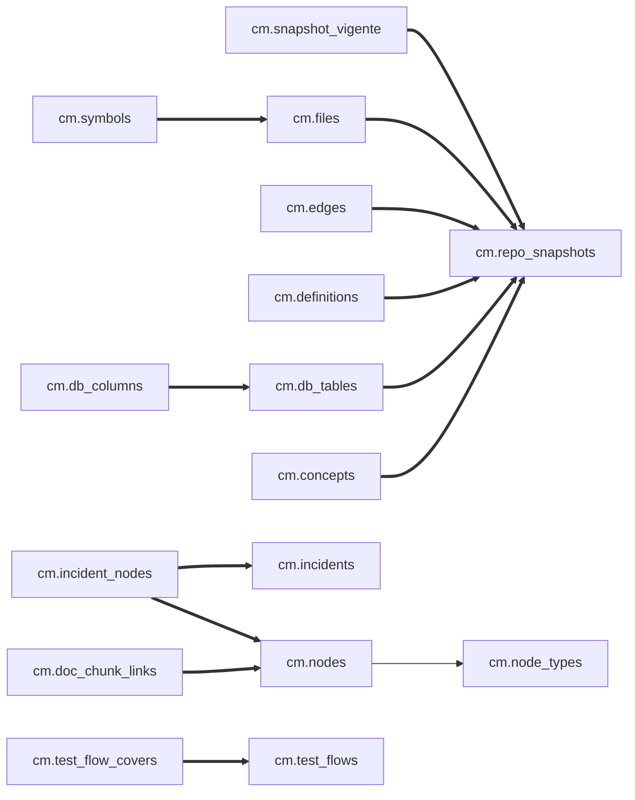

```mermaid
flowchart LR
    core_audit_exports[core.audit_exports] ==> core_users[core.users]
    core_audit_exports[core.audit_exports] --> core_organizations[core.organizations]
    core_audit_exports[core.audit_exports] ==> core_tickets[core.tickets]
    core_branch_map[core.branch_map] --> core_organizations[core.organizations]
    core_connections[core.connections] --> core_organizations[core.organizations]
    core_criteria_test_traceability[core.criteria_test_traceability] --> core_organizations[core.organizations]
    core_criteria_test_traceability[core.criteria_test_traceability] ==> core_qa_runs[core.qa_runs]
    core_escalations[core.escalations] ==> core_jobs[core.jobs]
    core_escalations[core.escalations] --> core_organizations[core.organizations]
    core_gate_signatures[core.gate_signatures] ==> core_users[core.users]
    core_gate_signatures[core.gate_signatures] ==> core_specs[core.specs]
    core_gate_signatures[core.gate_signatures] --> core_organizations[core.organizations]
    core_gate_signatures[core.gate_signatures] ==> core_tickets[core.tickets]
    core_invitations[core.invitations] ==> core_users[core.users]
    core_invitations[core.invitations] --> core_user_roles[core.user_roles]
    core_invitations[core.invitations] --> core_organizations[core.organizations]
    core_job_transitions[core.job_transitions] ==> core_jobs[core.jobs]
    core_job_transitions[core.job_transitions] --> core_organizations[core.organizations]
    core_jobs[core.jobs] ==> core_production_lines[core.production_lines]
    core_jobs[core.jobs] --> core_organizations[core.organizations]
    core_jobs[core.jobs] ==> core_tickets[core.tickets]
    core_llm_steps[core.llm_steps] --> core_pipeline_stages[core.pipeline_stages]
    core_llm_steps[core.llm_steps] ==> core_jobs[core.jobs]
    core_llm_steps[core.llm_steps] --> core_organizations[core.organizations]
    core_llm_steps[core.llm_steps] ==> core_tickets[core.tickets]
    core_model_assignments[core.model_assignments] ==> core_model_providers[core.model_providers]
    core_model_assignments[core.model_assignments] ==> core_model_providers[core.model_providers]
    core_model_assignments[core.model_assignments] --> core_organizations[core.organizations]
    core_model_providers[core.model_providers] --> core_organizations[core.organizations]
    core_notifications[core.notifications] --> core_organizations[core.organizations]
    core_notifications[core.notifications] ==> core_tickets[core.tickets]
    core_notifications[core.notifications] ==> core_users[core.users]
    core_onboarding_documents[core.onboarding_documents] ==> core_users[core.users]
    core_onboarding_documents[core.onboarding_documents] --> core_organizations[core.organizations]
    core_password_reset_tokens[core.password_reset_tokens] --> core_organizations[core.organizations]
    core_password_reset_tokens[core.password_reset_tokens] ==> core_users[core.users]
    core_plan_prices[core.plan_prices] --> core_plans[core.plans]
    core_production_lines[core.production_lines] ==> core_jobs[core.jobs]
    core_production_lines[core.production_lines] --> core_organizations[core.organizations]
    core_qa_results[core.qa_results] ==> core_qa_runs[core.qa_runs]
    core_qa_results[core.qa_results] --> core_organizations[core.organizations]
    core_qa_runs[core.qa_runs] ==> core_specs[core.specs]
    core_qa_runs[core.qa_runs] --> core_organizations[core.organizations]
    core_qa_runs[core.qa_runs] ==> core_tickets[core.tickets]
    core_refresh_tokens[core.refresh_tokens] --> core_organizations[core.organizations]
    core_refresh_tokens[core.refresh_tokens] ==> core_users[core.users]
    core_retention_policies[core.retention_policies] --> core_organizations[core.organizations]
    core_security_findings[core.security_findings] --> core_organizations[core.organizations]
    core_security_findings[core.security_findings] ==> core_tickets[core.tickets]
    core_spec_alternatives[core.spec_alternatives] ==> core_specs[core.specs]
    core_spec_alternatives[core.spec_alternatives] --> core_organizations[core.organizations]
    core_spec_criteria[core.spec_criteria] ==> core_specs[core.specs]
    core_spec_criteria[core.spec_criteria] --> core_organizations[core.organizations]
    core_specs[core.specs] --> core_organizations[core.organizations]
    core_specs[core.specs] ==> core_tickets[core.tickets]
    core_subscriptions[core.subscriptions] --> core_plans[core.plans]
    core_subscriptions[core.subscriptions] --> core_organizations[core.organizations]
    core_test_quarantine[core.test_quarantine] --> core_organizations[core.organizations]
    core_ticket_attachments[core.ticket_attachments] ==> core_users[core.users]
    core_ticket_attachments[core.ticket_attachments] --> core_organizations[core.organizations]
    core_ticket_attachments[core.ticket_attachments] ==> core_tickets[core.tickets]
    core_ticket_counters[core.ticket_counters] --> core_organizations[core.organizations]
    core_ticket_watchers[core.ticket_watchers] --> core_organizations[core.organizations]
    core_ticket_watchers[core.ticket_watchers] ==> core_tickets[core.tickets]
    core_ticket_watchers[core.ticket_watchers] ==> core_users[core.users]
    core_tickets[core.tickets] ==> core_users[core.users]
    core_tickets[core.tickets] ==> core_tickets[core.tickets]
    core_tickets[core.tickets] --> core_pipeline_stages[core.pipeline_stages]
    core_tickets[core.tickets] ==> core_users[core.users]
    core_tickets[core.tickets] --> core_organizations[core.organizations]
    core_upgrade_requests[core.upgrade_requests] --> core_plans[core.plans]
    core_upgrade_requests[core.upgrade_requests] ==> core_users[core.users]
    core_upgrade_requests[core.upgrade_requests] --> core_organizations[core.organizations]
    core_usage_cycles[core.usage_cycles] --> core_organizations[core.organizations]
    core_usage_loc[core.usage_loc] --> core_organizations[core.organizations]
    core_usage_loc[core.usage_loc] ==> core_tickets[core.tickets]
    core_usage_tokens[core.usage_tokens] --> core_organizations[core.organizations]
    core_usage_tokens[core.usage_tokens] ==> core_tickets[core.tickets]
    core_users[core.users] --> core_user_roles[core.user_roles]
    core_users[core.users] --> core_organizations[core.organizations]
    core_webhook_inbox[core.webhook_inbox] ==> core_connections[core.connections]
    core_webhook_inbox[core.webhook_inbox] --> core_organizations[core.organizations]
    core_webhook_inbox[core.webhook_inbox] ==> core_tickets[core.tickets]
```

# Modelo de datos v2 de KalliCode (generado)

> **Documento generado. No se edita a mano.** Sale de `pg_catalog` y de los `COMMENT` del esquema con `python db/tools/documentar_esquema.py` (KC-DB-12-2). El CI lo regenera y falla si difiere de esta copia: para cambiarlo, cambia el esquema (migración con su `COMMENT`) o `db/documentacion/afirmaciones_auditoria.json` y vuelve a generarlo.

**Versión del esquema:** `v2.0.0` (`core.version_esquema()`) · Política de cambios: [politica-cambios-esquema.md](politica-cambios-esquema.md)

## 1. Resumen

| Esquema | Tablas | Particionadas | Con RLS | Columnas | Constraints | Índices | Triggers | Políticas | Claves foráneas | FK compuestas con `tenant_id` |
|---|---:|---:|---:|---:|---:|---:|---:|---:|---:|---:|
| `core` | 50 | 4 | 40 | 472 | 290 | 146 | 27 | 45 | 83 | 40 |
| `vec` | 8 | 2 | 4 | 71 | 29 | 16 | 0 | 4 | 8 | 4 |
| `audit` | 5 | 1 | 3 | 48 | 23 | 12 | 8 | 3 | 2 | 0 |
| `cm` | 22 | 0 | 20 | 158 | 106 | 44 | 22 | 20 | 41 | 20 |
| **Total** | **85** | **7** | **67** | **749** | **448** | **218** | **57** | **72** | **134** | **64** |

## 2. Cómo se genera y se comprueba

```bash
uv run python db/tools/documentar_esquema.py              # regenera este documento
uv run python db/tools/documentar_esquema.py --comprobar  # compara; sale con 1 si difiere
uv run python db/tools/documentar_esquema.py --cobertura  # exige COMMENT en tablas, columnas y constraints
```

Alcance: esquemas `core`, `vec`, `audit`, `cm` y `public`, sin las particiones hijas (las crea `pg_partman`) ni los objetos de extensiones. Las descripciones son los `COMMENT` del esquema; los constraints tienen su descripción derivada de su definición en el catálogo (migración `068_comentarios_modelo.sql`).

## 3. Mapa de relaciones

134 claves foráneas (sin las réplicas en particiones hijas). **Compuesta con `tenant_id`** = la clave foránea incluye `tenant_id`, de modo que una fila no puede referenciar a otra de un tenant distinto (migración 013_v21_fks_compuestas); las demás referencian por identificador global.

| Tabla | Columnas | Referencia | Columnas referenciadas | Compuesta con `tenant_id` | Al borrar el padre |
|---|---|---|---|---|---|
| `audit.audit_events` | `tenant_id` | `core.organizations` | `id` | No | NO ACTION |
| `audit.chain_heads` | `tenant_id` | `core.organizations` | `id` | No | NO ACTION |
| `cm.concepts` | `tenant_id, curado_por` | `core.users` | `tenant_id, id` | **Sí** | NO ACTION |
| `cm.concepts` | `tenant_id, snapshot_id` | `cm.repo_snapshots` | `tenant_id, id` | **Sí** | NO ACTION |
| `cm.concepts` | `tenant_id` | `core.organizations` | `id` | No | NO ACTION |
| `cm.curation_queue` | `tenant_id, revisado_por` | `core.users` | `tenant_id, id` | **Sí** | NO ACTION |
| `cm.curation_queue` | `tenant_id` | `core.organizations` | `id` | No | NO ACTION |
| `cm.db_columns` | `tenant_id` | `core.organizations` | `id` | No | NO ACTION |
| `cm.db_columns` | `tenant_id, table_id` | `cm.db_tables` | `tenant_id, id` | **Sí** | CASCADE |
| `cm.db_tables` | `tenant_id, snapshot_id` | `cm.repo_snapshots` | `tenant_id, id` | **Sí** | NO ACTION |
| `cm.db_tables` | `tenant_id` | `core.organizations` | `id` | No | NO ACTION |
| `cm.definitions` | `tenant_id, snapshot_id` | `cm.repo_snapshots` | `tenant_id, id` | **Sí** | NO ACTION |
| `cm.definitions` | `tenant_id` | `core.organizations` | `id` | No | NO ACTION |
| `cm.doc_chunk_links` | `tenant_id, chunk_id` | `vec.doc_chunks` | `tenant_id, id` | **Sí** | CASCADE |
| `cm.doc_chunk_links` | `tenant_id, nodo_ref` | `cm.nodes` | `tenant_id, id` | **Sí** | CASCADE |
| `cm.doc_chunk_links` | `tenant_id` | `core.organizations` | `id` | No | CASCADE |
| `cm.edges` | `tenant_id, snapshot_id` | `cm.repo_snapshots` | `tenant_id, id` | **Sí** | NO ACTION |
| `cm.edges` | `tenant_id` | `core.organizations` | `id` | No | NO ACTION |
| `cm.files` | `tenant_id` | `core.organizations` | `id` | No | NO ACTION |
| `cm.files` | `tenant_id, snapshot_id` | `cm.repo_snapshots` | `tenant_id, id` | **Sí** | NO ACTION |
| `cm.incident_nodes` | `tenant_id` | `core.organizations` | `id` | No | CASCADE |
| `cm.incident_nodes` | `tenant_id, incident_id` | `cm.incidents` | `tenant_id, id` | **Sí** | CASCADE |
| `cm.incident_nodes` | `tenant_id, nodo_ref` | `cm.nodes` | `tenant_id, id` | **Sí** | CASCADE |
| `cm.incidents` | `tenant_id` | `core.organizations` | `id` | No | NO ACTION |
| `cm.incidents` | `tenant_id, ticket_id` | `core.tickets` | `tenant_id, id` | **Sí** | NO ACTION |
| `cm.nodes` | `kind` | `cm.node_types` | `kind` | No | NO ACTION |
| `cm.nodes` | `tenant_id` | `core.organizations` | `id` | No | NO ACTION |
| `cm.nuggets` | `tenant_id, evidencia_ref` | `vec.doc_chunks` | `tenant_id, id` | **Sí** | CASCADE |
| `cm.nuggets` | `tenant_id, resuelto_por` | `core.users` | `tenant_id, id` | **Sí** | NO ACTION |
| `cm.nuggets` | `tenant_id` | `core.organizations` | `id` | No | NO ACTION |
| `cm.nuggets` | `tenant_id, ticket_id` | `core.tickets` | `tenant_id, id` | **Sí** | CASCADE |
| `cm.reachability` | `tenant_id` | `core.organizations` | `id` | No | CASCADE |
| `cm.reachability_estado` | `tenant_id` | `core.organizations` | `id` | No | CASCADE |
| `cm.realimentacion_tickets` | `tenant_id, ticket_id` | `core.tickets` | `tenant_id, id` | **Sí** | CASCADE |
| `cm.realimentacion_tickets` | `tenant_id` | `core.organizations` | `id` | No | CASCADE |
| `cm.repo_snapshots` | `tenant_id` | `core.organizations` | `id` | No | NO ACTION |
| `cm.snapshot_vigente` | `tenant_id` | `core.organizations` | `id` | No | NO ACTION |
| `cm.snapshot_vigente` | `tenant_id, snapshot_id` | `cm.repo_snapshots` | `tenant_id, id` | **Sí** | NO ACTION |
| `cm.symbols` | `tenant_id, file_id` | `cm.files` | `tenant_id, id` | **Sí** | CASCADE |
| `cm.symbols` | `tenant_id` | `core.organizations` | `id` | No | NO ACTION |
| `cm.test_flow_covers` | `tenant_id` | `core.organizations` | `id` | No | NO ACTION |
| `cm.test_flow_covers` | `tenant_id, test_flow_id` | `cm.test_flows` | `tenant_id, id` | **Sí** | CASCADE |
| `cm.test_flows` | `tenant_id` | `core.organizations` | `id` | No | NO ACTION |
| `core.audit_exports` | `tenant_id, solicitado_por` | `core.users` | `tenant_id, id` | **Sí** | NO ACTION |
| `core.audit_exports` | `tenant_id` | `core.organizations` | `id` | No | NO ACTION |
| `core.audit_exports` | `tenant_id, ticket_id` | `core.tickets` | `tenant_id, id` | **Sí** | NO ACTION |
| `core.branch_map` | `tenant_id` | `core.organizations` | `id` | No | NO ACTION |
| `core.connections` | `tenant_id` | `core.organizations` | `id` | No | NO ACTION |
| `core.criteria_test_traceability` | `tenant_id` | `core.organizations` | `id` | No | NO ACTION |
| `core.criteria_test_traceability` | `tenant_id, qa_run_id` | `core.qa_runs` | `tenant_id, id` | **Sí** | RESTRICT |
| `core.escalations` | `tenant_id, job_id` | `core.jobs` | `tenant_id, id` | **Sí** | CASCADE |
| `core.escalations` | `tenant_id` | `core.organizations` | `id` | No | NO ACTION |
| `core.gate_signatures` | `tenant_id, actor_id` | `core.users` | `tenant_id, id` | **Sí** | NO ACTION |
| `core.gate_signatures` | `tenant_id, spec_id` | `core.specs` | `tenant_id, id` | **Sí** | NO ACTION |
| `core.gate_signatures` | `tenant_id` | `core.organizations` | `id` | No | NO ACTION |
| `core.gate_signatures` | `tenant_id, ticket_id` | `core.tickets` | `tenant_id, id` | **Sí** | CASCADE |
| `core.invitations` | `tenant_id, invitado_por` | `core.users` | `tenant_id, id` | **Sí** | NO ACTION |
| `core.invitations` | `rol` | `core.user_roles` | `codigo` | No | NO ACTION |
| `core.invitations` | `tenant_id` | `core.organizations` | `id` | No | NO ACTION |
| `core.job_transitions` | `tenant_id, job_id` | `core.jobs` | `tenant_id, id` | **Sí** | CASCADE |
| `core.job_transitions` | `tenant_id` | `core.organizations` | `id` | No | NO ACTION |
| `core.jobs` | `tenant_id, linea` | `core.production_lines` | `tenant_id, numero` | **Sí** | NO ACTION |
| `core.jobs` | `tenant_id` | `core.organizations` | `id` | No | NO ACTION |
| `core.jobs` | `tenant_id, ticket_id` | `core.tickets` | `tenant_id, id` | **Sí** | CASCADE |
| `core.llm_steps` | `etapa` | `core.pipeline_stages` | `codigo` | No | NO ACTION |
| `core.llm_steps` | `tenant_id, job_id` | `core.jobs` | `tenant_id, id` | **Sí** | CASCADE |
| `core.llm_steps` | `tenant_id` | `core.organizations` | `id` | No | NO ACTION |
| `core.llm_steps` | `tenant_id, ticket_id` | `core.tickets` | `tenant_id, id` | **Sí** | CASCADE |
| `core.model_assignments` | `tenant_id, fallback_proveedor` | `core.model_providers` | `tenant_id, proveedor` | **Sí** | NO ACTION |
| `core.model_assignments` | `tenant_id, principal_proveedor` | `core.model_providers` | `tenant_id, proveedor` | **Sí** | NO ACTION |
| `core.model_assignments` | `tenant_id` | `core.organizations` | `id` | No | NO ACTION |
| `core.model_providers` | `tenant_id` | `core.organizations` | `id` | No | NO ACTION |
| `core.notifications` | `tenant_id` | `core.organizations` | `id` | No | NO ACTION |
| `core.notifications` | `tenant_id, ticket_id` | `core.tickets` | `tenant_id, id` | **Sí** | CASCADE |
| `core.notifications` | `tenant_id, user_id` | `core.users` | `tenant_id, id` | **Sí** | CASCADE |
| `core.onboarding_documents` | `tenant_id, subido_por` | `core.users` | `tenant_id, id` | **Sí** | NO ACTION |
| `core.onboarding_documents` | `tenant_id` | `core.organizations` | `id` | No | NO ACTION |
| `core.password_reset_tokens` | `tenant_id` | `core.organizations` | `id` | No | NO ACTION |
| `core.password_reset_tokens` | `tenant_id, user_id` | `core.users` | `tenant_id, id` | **Sí** | CASCADE |
| `core.plan_prices` | `plan_codigo` | `core.plans` | `codigo` | No | NO ACTION |
| `core.production_lines` | `tenant_id, job_id` | `core.jobs` | `tenant_id, id` | **Sí** | NO ACTION |
| `core.production_lines` | `tenant_id` | `core.organizations` | `id` | No | NO ACTION |
| `core.qa_results` | `tenant_id, qa_run_id` | `core.qa_runs` | `tenant_id, id` | **Sí** | CASCADE |
| `core.qa_results` | `tenant_id` | `core.organizations` | `id` | No | NO ACTION |
| `core.qa_runs` | `tenant_id, spec_id` | `core.specs` | `tenant_id, id` | **Sí** | NO ACTION |
| `core.qa_runs` | `tenant_id` | `core.organizations` | `id` | No | NO ACTION |
| `core.qa_runs` | `tenant_id, ticket_id` | `core.tickets` | `tenant_id, id` | **Sí** | CASCADE |
| `core.refresh_tokens` | `tenant_id` | `core.organizations` | `id` | No | NO ACTION |
| `core.refresh_tokens` | `tenant_id, user_id` | `core.users` | `tenant_id, id` | **Sí** | CASCADE |
| `core.retention_policies` | `tenant_id` | `core.organizations` | `id` | No | CASCADE |
| `core.security_findings` | `tenant_id` | `core.organizations` | `id` | No | NO ACTION |
| `core.security_findings` | `tenant_id, ticket_id` | `core.tickets` | `tenant_id, id` | **Sí** | CASCADE |
| `core.spec_alternatives` | `tenant_id, spec_id` | `core.specs` | `tenant_id, id` | **Sí** | CASCADE |
| `core.spec_alternatives` | `tenant_id` | `core.organizations` | `id` | No | NO ACTION |
| `core.spec_criteria` | `tenant_id, spec_id` | `core.specs` | `tenant_id, id` | **Sí** | CASCADE |
| `core.spec_criteria` | `tenant_id` | `core.organizations` | `id` | No | NO ACTION |
| `core.specs` | `tenant_id` | `core.organizations` | `id` | No | NO ACTION |
| `core.specs` | `tenant_id, ticket_id` | `core.tickets` | `tenant_id, id` | **Sí** | CASCADE |
| `core.subscriptions` | `plan_codigo` | `core.plans` | `codigo` | No | NO ACTION |
| `core.subscriptions` | `tenant_id` | `core.organizations` | `id` | No | NO ACTION |
| `core.test_quarantine` | `tenant_id` | `core.organizations` | `id` | No | CASCADE |
| `core.ticket_attachments` | `tenant_id, subido_por` | `core.users` | `tenant_id, id` | **Sí** | NO ACTION |
| `core.ticket_attachments` | `tenant_id` | `core.organizations` | `id` | No | NO ACTION |
| `core.ticket_attachments` | `tenant_id, ticket_id` | `core.tickets` | `tenant_id, id` | **Sí** | CASCADE |
| `core.ticket_counters` | `tenant_id` | `core.organizations` | `id` | No | NO ACTION |
| `core.ticket_watchers` | `tenant_id` | `core.organizations` | `id` | No | NO ACTION |
| `core.ticket_watchers` | `tenant_id, ticket_id` | `core.tickets` | `tenant_id, id` | **Sí** | CASCADE |
| `core.ticket_watchers` | `tenant_id, user_id` | `core.users` | `tenant_id, id` | **Sí** | CASCADE |
| `core.tickets` | `tenant_id, cancelado_por` | `core.users` | `tenant_id, id` | **Sí** | NO ACTION |
| `core.tickets` | `tenant_id, duplicado_de` | `core.tickets` | `tenant_id, id` | **Sí** | NO ACTION |
| `core.tickets` | `etapa` | `core.pipeline_stages` | `codigo` | No | NO ACTION |
| `core.tickets` | `tenant_id, reportado_por` | `core.users` | `tenant_id, id` | **Sí** | NO ACTION |
| `core.tickets` | `tenant_id` | `core.organizations` | `id` | No | NO ACTION |
| `core.upgrade_requests` | `plan_deseado` | `core.plans` | `codigo` | No | NO ACTION |
| `core.upgrade_requests` | `tenant_id, solicitado_por` | `core.users` | `tenant_id, id` | **Sí** | NO ACTION |
| `core.upgrade_requests` | `tenant_id` | `core.organizations` | `id` | No | NO ACTION |
| `core.usage_cycles` | `tenant_id` | `core.organizations` | `id` | No | NO ACTION |
| `core.usage_loc` | `tenant_id` | `core.organizations` | `id` | No | NO ACTION |
| `core.usage_loc` | `tenant_id, ticket_id` | `core.tickets` | `tenant_id, id` | **Sí** | SET NULL |
| `core.usage_tokens` | `tenant_id` | `core.organizations` | `id` | No | NO ACTION |
| `core.usage_tokens` | `tenant_id, ticket_id` | `core.tickets` | `tenant_id, id` | **Sí** | CASCADE |
| `core.users` | `rol` | `core.user_roles` | `codigo` | No | NO ACTION |
| `core.users` | `tenant_id` | `core.organizations` | `id` | No | NO ACTION |
| `core.webhook_inbox` | `tenant_id, connection_id` | `core.connections` | `tenant_id, id` | **Sí** | CASCADE |
| `core.webhook_inbox` | `tenant_id` | `core.organizations` | `id` | No | NO ACTION |
| `core.webhook_inbox` | `tenant_id, ticket_id` | `core.tickets` | `tenant_id, id` | **Sí** | NO ACTION |
| `vec.definition_embeddings` | `tenant_id, nodo_ref` | `cm.nodes` | `tenant_id, id` | **Sí** | CASCADE |
| `vec.definition_embeddings` | `tenant_id` | `core.organizations` | `id` | No | CASCADE |
| `vec.doc_chunks` | `tenant_id, document_id` | `core.onboarding_documents` | `tenant_id, id` | **Sí** | CASCADE |
| `vec.doc_chunks` | `tenant_id` | `core.organizations` | `id` | No | CASCADE |
| `vec.incident_embeddings` | `tenant_id, incident_id` | `cm.incidents` | `tenant_id, id` | **Sí** | CASCADE |
| `vec.incident_embeddings` | `tenant_id` | `core.organizations` | `id` | No | CASCADE |
| `vec.ticket_embeddings` | `tenant_id` | `core.organizations` | `id` | No | NO ACTION |
| `vec.ticket_embeddings` | `tenant_id, ticket_id` | `core.tickets` | `tenant_id, id` | **Sí** | CASCADE |

Diagrama por esquema (relaciones dentro del esquema; flecha gruesa = compuesta con `tenant_id`; las relaciones entre esquemas están en la tabla de arriba).

### Esquema `core`



### Esquema `cm`



## 4. Chequeos de integridad

`core.validar_integridad()` ejecuta 26 chequeos de coherencia entre tablas que las claves foráneas no pueden expresar. Cada uno devuelve el número de filas con problema; lo esperado es cero.

| Chequeo | Qué verifica |
|---|---|
| `V01_suscripcion_vigente` | Tenants sin suscripción vigente (o con más de una) |
| `V02_espejo_ticket_job` | Tickets activos cuya etapa no corresponde al estado de su job |
| `V03_gate3_sin_previos` | Aprobaciones de Gate 3 sin aprobación previa de gates 1 y 2 |
| `V04_produccion_sin_firmas` | Tickets en producción sin las tres firmas de gates |
| `V05_spec_recomendada` | Specs sin exactamente una alternativa recomendada |
| `V06_spec_aprobada_sin_eleccion` | Specs aprobadas (Gate 1) sin alternativa elegida |
| `V07_matriz_qa_completa` | Corridas de QA que no cubren todos los criterios de la spec |
| `V08_qa_criterio_fantasma` | Resultados de QA con criterio_id que no existe en la spec de la corrida |
| `V09_produccion_con_bloqueantes` | Tickets en producción con hallazgos de seguridad bloqueantes abiertos |
| `V10_cuota_cuadra` | Ciclos cuyo agregado no cuadra con la suma de usage_loc (netas reales, piso en cero solo en el total) |
| `V11_lineas_coherentes` | Líneas ocupadas sin job activo o jobs con línea no reflejada |
| `V12_lineas_dentro_del_plan` | Tenants con más jobs en línea que líneas de su plan |
| `V13_duplicados_validos` | Tickets duplicados que apuntan a otro duplicado (cadenas) |
| `V14_embeddings_tickets` | Tickets activos (>1 h) sin embedding de deduplicación |
| `V15_dimension_embeddings` | Embeddings con dimensión distinta de 1024 |
| `V16_cadena_auditoria` | Tenants con cadena de auditoría rota: sello alterado, eslabón perdido o eventos faltantes (ver audit.verify_chain) |
| `V17_cabeza_cadena` | chain_heads que no cuadra con los eventos: último sello distinto, eventos de menos o de más, o eventos sin cabeza |
| `V18_webhooks_estancados` | Entradas de webhook_inbox fallidas hace más de 24 h |
| `V19_adjuntos_huerfanos` | Adjuntos sin ticket asociado hace más de 48 h |
| `V20_gate_spec_coherente` | Firmas de Gate 1 cuya spec no pertenece al mismo ticket |
| `V21_coherencia_tenant` | Filas cuyo tenant no coincide con el de su padre |
| `V22_consumo_no_negativo` | Ciclos de cuota con loc_consumidas negativo |
| `V23_renovacion_vencida` | Suscripciones activas con renueva_el vencido sin ciclo nuevo (ver core.renovar_ciclo) |
| `V24_bloqueantes_sin_adjudicar` | Hallazgos de seguridad bloqueantes abiertos hace más de 48 h sin corregir ni descartar |
| `V25_org_borrada_con_actividad` | Organizaciones borradas lógicamente con tickets, trabajos o consumo creados después del borrado |
| `V26_tabla_sin_retencion` | Tablas de core, audit, vec y cm sin política de retención declarada (core.retention_policies activa o core.retencion_dedicada) |

## 5. Afirmaciones corregidas de la auditoría

Cada afirmación del diseño original que la auditoría corrigió queda aquí con su corrección y con una verificación que se ejecuta contra el catálogo en cada generación: si deja de cumplirse, la prueba falla y obliga a revisar el esquema o la afirmación. Origen: `db/documentacion/afirmaciones_auditoria.json`.

### A1 · Entidad raíz del multi-tenant

- **Afirmación original:** El diseño de Fase 1 modela la organización cliente como core.tenants.
- **Corrección:** La raíz del aislamiento es core.organizations; no existe core.tenants. Todas las tablas con tenant_id apuntan a core.organizations(id), salvo las excepciones de A7.
- **Fuente:** Addendum Modelo de BD (KC-ONB-02-5), §5
- **Verificada contra el catálogo:** Sí

### A2 · Ticket y trabajo del pipeline

- **Afirmación original:** El estado del pipeline se modela como una lista cerrada de 16 valores en core.jobs, y no queda claro si core.jobs y core.tickets son la misma entidad.
- **Corrección:** Son dos tablas distintas que se mantienen en espejo: core.tickets.etapa (etapa visible del ticket) y core.jobs.estado (estado del trabajo). El chequeo V02 de core.validar_integridad() detecta cuando no corresponden.
- **Fuente:** Addendum Modelo de BD (KC-ONB-02-5), §5
- **Verificada contra el catálogo:** Sí

### A3 · Vectores de definiciones y nodos

- **Afirmación original:** vec.definition_embeddings referencia cm.definitions por def_id; después se afirmó que usa una referencia de texto libre sin integridad referencial.
- **Corrección:** La tabla guarda nodo_ref y tiene la clave foránea compuesta (tenant_id, nodo_ref) hacia cm.nodes(tenant_id, id) con borrado en cascada; no existe columna def_id. Cubre cualquier tipo de nodo, no solo definiciones.
- **Fuente:** Addendum Modelo de BD (KC-ONB-02-5), §3
- **Verificada contra el catálogo:** Sí

### A4 · Vectores de tickets

- **Afirmación original:** vec.ticket_embeddings no aparece en el modelo de base de datos.
- **Corrección:** Existe, está en uso y queda documentada: un embedding por ticket (clave tenant_id, ticket_id) para detectar duplicados.
- **Fuente:** Addendum Modelo de BD (KC-ONB-02-5), §4
- **Verificada contra el catálogo:** Sí

### A5 · Bandeja de webhooks y tickets

- **Afirmación original:** core.webhook_inbox y core.tickets no están en el diccionario de datos de Fase 1.
- **Corrección:** Ambas existen y se documentan aquí; core.webhook_inbox es una tabla particionada por mes de recepción (recibido_mes).
- **Fuente:** Addendum Modelo de BD (KC-ONB-02-5), §5
- **Verificada contra el catálogo:** Sí

### A6 · RLS efectiva

- **Afirmación original:** El DDL de RLS de Fase 1 no define un rol sin privilegios, de modo que ninguna política se ejercita.
- **Corrección:** El rol de la aplicación kallicode_app no es superusuario ni tiene BYPASSRLS, y todas las tablas con RLS la tienen también forzada (FORCE ROW LEVEL SECURITY), de modo que ni el dueño la evita.
- **Fuente:** Addendum Modelo de BD (KC-ONB-02-5), §6
- **Verificada contra el catálogo:** Sí

### A7 · Excepciones a la clave foránea hacia la organización

- **Afirmación original:** Toda tabla con tenant_id tiene una clave foránea a core.organizations.
- **Corrección:** Se cumple salvo en tres tablas, que conservan el tenant_id sin clave foránea a propósito para sobrevivir al borrado del tenant o purgarse por su cuenta: audit.chain_anchors, core.idempotency_keys y core.retention_purgas.
- **Fuente:** Catálogo del sistema (esta generación)
- **Verificada contra el catálogo:** Sí

## 6. Diccionario de datos

### Esquema `core`

50 tablas.

#### `core.audit_exports`

Solicitudes de exportación de la auditoría por tenant: formato, filtros, estado y referencia al archivo generado.

- **Tipo:** tabla · **Seguridad:** RLS activa y forzada

| # | Columna | Tipo | Nulo | Por defecto | Clave | Descripción |
|---:|---|---|---|---|---|---|
| 1 | `id` | `text` | no |  | PK | Identificador de la fila (clave primaria). |
| 2 | `tenant_id` | `text` | no |  | FK → core.users, FK → core.organizations, FK → core.tickets | Organización (tenant) propietaria de la fila; referencia a core.organizations y base del aislamiento por RLS. |
| 3 | `formato` | `text` | no |  |  | Formato del archivo de exportación. **Valores permitidos:** `csv`, `pdf`. |
| 4 | `ticket_id` | `text` | sí |  | FK → core.tickets | Ticket al que corresponde la fila. |
| 5 | `filtros` | `jsonb` | sí |  |  | Filtros aplicados a la exportación, en JSON. |
| 6 | `estado` | `text` | no | `'encolada'::text` |  | Estado del ciclo de vida de la fila. **Valores permitidos:** `encolada`, `procesando`, `lista`, `fallida`. |
| 7 | `blob_ref` | `text` | sí |  |  | Referencia al objeto en el almacenamiento de archivos; el contenido no vive en la base. |
| 8 | `solicitado_por` | `text` | no |  | FK → core.users | Usuario que pidió la exportación. |
| 9 | `creado_en` | `timestamp with time zone` | no | `now()` |  | Instante en que se creó la fila. |
| 10 | `completado_en` | `timestamp with time zone` | sí |  |  | Instante en que terminó la exportación. |

**Constraints**

| Nombre | Tipo | Definición | Descripción |
|---|---|---|---|
| `audit_exports_pkey` | clave primaria | `PRIMARY KEY (id)` | Clave primaria de core.audit_exports: (id). |
| `audit_exports_solicitado_por_fkey` | clave foránea (compuesta con `tenant_id`) | `FOREIGN KEY (tenant_id, solicitado_por) REFERENCES core.users(tenant_id, id)` | Clave foránea (tenant_id, solicitado_por) hacia core.users (tenant_id, id); compuesta con tenant_id: impide referenciar filas de otro tenant. Al borrar la fila padre: se rechaza (NO ACTION). |
| `audit_exports_tenant_id_fkey` | clave foránea | `FOREIGN KEY (tenant_id) REFERENCES core.organizations(id)` | Clave foránea (tenant_id) hacia core.organizations (id). Al borrar la fila padre: se rechaza (NO ACTION). |
| `audit_exports_ticket_id_fkey` | clave foránea (compuesta con `tenant_id`) | `FOREIGN KEY (tenant_id, ticket_id) REFERENCES core.tickets(tenant_id, id)` | Clave foránea (tenant_id, ticket_id) hacia core.tickets (tenant_id, id); compuesta con tenant_id: impide referenciar filas de otro tenant. Al borrar la fila padre: se rechaza (NO ACTION). |
| `exp_estado_chk` | regla (CHECK) | `CHECK ((estado = ANY (ARRAY['encolada'::text, 'procesando'::text, 'lista'::text, 'fallida'::text])))` |  |
| `exp_formato_chk` | regla (CHECK) | `CHECK ((formato = ANY (ARRAY['csv'::text, 'pdf'::text])))` |  |
| `exp_pdf_chk` | regla (CHECK) | `CHECK (((formato <> 'pdf'::text) OR (ticket_id IS NOT NULL)))` |  |

**Índices**

| Nombre | Definición |
|---|---|
| `audit_exports_pkey` | `UNIQUE ON core.audit_exports USING btree (id)` |
| `idx_audit_exports_tenant_solicitado_por` | `ON core.audit_exports USING btree (tenant_id, solicitado_por)` |
| `idx_audit_exports_tenant_ticket_id` | `ON core.audit_exports USING btree (tenant_id, ticket_id)` |

**Políticas RLS**

| Nombre | Comando | Roles | USING | WITH CHECK |
|---|---|---|---|---|
| `tenant_isolation` | ALL | kallicode_app, kallicode_worker | `(tenant_id = core.current_tenant())` | `(tenant_id = core.current_tenant())` |

#### `core.branch_map`

Equivalencia por tenant entre el patrón de ramas de feature y las ramas de staging y producción donde se integra el trabajo de la fábrica.

- **Tipo:** tabla · **Seguridad:** RLS activa y forzada

| # | Columna | Tipo | Nulo | Por defecto | Clave | Descripción |
|---:|---|---|---|---|---|---|
| 1 | `tenant_id` | `text` | no |  | PK, FK → core.organizations | Organización (tenant) propietaria de la fila; referencia a core.organizations y base del aislamiento por RLS. |
| 2 | `feature_pattern` | `text` | no | `'feature/*'::text` |  | Patrón de nombre de las ramas de feature a las que aplica la equivalencia. |
| 3 | `staging_branch` | `text` | no | `'develop'::text` |  | Rama de staging donde se integra el trabajo. |
| 4 | `prod_branch` | `text` | no | `'main'::text` |  | Rama de producción a la que se promueve. |
| 5 | `actualizado_en` | `timestamp with time zone` | no | `now()` |  | Instante de la última actualización de la fila. |

**Constraints**

| Nombre | Tipo | Definición | Descripción |
|---|---|---|---|
| `bm_distintas_chk` | regla (CHECK) | `CHECK ((staging_branch <> prod_branch))` |  |
| `branch_map_pkey` | clave primaria | `PRIMARY KEY (tenant_id)` | Clave primaria de core.branch_map: (tenant_id). |
| `branch_map_tenant_id_fkey` | clave foránea | `FOREIGN KEY (tenant_id) REFERENCES core.organizations(id)` | Clave foránea (tenant_id) hacia core.organizations (id). Al borrar la fila padre: se rechaza (NO ACTION). |

**Índices**

| Nombre | Definición |
|---|---|
| `branch_map_pkey` | `UNIQUE ON core.branch_map USING btree (tenant_id)` |

**Triggers**

| Nombre | Cuándo | Función |
|---|---|---|
| `trg_branch_map_updated` | BEFORE UPDATE | `core.set_updated_at` |

**Políticas RLS**

| Nombre | Comando | Roles | USING | WITH CHECK |
|---|---|---|---|---|
| `tenant_isolation` | ALL | kallicode_app, kallicode_worker | `(tenant_id = core.current_tenant())` | `(tenant_id = core.current_tenant())` |

#### `core.connections`

Conexiones del tenant con sistemas externos (repositorio, mensajería, base del cliente, etc.): proveedor, configuración y referencia al secreto, nunca el secreto en claro.

- **Tipo:** tabla · **Seguridad:** RLS activa y forzada

| # | Columna | Tipo | Nulo | Por defecto | Clave | Descripción |
|---:|---|---|---|---|---|---|
| 1 | `id` | `text` | no |  | PK | Identificador de la fila (clave primaria). |
| 2 | `tenant_id` | `text` | no |  | FK → core.organizations | Organización (tenant) propietaria de la fila; referencia a core.organizations y base del aislamiento por RLS. |
| 3 | `categoria` | `text` | no |  |  | Categoría de la conexión (repositorio, mensajería, base de datos del cliente, etc.). **Valores permitidos:** `repositorio`, `tickets`, `cicd`, `database`. |
| 4 | `proveedor` | `text` | no |  |  | Proveedor del servicio externo. **Valores permitidos:** `github`, `gitlab`, `bitbucket`, `corestream_repo`, `jira`, `github_issues`, `kallicode_help`, `corestream`, `github_actions`, `gitlab_ci`, `jenkins`, `postgresql`, `mysql`, `sqlserver`, `oracle`. |
| 5 | `nombre` | `text` | sí |  |  | Nombre que el tenant le dio a la conexión. |
| 6 | `config` | `jsonb` | no | `'{}'::jsonb` |  | Configuración no secreta de la conexión, en JSON. |
| 7 | `secreto_ref` | `text` | sí |  |  | Referencia al secreto en la bóveda; el secreto no se guarda en la base. |
| 8 | `ruta_token` | `text` | sí |  |  | Ruta del token de la conexión en la bóveda. |
| 9 | `estado` | `text` | no | `'pendiente'::text` |  | Estado del ciclo de vida de la fila. **Valores permitidos:** `conectada`, `pendiente`, `pendiente_oauth`, `error`, `deshabilitada`. |
| 10 | `ultimo_test` | `timestamp with time zone` | sí |  |  | Instante de la última prueba de la conexión. |
| 11 | `ultimo_test_detalle` | `jsonb` | sí |  |  | Resultado detallado de la última prueba, en JSON. |
| 12 | `creado_en` | `timestamp with time zone` | no | `now()` |  | Instante en que se creó la fila. |
| 13 | `actualizado_en` | `timestamp with time zone` | no | `now()` |  | Instante de la última actualización de la fila. |
| 14 | `deleted_at` | `timestamp with time zone` | sí |  |  | Borrado lógico: si no es nulo, el instante en que se eliminó la fila; la aplicación la trata como inexistente. |

**Constraints**

| Nombre | Tipo | Definición | Descripción |
|---|---|---|---|
| `cn_categoria_chk` | regla (CHECK) | `CHECK ((categoria = ANY (ARRAY['repositorio'::text, 'tickets'::text, 'cicd'::text, 'database'::text])))` |  |
| `cn_estado_chk` | regla (CHECK) | `CHECK ((estado = ANY (ARRAY['conectada'::text, 'pendiente'::text, 'pendiente_oauth'::text, 'error'::text, 'deshabilitada'::text])))` |  |
| `cn_proveedor_chk` | regla (CHECK) | `CHECK ((proveedor = ANY (ARRAY['github'::text, 'gitlab'::text, 'bitbucket'::text, 'corestream_repo'::text, 'jira'::text, 'github_issues'::text, 'kallicode_help'::text, 'corestream'::text, 'github_actions'::text, 'gitlab_ci'::text, 'jenkins'::text, 'postgresql'::text, 'mysql'::text, 'sqlserver'::text, 'oracle'::text])))` |  |
| `connections_pkey` | clave primaria | `PRIMARY KEY (id)` | Clave primaria de core.connections: (id). |
| `connections_ruta_token_key` | única | `UNIQUE (ruta_token)` | Unicidad de (ruta_token) en core.connections. |
| `connections_tenant_id_fkey` | clave foránea | `FOREIGN KEY (tenant_id) REFERENCES core.organizations(id)` | Clave foránea (tenant_id) hacia core.organizations (id). Al borrar la fila padre: se rechaza (NO ACTION). |
| `connections_tenant_id_uq` | única | `UNIQUE (tenant_id, id)` | Unicidad de (tenant_id, id) en core.connections. |

**Índices**

| Nombre | Definición |
|---|---|
| `connections_pkey` | `UNIQUE ON core.connections USING btree (id)` |
| `connections_ruta_token_key` | `UNIQUE ON core.connections USING btree (ruta_token)` |
| `connections_tenant_id_uq` | `UNIQUE ON core.connections USING btree (tenant_id, id)` |
| `connections_tenant_ix` | `ON core.connections USING btree (tenant_id, categoria)` |

**Triggers**

| Nombre | Cuándo | Función |
|---|---|---|
| `trg_connections_updated` | BEFORE UPDATE | `core.set_updated_at` |

**Políticas RLS**

| Nombre | Comando | Roles | USING | WITH CHECK |
|---|---|---|---|---|
| `tenant_isolation` | ALL | kallicode_app, kallicode_worker | `(tenant_id = core.current_tenant())` | `(tenant_id = core.current_tenant())` |

#### `core.criteria_test_traceability`

Trazabilidad entre un criterio de aceptación de una especificación y la ejecución de la prueba que lo verifica, con su resultado y evidencia.

- **Tipo:** tabla · **Seguridad:** RLS activa y forzada

| # | Columna | Tipo | Nulo | Por defecto | Clave | Descripción |
|---:|---|---|---|---|---|---|
| 1 | `id` | `text` | no |  | PK | Identificador de la fila (clave primaria). |
| 2 | `tenant_id` | `text` | no |  | PK, FK → core.organizations, FK → core.qa_runs | Organización (tenant) propietaria de la fila; referencia a core.organizations y base del aislamiento por RLS. |
| 3 | `spec_id` | `text` | no |  |  | Especificación (core.specs) a la que corresponde la fila. |
| 4 | `criterio_id` | `text` | no |  |  | Identificador del criterio de aceptación dentro de su especificación. |
| 5 | `qa_run_id` | `text` | no |  | FK → core.qa_runs | Corrida de QA (core.qa_runs.id) en la que se ejecutó la prueba. |
| 6 | `test_nodeid` | `text` | no |  |  | Identificador de la prueba. |
| 7 | `test_suite` | `text` | no | `'pytest'::text` |  | Suite a la que pertenece la prueba. |
| 8 | `resultado` | `text` | no |  |  | Resultado de la prueba frente al criterio. **Valores permitidos:** `passed`, `failed`, `skipped`, `error`. |
| 9 | `duracion_ms` | `integer` | sí |  |  | Duración en milisegundos. |
| 10 | `evidencia_hash` | `text` | sí |  |  | Hash de la evidencia guardada de la ejecución. |
| 11 | `ejecutado_en` | `timestamp with time zone` | no | `now()` |  | Instante en que se ejecutó. |

**Constraints**

| Nombre | Tipo | Definición | Descripción |
|---|---|---|---|
| `criteria_test_traceability_pkey` | clave primaria | `PRIMARY KEY (tenant_id, id)` | Clave primaria de core.criteria_test_traceability: (tenant_id, id). |
| `criteria_test_traceability_tenant_id_fkey` | clave foránea | `FOREIGN KEY (tenant_id) REFERENCES core.organizations(id)` | Clave foránea (tenant_id) hacia core.organizations (id). Al borrar la fila padre: se rechaza (NO ACTION). |
| `ctt_duracion_chk` | regla (CHECK) | `CHECK (((duracion_ms IS NULL) OR (duracion_ms >= 0)))` |  |
| `ctt_qa_run_fkey` | clave foránea (compuesta con `tenant_id`) | `FOREIGN KEY (tenant_id, qa_run_id) REFERENCES core.qa_runs(tenant_id, id) ON DELETE RESTRICT` | Clave foránea (tenant_id, qa_run_id) hacia core.qa_runs (tenant_id, id); compuesta con tenant_id: impide referenciar filas de otro tenant. Al borrar la fila padre: se rechaza (RESTRICT). |
| `ctt_resultado_chk` | regla (CHECK) | `CHECK ((resultado = ANY (ARRAY['passed'::text, 'failed'::text, 'skipped'::text, 'error'::text])))` |  |

**Índices**

| Nombre | Definición |
|---|---|
| `criteria_test_traceability_pkey` | `UNIQUE ON core.criteria_test_traceability USING btree (tenant_id, id)` |
| `idx_ctt_tenant_qa_run` | `ON core.criteria_test_traceability USING btree (tenant_id, qa_run_id)` |
| `idx_ctt_tenant_spec_criterio` | `ON core.criteria_test_traceability USING btree (tenant_id, spec_id, criterio_id, ejecutado_en DESC)` |

**Triggers**

| Nombre | Cuándo | Función |
|---|---|---|
| `trg_ctt_append_only` | BEFORE DELETE OR UPDATE | `core.criteria_traceability_append_only` |

**Políticas RLS**

| Nombre | Comando | Roles | USING | WITH CHECK |
|---|---|---|---|---|
| `tenant_isolation` | ALL | kallicode_app, kallicode_worker | `(tenant_id = core.current_tenant())` | `(tenant_id = core.current_tenant())` |

#### `core.escalations`

Escalaciones del pipeline a una persona: qué trabajo, etapa y paso se detuvo, por qué, con qué severidad y cómo se resolvió.

- **Tipo:** tabla · **Seguridad:** RLS activa y forzada

| # | Columna | Tipo | Nulo | Por defecto | Clave | Descripción |
|---:|---|---|---|---|---|---|
| 1 | `id` | `text` | no |  | PK | Identificador de la fila (clave primaria). |
| 2 | `tenant_id` | `text` | no |  | FK → core.jobs, FK → core.organizations | Organización (tenant) propietaria de la fila; referencia a core.organizations y base del aislamiento por RLS. |
| 3 | `job_id` | `text` | no |  | FK → core.jobs | Trabajo del pipeline (core.jobs) al que corresponde la fila. |
| 4 | `etapa` | `text` | no |  |  | Etapa del pipeline de producción (core.pipeline_stages). |
| 5 | `paso` | `text` | sí |  |  | Paso del pipeline que escaló. |
| 6 | `motivo` | `text` | no |  |  | Razón que explica el estado o la acción registrada. **Valores permitidos:** `validacion_persistente`, `baja_confianza`, `max_iteraciones`, `selector_repair`, `anomalia_deploy`, `otro`. |
| 7 | `severidad` | `text` | no |  |  | Gravedad de la escalación. **Valores permitidos:** `baja`, `media`, `alta`, `critica`. |
| 8 | `detalle` | `jsonb` | no |  |  | Contexto de la escalación, en JSON. |
| 9 | `estado` | `text` | no | `'abierta'::text` |  | Estado del ciclo de vida de la fila. **Valores permitidos:** `abierta`, `en_curso`, `resuelta`. |
| 10 | `resuelto_por` | `text` | sí |  |  | Persona que resolvió la escalación. |
| 11 | `resuelto_en` | `timestamp with time zone` | sí |  |  | Instante en que se resolvió. |
| 12 | `creado_en` | `timestamp with time zone` | no | `now()` |  | Instante en que se creó la fila. |

**Constraints**

| Nombre | Tipo | Definición | Descripción |
|---|---|---|---|
| `esc_estado_chk` | regla (CHECK) | `CHECK ((estado = ANY (ARRAY['abierta'::text, 'en_curso'::text, 'resuelta'::text])))` |  |
| `esc_motivo_chk` | regla (CHECK) | `CHECK ((motivo = ANY (ARRAY['validacion_persistente'::text, 'baja_confianza'::text, 'max_iteraciones'::text, 'selector_repair'::text, 'anomalia_deploy'::text, 'otro'::text])))` |  |
| `esc_sev_chk` | regla (CHECK) | `CHECK ((severidad = ANY (ARRAY['baja'::text, 'media'::text, 'alta'::text, 'critica'::text])))` |  |
| `escalations_job_id_fkey` | clave foránea (compuesta con `tenant_id`) | `FOREIGN KEY (tenant_id, job_id) REFERENCES core.jobs(tenant_id, id) ON DELETE CASCADE` | Clave foránea (tenant_id, job_id) hacia core.jobs (tenant_id, id); compuesta con tenant_id: impide referenciar filas de otro tenant. Al borrar la fila padre: se borran en cascada las filas hijas (CASCADE). |
| `escalations_pkey` | clave primaria | `PRIMARY KEY (id)` | Clave primaria de core.escalations: (id). |
| `escalations_tenant_id_fkey` | clave foránea | `FOREIGN KEY (tenant_id) REFERENCES core.organizations(id)` | Clave foránea (tenant_id) hacia core.organizations (id). Al borrar la fila padre: se rechaza (NO ACTION). |

**Índices**

| Nombre | Definición |
|---|---|
| `escalations_abierta_uq` | `UNIQUE ON core.escalations USING btree (job_id, COALESCE(paso, '-'::text)) WHERE (estado = 'abierta'::text)` |
| `escalations_pkey` | `UNIQUE ON core.escalations USING btree (id)` |
| `idx_escalations_tenant_job_id` | `ON core.escalations USING btree (tenant_id, job_id)` |

**Políticas RLS**

| Nombre | Comando | Roles | USING | WITH CHECK |
|---|---|---|---|---|
| `tenant_isolation` | ALL | kallicode_app, kallicode_worker | `(tenant_id = core.current_tenant())` | `(tenant_id = core.current_tenant())` |

#### `core.excepciones_aislamiento`

KC-DB-12-3: justificación escrita de cada tabla sin RLS y de cada política que no filtra por tenant. core.informe_aislamiento() marca como INCUMPLE todo lo que no figure aquí.

- **Tipo:** tabla · **Seguridad:** sin RLS

| # | Columna | Tipo | Nulo | Por defecto | Clave | Descripción |
|---:|---|---|---|---|---|---|
| 1 | `entidad` | `text` | no |  | PK | esquema.tabla para una tabla sin RLS; esquema.tabla#política para una política que no filtra por tenant. |
| 2 | `tipo` | `text` | no |  |  | tabla_sin_rls o politica_sin_filtro_de_tenant. **Valores permitidos:** `tabla_sin_rls`, `politica_sin_filtro_de_tenant`. |
| 3 | `motivo` | `text` | no |  |  | Por qué es seguro que no filtre por tenant (mínimo 20 caracteres): qué contiene y quién puede acceder. |
| 4 | `permite_escritura` | `boolean` | no | `false` |  | true si se justifica que kallicode_app o kallicode_worker escriban en la tabla sin RLS; por defecto no. |
| 5 | `ticket` | `text` | no | `'KC-DB-12-3'::text` |  | Ticket que decidió la excepción. |

**Constraints**

| Nombre | Tipo | Definición | Descripción |
|---|---|---|---|
| `excepciones_aislamiento_motivo_chk` | regla (CHECK) | `CHECK ((char_length(btrim(motivo)) >= 20))` |  |
| `excepciones_aislamiento_pkey` | clave primaria | `PRIMARY KEY (entidad)` | Una excepción por entidad. |
| `excepciones_aislamiento_tipo_chk` | regla (CHECK) | `CHECK ((tipo = ANY (ARRAY['tabla_sin_rls'::text, 'politica_sin_filtro_de_tenant'::text])))` |  |

**Índices**

| Nombre | Definición |
|---|---|
| `excepciones_aislamiento_pkey` | `UNIQUE ON core.excepciones_aislamiento USING btree (entidad)` |

#### `core.gate_signatures`

Firmas de las compuertas humanas (gates) del pipeline por ticket: acción, actor, comentario y sello que las hace verificables.

- **Tipo:** tabla · **Seguridad:** RLS activa y forzada

| # | Columna | Tipo | Nulo | Por defecto | Clave | Descripción |
|---:|---|---|---|---|---|---|
| 1 | `id` | `text` | no |  | PK | Identificador de la fila (clave primaria). |
| 2 | `tenant_id` | `text` | no |  | FK → core.users, FK → core.specs, FK → core.organizations, FK → core.tickets | Organización (tenant) propietaria de la fila; referencia a core.organizations y base del aislamiento por RLS. |
| 3 | `ticket_id` | `text` | no |  | FK → core.tickets | Ticket al que corresponde la fila. |
| 4 | `gate` | `smallint` | no |  |  | Número de la compuerta humana (1, 2 o 3). **Valores permitidos:** `1`, `2`, `3`. |
| 5 | `accion` | `text` | no |  |  | Decisión tomada en la compuerta. **Valores permitidos:** `aprobado`, `cambios_pedidos`. |
| 6 | `actor_id` | `text` | no |  | FK → core.users | Usuario que firmó. |
| 7 | `comentario` | `text` | sí |  |  | Comentario de quien firmó. |
| 8 | `alternativa_id` | `text` | sí |  |  | Alternativa de diseño elegida (core.spec_alternatives.alt_id), si aplica. |
| 9 | `acepta_fallos` | `boolean` | no | `false` |  | Verdadero si quien firma acepta continuar con fallos conocidos. |
| 10 | `devolver_a` | `text` | sí |  |  | Etapa a la que se devuelve el ticket cuando la acción es devolver. **Valores permitidos:** `design`, `build`, `qa`. |
| 11 | `spec_id` | `text` | sí |  | FK → core.specs | Especificación (core.specs) a la que corresponde la fila. |
| 12 | `sello` | `text` | no |  |  | Sello que hace verificable la firma. |
| 13 | `creado_en` | `timestamp with time zone` | no | `now()` |  | Instante en que se creó la fila. |

**Constraints**

| Nombre | Tipo | Definición | Descripción |
|---|---|---|---|
| `gate_accion_chk` | regla (CHECK) | `CHECK ((accion = ANY (ARRAY['aprobado'::text, 'cambios_pedidos'::text])))` |  |
| `gate_dev_chk` | regla (CHECK) | `CHECK (((devolver_a IS NULL) OR (devolver_a = ANY (ARRAY['design'::text, 'build'::text, 'qa'::text]))))` |  |
| `gate_num_chk` | regla (CHECK) | `CHECK ((gate = ANY (ARRAY[1, 2, 3])))` |  |
| `gate_signatures_actor_id_fkey` | clave foránea (compuesta con `tenant_id`) | `FOREIGN KEY (tenant_id, actor_id) REFERENCES core.users(tenant_id, id)` | Clave foránea (tenant_id, actor_id) hacia core.users (tenant_id, id); compuesta con tenant_id: impide referenciar filas de otro tenant. Al borrar la fila padre: se rechaza (NO ACTION). |
| `gate_signatures_pkey` | clave primaria | `PRIMARY KEY (id)` | Clave primaria de core.gate_signatures: (id). |
| `gate_signatures_spec_id_fkey` | clave foránea (compuesta con `tenant_id`) | `FOREIGN KEY (tenant_id, spec_id) REFERENCES core.specs(tenant_id, id)` | Clave foránea (tenant_id, spec_id) hacia core.specs (tenant_id, id); compuesta con tenant_id: impide referenciar filas de otro tenant. Al borrar la fila padre: se rechaza (NO ACTION). |
| `gate_signatures_tenant_id_fkey` | clave foránea | `FOREIGN KEY (tenant_id) REFERENCES core.organizations(id)` | Clave foránea (tenant_id) hacia core.organizations (id). Al borrar la fila padre: se rechaza (NO ACTION). |
| `gate_signatures_ticket_id_fkey` | clave foránea (compuesta con `tenant_id`) | `FOREIGN KEY (tenant_id, ticket_id) REFERENCES core.tickets(tenant_id, id) ON DELETE CASCADE` | Clave foránea (tenant_id, ticket_id) hacia core.tickets (tenant_id, id); compuesta con tenant_id: impide referenciar filas de otro tenant. Al borrar la fila padre: se borran en cascada las filas hijas (CASCADE). |
| `gs_accion_coherencia_chk` | regla (CHECK) | `CHECK ((((accion = 'aprobado'::text) AND (devolver_a IS NULL)) OR ((accion = 'cambios_pedidos'::text) AND (devolver_a IS NOT NULL) AND (comentario IS NOT NULL) AND (length(TRIM(BOTH FROM comentario)) > 0))))` |  |
| `gs_comentario_len_chk` | regla (CHECK) | `CHECK ((char_length(comentario) <= 20000))` |  |
| `gs_comentario_no_vacio_chk` | regla (CHECK) | `CHECK (((comentario IS NULL) OR (length(TRIM(BOTH FROM comentario)) > 0)))` |  |
| `gs_sello_formato_chk` | regla (CHECK) | `CHECK ((length(TRIM(BOTH FROM sello)) > 0))` |  |
| `trg_gate3_precondicion` | disparador de constraint | `TRIGGER DEFERRABLE` | Disparador de constraint en core.gate_signatures: ejecuta core.gate3_requires_gates12 al cierre de la transacción (DEFERRABLE) para verificar una regla entre filas. |

**Índices**

| Nombre | Definición |
|---|---|
| `gate_aprobado_uq` | `UNIQUE ON core.gate_signatures USING btree (ticket_id, gate) WHERE (accion = 'aprobado'::text)` |
| `gate_signatures_pkey` | `UNIQUE ON core.gate_signatures USING btree (id)` |
| `gates_tenant_ticket_ix` | `ON core.gate_signatures USING btree (tenant_id, ticket_id, gate, creado_en)` |
| `idx_gate_signatures_tenant_actor_id` | `ON core.gate_signatures USING btree (tenant_id, actor_id)` |
| `idx_gate_signatures_tenant_spec_id` | `ON core.gate_signatures USING btree (tenant_id, spec_id)` |

**Triggers**

| Nombre | Cuándo | Función |
|---|---|---|
| `trg_gate3_precondicion` | AFTER INSERT | `core.gate3_requires_gates12` |
| `trg_probatoria_append_only` | BEFORE DELETE OR UPDATE | `core.probatoria_append_only` |

**Políticas RLS**

| Nombre | Comando | Roles | USING | WITH CHECK |
|---|---|---|---|---|
| `tenant_isolation` | ALL | kallicode_app, kallicode_worker | `(tenant_id = core.current_tenant())` | `(tenant_id = core.current_tenant())` |

#### `core.idempotency_keys`

Claves de idempotencia de la API: guardan la respuesta de una petición para devolver la misma ante un reintento con la misma clave.

- **Tipo:** tabla · **Seguridad:** RLS activa y forzada

| # | Columna | Tipo | Nulo | Por defecto | Clave | Descripción |
|---:|---|---|---|---|---|---|
| 1 | `clave` | `text` | no |  | PK | Clave de idempotencia enviada por el cliente. |
| 2 | `tenant_id` | `text` | no |  | PK | Organización (tenant) propietaria de la fila; referencia a core.organizations y base del aislamiento por RLS. |
| 3 | `endpoint` | `text` | no |  | PK | Operación de la API a la que corresponde la clave. |
| 4 | `respuesta` | `jsonb` | no |  |  | Cuerpo de la respuesta que se devolvió la primera vez, en JSON. |
| 5 | `status_code` | `smallint` | no |  |  | Código HTTP de la respuesta original. |
| 6 | `creado_en` | `timestamp with time zone` | no | `now()` |  | Instante en que se creó la fila. |

**Constraints**

| Nombre | Tipo | Definición | Descripción |
|---|---|---|---|
| `idempotency_keys_pkey` | clave primaria | `PRIMARY KEY (tenant_id, endpoint, clave)` | Clave primaria de core.idempotency_keys: (tenant_id, endpoint, clave). |

**Índices**

| Nombre | Definición |
|---|---|
| `idempotency_keys_pkey` | `UNIQUE ON core.idempotency_keys USING btree (tenant_id, endpoint, clave)` |
| `idempotency_purga_ix` | `ON core.idempotency_keys USING btree (creado_en)` |

**Políticas RLS**

| Nombre | Comando | Roles | USING | WITH CHECK |
|---|---|---|---|---|
| `tenant_isolation` | ALL | kallicode_app, kallicode_worker | `(tenant_id = core.current_tenant())` | `(tenant_id = core.current_tenant())` |
| `worker_colas` | ALL | kallicode_worker | `true` |  |

#### `core.invitations`

Invitaciones a unirse a un tenant con un rol; solo se guarda el hash del token.

- **Tipo:** tabla · **Seguridad:** RLS activa y forzada

| # | Columna | Tipo | Nulo | Por defecto | Clave | Descripción |
|---:|---|---|---|---|---|---|
| 1 | `id` | `text` | no |  | PK | Identificador de la fila (clave primaria). |
| 2 | `tenant_id` | `text` | no |  | FK → core.users, FK → core.organizations | Organización (tenant) propietaria de la fila; referencia a core.organizations y base del aislamiento por RLS. |
| 3 | `email` | `text` | no |  |  | Correo al que se envió la invitación. |
| 4 | `rol` | `text` | no |  | FK → core.user_roles | Rol que tendrá el invitado (core.user_roles.codigo). |
| 5 | `token_hash` | `text` | no |  |  | Hash del token; el token en claro nunca se guarda. |
| 6 | `invitado_por` | `text` | no |  | FK → core.users | Usuario que invitó. |
| 7 | `estado` | `text` | no | `'enviada'::text` |  | Estado del ciclo de vida de la fila. **Valores permitidos:** `enviada`, `aceptada`, `expirada`, `revocada`. |
| 8 | `expira_en` | `timestamp with time zone` | no |  |  | Instante a partir del cual deja de ser válido. |
| 9 | `usado_en` | `timestamp with time zone` | sí |  |  | Instante en que se usó; nulo si aún no se usa (uso único). |
| 10 | `creado_en` | `timestamp with time zone` | no | `now()` |  | Instante en que se creó la fila. |
| 11 | `deleted_at` | `timestamp with time zone` | sí |  |  | Borrado lógico: si no es nulo, el instante en que se eliminó la fila; la aplicación la trata como inexistente. |

**Constraints**

| Nombre | Tipo | Definición | Descripción |
|---|---|---|---|
| `inv_estado_chk` | regla (CHECK) | `CHECK ((estado = ANY (ARRAY['enviada'::text, 'aceptada'::text, 'expirada'::text, 'revocada'::text])))` |  |
| `invitations_invitado_por_fkey` | clave foránea (compuesta con `tenant_id`) | `FOREIGN KEY (tenant_id, invitado_por) REFERENCES core.users(tenant_id, id)` | Clave foránea (tenant_id, invitado_por) hacia core.users (tenant_id, id); compuesta con tenant_id: impide referenciar filas de otro tenant. Al borrar la fila padre: se rechaza (NO ACTION). |
| `invitations_pkey` | clave primaria | `PRIMARY KEY (id)` | Clave primaria de core.invitations: (id). |
| `invitations_rol_fkey` | clave foránea | `FOREIGN KEY (rol) REFERENCES core.user_roles(codigo)` | Clave foránea (rol) hacia core.user_roles (codigo). Al borrar la fila padre: se rechaza (NO ACTION). |
| `invitations_tenant_id_fkey` | clave foránea | `FOREIGN KEY (tenant_id) REFERENCES core.organizations(id)` | Clave foránea (tenant_id) hacia core.organizations (id). Al borrar la fila padre: se rechaza (NO ACTION). |
| `invitations_token_hash_key` | única | `UNIQUE (token_hash)` | Unicidad de (token_hash) en core.invitations. |

**Índices**

| Nombre | Definición |
|---|---|
| `idx_invitations_tenant_invitado_por` | `ON core.invitations USING btree (tenant_id, invitado_por)` |
| `invitations_pendiente_uq` | `UNIQUE ON core.invitations USING btree (tenant_id, email) WHERE (estado = 'enviada'::text)` |
| `invitations_pkey` | `UNIQUE ON core.invitations USING btree (id)` |
| `invitations_tenant_ix` | `ON core.invitations USING btree (tenant_id, estado)` |
| `invitations_token_hash_key` | `UNIQUE ON core.invitations USING btree (token_hash)` |

**Políticas RLS**

| Nombre | Comando | Roles | USING | WITH CHECK |
|---|---|---|---|---|
| `tenant_isolation` | ALL | kallicode_app, kallicode_worker | `(tenant_id = core.current_tenant())` | `(tenant_id = core.current_tenant())` |

#### `core.job_transitions`

Historia de transiciones de estado de cada trabajo del pipeline, con motivo, contexto y actor.

- **Tipo:** tabla particionada (RANGE (creado_en)) · **Seguridad:** RLS activa y forzada

| # | Columna | Tipo | Nulo | Por defecto | Clave | Descripción |
|---:|---|---|---|---|---|---|
| 1 | `id` | `bigint` | no | `identidad (siempre)` | PK | Identificador de la fila (clave primaria). |
| 2 | `tenant_id` | `text` | no |  | FK → core.jobs, FK → core.organizations | Organización (tenant) propietaria de la fila; referencia a core.organizations y base del aislamiento por RLS. |
| 3 | `job_id` | `text` | no |  | FK → core.jobs | Trabajo del pipeline (core.jobs) al que corresponde la fila. |
| 4 | `de_estado` | `text` | no |  |  | Estado del que parte el trabajo. |
| 5 | `a_estado` | `text` | no |  |  | Estado al que pasa el trabajo. |
| 6 | `motivo` | `text` | sí |  |  | Razón que explica el estado o la acción registrada. |
| 7 | `contexto` | `jsonb` | sí |  |  | Contexto de la transición, en JSON. |
| 8 | `actor` | `text` | no | `'sistema'::text` |  | Quién provocó la transición. |
| 9 | `creado_en` | `timestamp with time zone` | no | `now()` | PK | Instante en que se creó la fila. |

**Constraints**

| Nombre | Tipo | Definición | Descripción |
|---|---|---|---|
| `job_transitions_job_id_fkey` | clave foránea (compuesta con `tenant_id`) | `FOREIGN KEY (tenant_id, job_id) REFERENCES core.jobs(tenant_id, id) ON DELETE CASCADE` | Clave foránea (tenant_id, job_id) hacia core.jobs (tenant_id, id); compuesta con tenant_id: impide referenciar filas de otro tenant. Al borrar la fila padre: se borran en cascada las filas hijas (CASCADE). |
| `job_transitions_pkey` | clave primaria | `PRIMARY KEY (creado_en, id)` | Clave primaria de core.job_transitions: (creado_en, id). |
| `job_transitions_tenant_id_fkey` | clave foránea | `FOREIGN KEY (tenant_id) REFERENCES core.organizations(id)` | Clave foránea (tenant_id) hacia core.organizations (id). Al borrar la fila padre: se rechaza (NO ACTION). |

**Índices**

| Nombre | Definición |
|---|---|
| `idx_job_transitions_tenant_job_id` | `ON ONLY core.job_transitions USING btree (tenant_id, job_id)` |
| `job_transitions_pkey` | `UNIQUE ON ONLY core.job_transitions USING btree (creado_en, id)` |

**Triggers**

| Nombre | Cuándo | Función |
|---|---|---|
| `trg_probatoria_append_only` | BEFORE DELETE OR UPDATE | `core.probatoria_append_only` |

**Políticas RLS**

| Nombre | Comando | Roles | USING | WITH CHECK |
|---|---|---|---|---|
| `tenant_isolation` | ALL | kallicode_app, kallicode_worker | `(tenant_id = core.current_tenant())` | `(tenant_id = core.current_tenant())` |

#### `core.jobs`

Trabajos del pipeline de producción: un ticket en proceso con su estado, línea de producción, prioridad y contexto de ejecución.

- **Tipo:** tabla · **Seguridad:** RLS activa y forzada

| # | Columna | Tipo | Nulo | Por defecto | Clave | Descripción |
|---:|---|---|---|---|---|---|
| 1 | `id` | `text` | no |  | PK | Identificador de la fila (clave primaria). |
| 2 | `tenant_id` | `text` | no |  | FK → core.production_lines, FK → core.organizations, FK → core.tickets | Organización (tenant) propietaria de la fila; referencia a core.organizations y base del aislamiento por RLS. |
| 3 | `ticket_id` | `text` | no |  | FK → core.tickets | Ticket al que corresponde la fila. |
| 4 | `estado` | `text` | no | `'pendiente_asignacion'::text` |  | Estado del ciclo de vida de la fila. **Valores permitidos:** `pendiente_asignacion`, `triage`, `design`, `gate1`, `build`, `qa`, `gate2`, `security`, `deploy_preflight`, `gate3`, `deploy`, `produccion`, `pausado_por_cuota`, `escalado_humano`, `cancelado`, `cerrado_duplicado`. |
| 5 | `linea` | `integer` | sí |  | FK → core.production_lines | Número de la línea de producción que ejecuta el trabajo. |
| 6 | `prioridad` | `text` | no |  |  | Prioridad del trabajo en la cola. **Valores permitidos:** `P1`, `P2`, `P3`, `P4`. |
| 7 | `iteraciones` | `jsonb` | no | `'{}'::jsonb` |  | Registro de las iteraciones del trabajo, en JSON. |
| 8 | `contexto` | `jsonb` | sí |  |  | Contexto de ejecución del trabajo, en JSON. |
| 9 | `creado_en` | `timestamp with time zone` | no | `now()` |  | Instante en que se creó la fila. |
| 10 | `actualizado_en` | `timestamp with time zone` | no | `now()` |  | Instante de la última actualización de la fila. |
| 11 | `terminado_en` | `timestamp with time zone` | sí |  |  | Instante en que terminó el trabajo. |
| 12 | `deleted_at` | `timestamp with time zone` | sí |  |  | Borrado lógico: si no es nulo, el instante en que se eliminó la fila; la aplicación la trata como inexistente. |

**Constraints**

| Nombre | Tipo | Definición | Descripción |
|---|---|---|---|
| `job_estado_chk` | regla (CHECK) | `CHECK ((estado = ANY (ARRAY['pendiente_asignacion'::text, 'triage'::text, 'design'::text, 'gate1'::text, 'build'::text, 'qa'::text, 'gate2'::text, 'security'::text, 'deploy_preflight'::text, 'gate3'::text, 'deploy'::text, 'produccion'::text, 'pausado_por_cuota'::text, 'escalado_humano'::text, 'cancelado'::text, 'cerrado_duplicado'::text])))` |  |
| `job_linea_fk` | clave foránea (compuesta con `tenant_id`) | `FOREIGN KEY (tenant_id, linea) REFERENCES core.production_lines(tenant_id, numero)` | Clave foránea (tenant_id, linea) hacia core.production_lines (tenant_id, numero); compuesta con tenant_id: impide referenciar filas de otro tenant. Al borrar la fila padre: se rechaza (NO ACTION). |
| `job_prio_chk` | regla (CHECK) | `CHECK ((prioridad = ANY (ARRAY['P1'::text, 'P2'::text, 'P3'::text, 'P4'::text])))` |  |
| `jobs_pkey` | clave primaria | `PRIMARY KEY (id)` | Clave primaria de core.jobs: (id). |
| `jobs_tenant_id_fkey` | clave foránea | `FOREIGN KEY (tenant_id) REFERENCES core.organizations(id)` | Clave foránea (tenant_id) hacia core.organizations (id). Al borrar la fila padre: se rechaza (NO ACTION). |
| `jobs_tenant_id_uq` | única | `UNIQUE (tenant_id, id)` | Unicidad de (tenant_id, id) en core.jobs. |
| `jobs_ticket_id_fkey` | clave foránea (compuesta con `tenant_id`) | `FOREIGN KEY (tenant_id, ticket_id) REFERENCES core.tickets(tenant_id, id) ON DELETE CASCADE` | Clave foránea (tenant_id, ticket_id) hacia core.tickets (tenant_id, id); compuesta con tenant_id: impide referenciar filas de otro tenant. Al borrar la fila padre: se borran en cascada las filas hijas (CASCADE). |

**Índices**

| Nombre | Definición |
|---|---|
| `idx_jobs_tenant_ticket_id` | `ON core.jobs USING btree (tenant_id, ticket_id)` |
| `jobs_activo_por_ticket_uq` | `UNIQUE ON core.jobs USING btree (ticket_id) WHERE (estado <> ALL (ARRAY['produccion'::text, 'cancelado'::text, 'cerrado_duplicado'::text]))` |
| `jobs_linea_ocupada_uq` | `UNIQUE ON core.jobs USING btree (tenant_id, linea) WHERE ((linea IS NOT NULL) AND (estado <> ALL (ARRAY['produccion'::text, 'cancelado'::text, 'cerrado_duplicado'::text])))` |
| `jobs_pendientes_ix` | `ON core.jobs USING btree (tenant_id, prioridad, creado_en) WHERE (estado = 'pendiente_asignacion'::text)` |
| `jobs_pkey` | `UNIQUE ON core.jobs USING btree (id)` |
| `jobs_tenant_estado_ix` | `ON core.jobs USING btree (tenant_id, estado)` |
| `jobs_tenant_id_uq` | `UNIQUE ON core.jobs USING btree (tenant_id, id)` |

**Triggers**

| Nombre | Cuándo | Función |
|---|---|---|
| `trg_jobs_espejo_ticket` | AFTER INSERT OR UPDATE OF estado | `core.mirror_ticket_stage` |
| `trg_jobs_sync_linea` | AFTER INSERT OR UPDATE OF linea, estado | `core.sync_line_state` |
| `trg_jobs_transicion` | AFTER UPDATE OF estado | `core.log_job_transition` |
| `trg_jobs_updated` | BEFORE UPDATE | `core.set_updated_at` |

**Políticas RLS**

| Nombre | Comando | Roles | USING | WITH CHECK |
|---|---|---|---|---|
| `tenant_isolation` | ALL | kallicode_app, kallicode_worker | `(tenant_id = core.current_tenant())` | `(tenant_id = core.current_tenant())` |
| `worker_colas` | ALL | kallicode_worker | `true` |  |

#### `core.llm_steps`

Cada paso de LLM del pipeline: etapa, plantilla, modelo, confianza, validación, reintentos, consumo de tokens y referencias a su entrada y salida.

- **Tipo:** tabla · **Seguridad:** RLS activa y forzada

| # | Columna | Tipo | Nulo | Por defecto | Clave | Descripción |
|---:|---|---|---|---|---|---|
| 1 | `id` | `text` | no |  | PK | Identificador de la fila (clave primaria). |
| 2 | `tenant_id` | `text` | no |  | FK → core.jobs, FK → core.organizations, FK → core.tickets | Organización (tenant) propietaria de la fila; referencia a core.organizations y base del aislamiento por RLS. |
| 3 | `job_id` | `text` | no |  | FK → core.jobs | Trabajo del pipeline (core.jobs) al que corresponde la fila. |
| 4 | `ticket_id` | `text` | no |  | FK → core.tickets | Ticket al que corresponde la fila. |
| 5 | `etapa` | `text` | no |  | FK → core.pipeline_stages | Etapa del pipeline de producción (core.pipeline_stages). |
| 6 | `paso` | `text` | no |  |  | Paso dentro de la etapa. |
| 7 | `version_plantilla` | `text` | no |  |  | Versión de la plantilla de instrucciones usada. |
| 8 | `modelo` | `text` | no |  |  | Modelo de lenguaje utilizado. |
| 9 | `tier` | `text` | no |  |  | Nivel del modelo (capacidad y costo) con que se ejecutó. **Valores permitidos:** `flash`, `pro`, `fable`. |
| 10 | `confianza` | `numeric(4,3)` | sí |  |  | Confianza declarada del modelo, de 0 a 1. |
| 11 | `validacion` | `text` | no |  |  | Resultado de validar la salida. **Valores permitidos:** `esquema_valido`, `reintento`, `escalado_tier`, `escalado_humano`. |
| 12 | `reintentos` | `smallint` | no | `0` |  | Reintentos necesarios. |
| 13 | `tokens_in` | `integer` | no |  |  | Tokens de entrada consumidos. |
| 14 | `tokens_out` | `integer` | no |  |  | Tokens de salida generados. |
| 15 | `duracion_ms` | `integer` | no |  |  | Duración en milisegundos. |
| 16 | `entrada_ref` | `text` | no |  |  | Referencia a la entrada enviada al modelo. |
| 17 | `salida_ref` | `text` | no |  |  | Referencia a la salida del modelo. |
| 18 | `creado_en` | `timestamp with time zone` | no | `now()` |  | Instante en que se creó la fila. |

**Constraints**

| Nombre | Tipo | Definición | Descripción |
|---|---|---|---|
| `llm_steps_etapa_fkey` | clave foránea | `FOREIGN KEY (etapa) REFERENCES core.pipeline_stages(codigo)` | Clave foránea (etapa) hacia core.pipeline_stages (codigo). Al borrar la fila padre: se rechaza (NO ACTION). |
| `llm_steps_job_id_fkey` | clave foránea (compuesta con `tenant_id`) | `FOREIGN KEY (tenant_id, job_id) REFERENCES core.jobs(tenant_id, id) ON DELETE CASCADE` | Clave foránea (tenant_id, job_id) hacia core.jobs (tenant_id, id); compuesta con tenant_id: impide referenciar filas de otro tenant. Al borrar la fila padre: se borran en cascada las filas hijas (CASCADE). |
| `llm_steps_pkey` | clave primaria | `PRIMARY KEY (id)` | Clave primaria de core.llm_steps: (id). |
| `llm_steps_tenant_id_fkey` | clave foránea | `FOREIGN KEY (tenant_id) REFERENCES core.organizations(id)` | Clave foránea (tenant_id) hacia core.organizations (id). Al borrar la fila padre: se rechaza (NO ACTION). |
| `llm_steps_ticket_id_fkey` | clave foránea (compuesta con `tenant_id`) | `FOREIGN KEY (tenant_id, ticket_id) REFERENCES core.tickets(tenant_id, id) ON DELETE CASCADE` | Clave foránea (tenant_id, ticket_id) hacia core.tickets (tenant_id, id); compuesta con tenant_id: impide referenciar filas de otro tenant. Al borrar la fila padre: se borran en cascada las filas hijas (CASCADE). |
| `step_conf_chk` | regla (CHECK) | `CHECK (((confianza IS NULL) OR ((confianza >= (0)::numeric) AND (confianza <= (1)::numeric))))` |  |
| `step_tier_chk` | regla (CHECK) | `CHECK ((tier = ANY (ARRAY['flash'::text, 'pro'::text, 'fable'::text])))` |  |
| `step_tokens_chk` | regla (CHECK) | `CHECK (((tokens_in >= 0) AND (tokens_out >= 0) AND (duracion_ms >= 0)))` |  |
| `step_valid_chk` | regla (CHECK) | `CHECK ((validacion = ANY (ARRAY['esquema_valido'::text, 'reintento'::text, 'escalado_tier'::text, 'escalado_humano'::text])))` |  |

**Índices**

| Nombre | Definición |
|---|---|
| `idx_llm_steps_tenant_job_id` | `ON core.llm_steps USING btree (tenant_id, job_id)` |
| `llm_steps_pkey` | `UNIQUE ON core.llm_steps USING btree (id)` |
| `llm_steps_tenant_ticket_etapa_ix` | `ON core.llm_steps USING btree (tenant_id, ticket_id, etapa)` |

**Triggers**

| Nombre | Cuándo | Función |
|---|---|---|
| `trg_probatoria_append_only` | BEFORE DELETE OR UPDATE | `core.probatoria_append_only` |

**Políticas RLS**

| Nombre | Comando | Roles | USING | WITH CHECK |
|---|---|---|---|---|
| `tenant_isolation` | ALL | kallicode_app, kallicode_worker | `(tenant_id = core.current_tenant())` | `(tenant_id = core.current_tenant())` |

#### `core.model_assignments`

Asignación por tenant de modelo principal y de respaldo para cada función del pipeline.

- **Tipo:** tabla · **Seguridad:** RLS activa y forzada

| # | Columna | Tipo | Nulo | Por defecto | Clave | Descripción |
|---:|---|---|---|---|---|---|
| 1 | `tenant_id` | `text` | no |  | FK → core.model_providers, FK → core.model_providers, PK, FK → core.organizations | Organización (tenant) propietaria de la fila; referencia a core.organizations y base del aislamiento por RLS. |
| 2 | `funcion` | `text` | no |  | PK | Función del pipeline a la que se asigna el modelo. **Valores permitidos:** `triage`, `design`, `build`, `qa`, `security`, `deploy`. |
| 3 | `principal_proveedor` | `text` | no |  | FK → core.model_providers | Proveedor del modelo principal. |
| 4 | `principal_modelo` | `text` | no |  |  | Modelo principal. |
| 5 | `fallback_proveedor` | `text` | no |  | FK → core.model_providers | Proveedor del modelo de respaldo. |
| 6 | `fallback_modelo` | `text` | no |  |  | Modelo de respaldo si falla el principal. |
| 7 | `actualizado_en` | `timestamp with time zone` | no | `now()` |  | Instante de la última actualización de la fila. |

**Constraints**

| Nombre | Tipo | Definición | Descripción |
|---|---|---|---|
| `ma_distintos_chk` | regla (CHECK) | `CHECK (((principal_proveedor <> fallback_proveedor) OR (principal_modelo <> fallback_modelo)))` |  |
| `ma_funcion_chk` | regla (CHECK) | `CHECK ((funcion = ANY (ARRAY['triage'::text, 'design'::text, 'build'::text, 'qa'::text, 'security'::text, 'deploy'::text])))` |  |
| `ma_prov_fb_fk` | clave foránea (compuesta con `tenant_id`) | `FOREIGN KEY (tenant_id, fallback_proveedor) REFERENCES core.model_providers(tenant_id, proveedor)` | Clave foránea (tenant_id, fallback_proveedor) hacia core.model_providers (tenant_id, proveedor); compuesta con tenant_id: impide referenciar filas de otro tenant. Al borrar la fila padre: se rechaza (NO ACTION). |
| `ma_prov_ppal_fk` | clave foránea (compuesta con `tenant_id`) | `FOREIGN KEY (tenant_id, principal_proveedor) REFERENCES core.model_providers(tenant_id, proveedor)` | Clave foránea (tenant_id, principal_proveedor) hacia core.model_providers (tenant_id, proveedor); compuesta con tenant_id: impide referenciar filas de otro tenant. Al borrar la fila padre: se rechaza (NO ACTION). |
| `model_assignments_pkey` | clave primaria | `PRIMARY KEY (tenant_id, funcion)` | Clave primaria de core.model_assignments: (tenant_id, funcion). |
| `model_assignments_tenant_id_fkey` | clave foránea | `FOREIGN KEY (tenant_id) REFERENCES core.organizations(id)` | Clave foránea (tenant_id) hacia core.organizations (id). Al borrar la fila padre: se rechaza (NO ACTION). |

**Índices**

| Nombre | Definición |
|---|---|
| `idx_model_assignments_tenant_prov_fb` | `ON core.model_assignments USING btree (tenant_id, fallback_proveedor)` |
| `idx_model_assignments_tenant_prov_ppal` | `ON core.model_assignments USING btree (tenant_id, principal_proveedor)` |
| `model_assignments_pkey` | `UNIQUE ON core.model_assignments USING btree (tenant_id, funcion)` |

**Políticas RLS**

| Nombre | Comando | Roles | USING | WITH CHECK |
|---|---|---|---|---|
| `tenant_isolation` | ALL | kallicode_app, kallicode_worker | `(tenant_id = core.current_tenant())` | `(tenant_id = core.current_tenant())` |

#### `core.model_providers`

Proveedores de modelos configurados por tenant: referencia a la llave (no la llave), máscara, URL base y modelos disponibles.

- **Tipo:** tabla · **Seguridad:** RLS activa y forzada

| # | Columna | Tipo | Nulo | Por defecto | Clave | Descripción |
|---:|---|---|---|---|---|---|
| 1 | `tenant_id` | `text` | no |  | PK, FK → core.organizations | Organización (tenant) propietaria de la fila; referencia a core.organizations y base del aislamiento por RLS. |
| 2 | `proveedor` | `text` | no |  | PK | Proveedor de modelos. **Valores permitidos:** `anthropic`, `openai`, `google`, `deepseek_selfhosted`. |
| 3 | `llave_ref` | `text` | sí |  |  | Referencia a la llave en la bóveda; la llave no se guarda en la base. |
| 4 | `llave_mascara` | `text` | sí |  |  | Fragmento enmascarado de la llave, para identificarla en la interfaz. |
| 5 | `base_url` | `text` | sí |  |  | URL base del proveedor. |
| 6 | `estado` | `text` | no | `'sin_configurar'::text` |  | Estado del ciclo de vida de la fila. **Valores permitidos:** `valida`, `invalida`, `sin_configurar`. |
| 7 | `modelos_disponibles` | `jsonb` | no | `'[]'::jsonb` |  | Modelos que el proveedor ofrece al tenant, en JSON. |
| 8 | `ultimo_test` | `timestamp with time zone` | sí |  |  | Instante de la última prueba de conexión. |
| 9 | `actualizado_en` | `timestamp with time zone` | no | `now()` |  | Instante de la última actualización de la fila. |

**Constraints**

| Nombre | Tipo | Definición | Descripción |
|---|---|---|---|
| `model_providers_pkey` | clave primaria | `PRIMARY KEY (tenant_id, proveedor)` | Clave primaria de core.model_providers: (tenant_id, proveedor). |
| `model_providers_tenant_id_fkey` | clave foránea | `FOREIGN KEY (tenant_id) REFERENCES core.organizations(id)` | Clave foránea (tenant_id) hacia core.organizations (id). Al borrar la fila padre: se rechaza (NO ACTION). |
| `mp_estado_chk` | regla (CHECK) | `CHECK ((estado = ANY (ARRAY['valida'::text, 'invalida'::text, 'sin_configurar'::text])))` |  |
| `mp_proveedor_chk` | regla (CHECK) | `CHECK ((proveedor = ANY (ARRAY['anthropic'::text, 'openai'::text, 'google'::text, 'deepseek_selfhosted'::text])))` |  |
| `mp_selfhost_chk` | regla (CHECK) | `CHECK (((proveedor <> 'deepseek_selfhosted'::text) OR (base_url IS NOT NULL)))` |  |

**Índices**

| Nombre | Definición |
|---|---|
| `model_providers_pkey` | `UNIQUE ON core.model_providers USING btree (tenant_id, proveedor)` |

**Triggers**

| Nombre | Cuándo | Función |
|---|---|---|
| `trg_model_providers_updated` | BEFORE UPDATE | `core.set_updated_at` |

**Políticas RLS**

| Nombre | Comando | Roles | USING | WITH CHECK |
|---|---|---|---|---|
| `tenant_isolation` | ALL | kallicode_app, kallicode_worker | `(tenant_id = core.current_tenant())` | `(tenant_id = core.current_tenant())` |

#### `core.notifications`

Notificaciones a usuarios del tenant sobre eventos de tickets.

- **Tipo:** tabla particionada (RANGE (creada_en)) · **Seguridad:** RLS activa y forzada

| # | Columna | Tipo | Nulo | Por defecto | Clave | Descripción |
|---:|---|---|---|---|---|---|
| 1 | `id` | `text` | no |  | PK | Identificador de la fila (clave primaria). |
| 2 | `tenant_id` | `text` | no |  | FK → core.organizations, FK → core.tickets, FK → core.users | Organización (tenant) propietaria de la fila; referencia a core.organizations y base del aislamiento por RLS. |
| 3 | `user_id` | `text` | no |  | FK → core.users | Usuario (core.users) al que corresponde la fila. |
| 4 | `tipo` | `text` | no |  |  | Clasificación de la fila. **Valores permitidos:** `cambio_etapa`, `gate_pendiente`, `ticket_cerrado`, `aviso_cuota`, `seguridad`, `sistema`. |
| 5 | `titulo` | `text` | no |  |  | Título corto. |
| 6 | `cuerpo` | `text` | sí |  |  | Texto de la notificación. |
| 7 | `ticket_id` | `text` | sí |  | FK → core.tickets | Ticket al que corresponde la fila. |
| 8 | `leida` | `boolean` | no | `false` |  | Verdadero si el usuario ya la leyó. |
| 9 | `creada_en` | `timestamp with time zone` | no | `now()` | PK | Instante en que se generó la notificación. |

**Constraints**

| Nombre | Tipo | Definición | Descripción |
|---|---|---|---|
| `notifications_pkey` | clave primaria | `PRIMARY KEY (creada_en, id)` | Clave primaria de core.notifications: (creada_en, id). |
| `notifications_tenant_id_fkey` | clave foránea | `FOREIGN KEY (tenant_id) REFERENCES core.organizations(id)` | Clave foránea (tenant_id) hacia core.organizations (id). Al borrar la fila padre: se rechaza (NO ACTION). |
| `notifications_ticket_id_fkey` | clave foránea (compuesta con `tenant_id`) | `FOREIGN KEY (tenant_id, ticket_id) REFERENCES core.tickets(tenant_id, id) ON DELETE CASCADE` | Clave foránea (tenant_id, ticket_id) hacia core.tickets (tenant_id, id); compuesta con tenant_id: impide referenciar filas de otro tenant. Al borrar la fila padre: se borran en cascada las filas hijas (CASCADE). |
| `notifications_user_id_fkey` | clave foránea (compuesta con `tenant_id`) | `FOREIGN KEY (tenant_id, user_id) REFERENCES core.users(tenant_id, id) ON DELETE CASCADE` | Clave foránea (tenant_id, user_id) hacia core.users (tenant_id, id); compuesta con tenant_id: impide referenciar filas de otro tenant. Al borrar la fila padre: se borran en cascada las filas hijas (CASCADE). |
| `nt_tipo_chk` | regla (CHECK) | `CHECK ((tipo = ANY (ARRAY['cambio_etapa'::text, 'gate_pendiente'::text, 'ticket_cerrado'::text, 'aviso_cuota'::text, 'seguridad'::text, 'sistema'::text])))` |  |
| `nt_titulo_len_chk` | regla (CHECK) | `CHECK ((char_length(titulo) <= 200))` |  |

**Índices**

| Nombre | Definición |
|---|---|
| `idx_notifications_tenant_ticket_id` | `ON ONLY core.notifications USING btree (tenant_id, ticket_id)` |
| `idx_notifications_tenant_user_id` | `ON ONLY core.notifications USING btree (tenant_id, user_id)` |
| `notifications_pkey` | `UNIQUE ON ONLY core.notifications USING btree (creada_en, id)` |
| `notifications_tenant_noleidas_ix` | `ON ONLY core.notifications USING btree (tenant_id, user_id) WHERE (NOT leida)` |
| `notifications_tenant_user_ix` | `ON ONLY core.notifications USING btree (tenant_id, user_id, creada_en DESC)` |

**Políticas RLS**

| Nombre | Comando | Roles | USING | WITH CHECK |
|---|---|---|---|---|
| `tenant_isolation` | ALL | kallicode_app, kallicode_worker | `(tenant_id = core.current_tenant())` | `(tenant_id = core.current_tenant())` |

#### `core.objetivos_recuperacion`

KC-DB-11-1: objetivos de recuperación declarados (RPO/RTO en minutos). Una fila aprobada exige quién, cuándo y la referencia del acta del Architecture Board; solo una puede estar aprobada a la vez.

- **Tipo:** tabla · **Seguridad:** sin RLS

| # | Columna | Tipo | Nulo | Por defecto | Clave | Descripción |
|---:|---|---|---|---|---|---|
| 1 | `id` | `bigint` | no | `identidad (siempre)` | PK | Identificador de la fila (clave primaria). |
| 2 | `rpo_minutos` | `integer` | no |  |  | Pérdida de datos máxima tolerada, en minutos (RPO). |
| 3 | `rto_minutos` | `integer` | no |  |  | Tiempo máximo de recuperación tolerado, en minutos (RTO). |
| 4 | `estado` | `text` | no | `'propuesto'::text` |  | Estado del ciclo de vida de la fila. **Valores permitidos:** `propuesto`, `aprobado`, `sustituido`. |
| 5 | `propuesto_por` | `text` | no |  |  | Quien propuso los objetivos. |
| 6 | `aprobado_por` | `text` | sí |  |  | Quien los aprobó (Architecture Board). |
| 7 | `aprobado_en` | `timestamp with time zone` | sí |  |  | Instante de la aprobación. |
| 8 | `acta_ref` | `text` | sí |  |  | Referencia al acta de aprobación. |
| 9 | `nota` | `text` | sí |  |  | Nota sobre el alcance de los objetivos. |
| 10 | `creado_en` | `timestamp with time zone` | no | `now()` |  | Instante en que se creó la fila. |

**Constraints**

| Nombre | Tipo | Definición | Descripción |
|---|---|---|---|
| `objetivos_recuperacion_aprobacion_chk` | regla (CHECK) | `CHECK (((estado <> 'aprobado'::text) OR ((aprobado_por IS NOT NULL) AND (aprobado_en IS NOT NULL) AND (acta_ref IS NOT NULL))))` |  |
| `objetivos_recuperacion_estado_chk` | regla (CHECK) | `CHECK ((estado = ANY (ARRAY['propuesto'::text, 'aprobado'::text, 'sustituido'::text])))` |  |
| `objetivos_recuperacion_pkey` | clave primaria | `PRIMARY KEY (id)` | Clave primaria de core.objetivos_recuperacion: (id). |
| `objetivos_recuperacion_rpo_chk` | regla (CHECK) | `CHECK (((rpo_minutos >= 1) AND (rpo_minutos <= 1440)))` |  |
| `objetivos_recuperacion_rto_chk` | regla (CHECK) | `CHECK (((rto_minutos >= 1) AND (rto_minutos <= 10080)))` |  |

**Índices**

| Nombre | Definición |
|---|---|
| `objetivos_recuperacion_aprobado_uq` | `UNIQUE ON core.objetivos_recuperacion USING btree ((true)) WHERE (estado = 'aprobado'::text)` |
| `objetivos_recuperacion_pkey` | `UNIQUE ON core.objetivos_recuperacion USING btree (id)` |

#### `core.onboarding_documents`

Documentos que el tenant sube en el onboarding para alimentar el conocimiento del proyecto: archivo, hash, estado de procesamiento y fragmentos generados.

- **Tipo:** tabla · **Seguridad:** RLS activa y forzada

| # | Columna | Tipo | Nulo | Por defecto | Clave | Descripción |
|---:|---|---|---|---|---|---|
| 1 | `id` | `text` | no |  | PK | Identificador de la fila (clave primaria). |
| 2 | `tenant_id` | `text` | no |  | FK → core.users, FK → core.organizations | Organización (tenant) propietaria de la fila; referencia a core.organizations y base del aislamiento por RLS. |
| 3 | `nombre_archivo` | `text` | no |  |  | Nombre original del archivo subido. |
| 4 | `content_type` | `text` | no |  |  | Tipo MIME del archivo. |
| 5 | `tamano_bytes` | `bigint` | no |  |  | Tamaño en bytes. |
| 6 | `tipo_documento` | `text` | no | `'otro'::text` |  | Clase de documento. **Valores permitidos:** `manual`, `spec`, `adr`, `negocio`, `otro`. |
| 7 | `blob_ref` | `text` | no |  |  | Referencia al objeto en el almacenamiento de archivos; el contenido no vive en la base. |
| 8 | `hash_contenido` | `text` | sí |  |  | Hash del contenido; evita procesar dos veces el mismo documento. |
| 9 | `estado` | `text` | no | `'pendiente'::text` |  | Estado del ciclo de vida de la fila. **Valores permitidos:** `pendiente`, `procesado`, `fallido`. |
| 10 | `subido_por` | `text` | no |  | FK → core.users | Usuario que subió el documento. |
| 11 | `creado_en` | `timestamp with time zone` | no | `now()` |  | Instante en que se creó la fila. |
| 12 | `motivo_fallo` | `text` | sí |  |  | Por qué falló el procesamiento, si falló. |
| 13 | `procesado_en` | `timestamp with time zone` | sí |  |  | Instante en que terminó el procesamiento. |
| 14 | `chunks_count` | `integer` | sí |  |  | Fragmentos generados a partir del documento. |
| 15 | `eliminado_en` | `timestamp with time zone` | sí |  |  | Instante en que se eliminó el documento. |
| 16 | `deleted_at` | `timestamp with time zone` | sí |  |  | Borrado lógico: si no es nulo, el instante en que se eliminó la fila; la aplicación la trata como inexistente. |

**Constraints**

| Nombre | Tipo | Definición | Descripción |
|---|---|---|---|
| `od_chunks_chk` | regla (CHECK) | `CHECK (((chunks_count IS NULL) OR (chunks_count >= 0)))` |  |
| `od_estado_chk` | regla (CHECK) | `CHECK ((estado = ANY (ARRAY['pendiente'::text, 'procesado'::text, 'fallido'::text])))` |  |
| `od_motivo_chk` | regla (CHECK) | `CHECK (((estado = 'fallido'::text) = ((motivo_fallo IS NOT NULL) AND (motivo_fallo <> ''::text))))` |  |
| `od_tamano_chk` | regla (CHECK) | `CHECK (((tamano_bytes >= 1) AND (tamano_bytes <= 52428800)))` |  |
| `od_tipo_chk` | regla (CHECK) | `CHECK ((tipo_documento = ANY (ARRAY['manual'::text, 'spec'::text, 'adr'::text, 'negocio'::text, 'otro'::text])))` |  |
| `onboarding_documents_pkey` | clave primaria | `PRIMARY KEY (id)` | Clave primaria de core.onboarding_documents: (id). |
| `onboarding_documents_subido_por_fkey` | clave foránea (compuesta con `tenant_id`) | `FOREIGN KEY (tenant_id, subido_por) REFERENCES core.users(tenant_id, id)` | Clave foránea (tenant_id, subido_por) hacia core.users (tenant_id, id); compuesta con tenant_id: impide referenciar filas de otro tenant. Al borrar la fila padre: se rechaza (NO ACTION). |
| `onboarding_documents_tenant_id_fkey` | clave foránea | `FOREIGN KEY (tenant_id) REFERENCES core.organizations(id)` | Clave foránea (tenant_id) hacia core.organizations (id). Al borrar la fila padre: se rechaza (NO ACTION). |
| `onboarding_documents_tenant_id_uq` | única | `UNIQUE (tenant_id, id)` | Unicidad de (tenant_id, id) en core.onboarding_documents. |

**Índices**

| Nombre | Definición |
|---|---|
| `idx_onboarding_documents_tenant_subido_por` | `ON core.onboarding_documents USING btree (tenant_id, subido_por)` |
| `onboarding_docs_hash_uq` | `UNIQUE ON core.onboarding_documents USING btree (tenant_id, hash_contenido) WHERE (hash_contenido IS NOT NULL)` |
| `onboarding_documents_pkey` | `UNIQUE ON core.onboarding_documents USING btree (id)` |
| `onboarding_documents_tenant_id_uq` | `UNIQUE ON core.onboarding_documents USING btree (tenant_id, id)` |

**Políticas RLS**

| Nombre | Comando | Roles | USING | WITH CHECK |
|---|---|---|---|---|
| `tenant_isolation` | ALL | kallicode_app, kallicode_worker | `(tenant_id = core.current_tenant())` | `(tenant_id = core.current_tenant())` |

#### `core.organizations`

Organizaciones cliente (tenants) de la plataforma: raíz del aislamiento multi-tenant, a la que referencian el resto de tablas por tenant_id.

- **Tipo:** tabla · **Seguridad:** RLS activa y forzada

| # | Columna | Tipo | Nulo | Por defecto | Clave | Descripción |
|---:|---|---|---|---|---|---|
| 1 | `id` | `text` | no |  | PK | Identificador del tenant; es el valor que todas las demás tablas guardan en tenant_id. |
| 2 | `nombre` | `text` | no |  |  | Nombre de la organización. |
| 3 | `idioma` | `text` | no | `'es'::text` |  | Idioma por defecto de la organización. **Valores permitidos:** `es`, `en`, `pt`. |
| 4 | `timezone` | `text` | no | `'Europe/Madrid'::text` |  | Zona horaria de la organización. |
| 5 | `despliegue` | `text` | no | `'cloud'::text` |  | Modalidad de despliegue contratada. **Valores permitidos:** `cloud`, `hibrido`, `onprem`. |
| 6 | `fabrica_activa` | `boolean` | no | `false` |  | Verdadero si la fábrica de producción está habilitada para el tenant. |
| 7 | `creado_en` | `timestamp with time zone` | no | `now()` |  | Instante en que se creó la fila. |
| 8 | `actualizado_en` | `timestamp with time zone` | no | `now()` |  | Instante de la última actualización de la fila. |
| 9 | `eliminado_en` | `timestamp with time zone` | sí |  |  | Instante en que se solicitó la eliminación del tenant. |
| 10 | `deleted_at` | `timestamp with time zone` | sí |  |  | Borrado lógico: si no es nulo, el instante en que se eliminó la fila; la aplicación la trata como inexistente. |

**Constraints**

| Nombre | Tipo | Definición | Descripción |
|---|---|---|---|
| `org_despliegue_chk` | regla (CHECK) | `CHECK ((despliegue = ANY (ARRAY['cloud'::text, 'hibrido'::text, 'onprem'::text])))` |  |
| `org_idioma_chk` | regla (CHECK) | `CHECK ((idioma = ANY (ARRAY['es'::text, 'en'::text, 'pt'::text])))` |  |
| `organizations_pkey` | clave primaria | `PRIMARY KEY (id)` | Clave primaria de core.organizations: (id). |

**Índices**

| Nombre | Definición |
|---|---|
| `organizations_pkey` | `UNIQUE ON core.organizations USING btree (id)` |

**Triggers**

| Nombre | Cuándo | Función |
|---|---|---|
| `trg_organizations_updated` | BEFORE UPDATE | `core.set_updated_at` |

**Políticas RLS**

| Nombre | Comando | Roles | USING | WITH CHECK |
|---|---|---|---|---|
| `tenant_isolation` | ALL | kallicode_app, kallicode_worker | `(id = core.current_tenant())` | `(id = core.current_tenant())` |

#### `core.password_reset_tokens`

Tokens de restablecimiento de contraseña de un usuario; solo se guarda el hash, con vencimiento y uso único.

- **Tipo:** tabla · **Seguridad:** RLS activa y forzada

| # | Columna | Tipo | Nulo | Por defecto | Clave | Descripción |
|---:|---|---|---|---|---|---|
| 1 | `id` | `text` | no |  | PK | Identificador de la fila (clave primaria). |
| 2 | `tenant_id` | `text` | no |  | FK → core.organizations, FK → core.users | Organización (tenant) propietaria de la fila; referencia a core.organizations y base del aislamiento por RLS. |
| 3 | `user_id` | `text` | no |  | FK → core.users | Usuario (core.users) al que corresponde la fila. |
| 4 | `token_hash` | `text` | no |  |  | Hash del token; el token en claro nunca se guarda. |
| 5 | `expira_en` | `timestamp with time zone` | no |  |  | Instante a partir del cual deja de ser válido. |
| 6 | `usado_en` | `timestamp with time zone` | sí |  |  | Instante en que se usó; nulo si aún no se usa (uso único). |
| 7 | `creado_en` | `timestamp with time zone` | no | `now()` |  | Instante en que se creó la fila. |

**Constraints**

| Nombre | Tipo | Definición | Descripción |
|---|---|---|---|
| `password_reset_tokens_pkey` | clave primaria | `PRIMARY KEY (id)` | Clave primaria de core.password_reset_tokens: (id). |
| `password_reset_tokens_tenant_id_fkey` | clave foránea | `FOREIGN KEY (tenant_id) REFERENCES core.organizations(id)` | Clave foránea (tenant_id) hacia core.organizations (id). Al borrar la fila padre: se rechaza (NO ACTION). |
| `password_reset_tokens_token_hash_key` | única | `UNIQUE (token_hash)` | Unicidad de (token_hash) en core.password_reset_tokens. |
| `password_reset_tokens_user_id_fkey` | clave foránea (compuesta con `tenant_id`) | `FOREIGN KEY (tenant_id, user_id) REFERENCES core.users(tenant_id, id) ON DELETE CASCADE` | Clave foránea (tenant_id, user_id) hacia core.users (tenant_id, id); compuesta con tenant_id: impide referenciar filas de otro tenant. Al borrar la fila padre: se borran en cascada las filas hijas (CASCADE). |

**Índices**

| Nombre | Definición |
|---|---|
| `idx_password_reset_tokens_tenant_user_id` | `ON core.password_reset_tokens USING btree (tenant_id, user_id)` |
| `password_reset_tokens_pkey` | `UNIQUE ON core.password_reset_tokens USING btree (id)` |
| `password_reset_tokens_token_hash_key` | `UNIQUE ON core.password_reset_tokens USING btree (token_hash)` |

**Políticas RLS**

| Nombre | Comando | Roles | USING | WITH CHECK |
|---|---|---|---|---|
| `tenant_isolation` | ALL | kallicode_app, kallicode_worker | `(tenant_id = core.current_tenant())` | `(tenant_id = core.current_tenant())` |

#### `core.pii_ventanas`

KC-DB-10-3: ventana operativa de cada regla de core.minimizar_pii(). Pasado ese plazo, el dato personal se anonimiza. Ajustar la ventana es una decisión de negocio, no de código.

- **Tipo:** tabla · **Seguridad:** sin RLS

| # | Columna | Tipo | Nulo | Por defecto | Clave | Descripción |
|---:|---|---|---|---|---|---|
| 1 | `regla` | `text` | no |  | PK | Regla aplicada o propuesta. |
| 2 | `ventana` | `interval` | no |  |  | Tiempo tras el cual se anonimiza el dato personal de la regla. |
| 3 | `activa` | `boolean` | no | `true` |  | Verdadero si la regla se aplica. |
| 4 | `descripcion` | `text` | no |  |  | Texto descriptivo. |

**Constraints**

| Nombre | Tipo | Definición | Descripción |
|---|---|---|---|
| `pii_ventanas_pkey` | clave primaria | `PRIMARY KEY (regla)` | Clave primaria de core.pii_ventanas: (regla). |
| `pii_ventanas_ventana_chk` | regla (CHECK) | `CHECK ((ventana >= '01:00:00'::interval))` |  |

**Índices**

| Nombre | Definición |
|---|---|
| `pii_ventanas_pkey` | `UNIQUE ON core.pii_ventanas USING btree (regla)` |

#### `core.pipeline_stages`

Catálogo de las etapas del pipeline de producción: código, nombre, si interviene el LLM, si es terminal y su orden en el flujo.

- **Tipo:** tabla · **Seguridad:** sin RLS

| # | Columna | Tipo | Nulo | Por defecto | Clave | Descripción |
|---:|---|---|---|---|---|---|
| 1 | `codigo` | `text` | no |  | PK | Código estable que identifica la fila en su catálogo. |
| 2 | `nombre` | `text` | no |  |  | Nombre legible de la etapa. |
| 3 | `es_etapa_llm` | `boolean` | no | `false` |  | Verdadero si la etapa la ejecuta un modelo de lenguaje. |
| 4 | `es_terminal` | `boolean` | no | `false` |  | Verdadero si el ticket termina su recorrido en esta etapa. |
| 5 | `orden_flujo` | `smallint` | no |  |  | Posición de la etapa en el flujo normal. |
| 6 | `creado_en` | `timestamp with time zone` | no | `now()` |  | Instante en que se creó la fila. |

**Constraints**

| Nombre | Tipo | Definición | Descripción |
|---|---|---|---|
| `pipeline_stages_pkey` | clave primaria | `PRIMARY KEY (codigo)` | Clave primaria de core.pipeline_stages: (codigo). |

**Índices**

| Nombre | Definición |
|---|---|
| `pipeline_stages_pkey` | `UNIQUE ON core.pipeline_stages USING btree (codigo)` |

#### `core.plan_prices`

KC-DB-09-3: tarifas por plan, concepto (suscripcion \| tokens_in \| tokens_out), tier LLM y moneda, con vigencia [vigente_desde, vigente_hasta). Catálogo global de solo lectura para la app.

- **Tipo:** tabla · **Seguridad:** RLS activa y forzada

| # | Columna | Tipo | Nulo | Por defecto | Clave | Descripción |
|---:|---|---|---|---|---|---|
| 1 | `id` | `bigint` | no | `identidad (siempre)` | PK | Identificador de la fila (clave primaria). |
| 2 | `plan_codigo` | `text` | no |  | FK → core.plans | Plan al que corresponde la tarifa (core.plans.codigo). |
| 3 | `concepto` | `text` | no |  |  | Concepto que se cobra: suscripcion, tokens_in o tokens_out. **Valores permitidos:** `suscripcion`, `tokens_in`, `tokens_out`. |
| 4 | `tier` | `text` | sí |  |  | Nivel de modelo al que aplica la tarifa; nulo para la suscripción. **Valores permitidos:** `flash`, `pro`, `fable`. |
| 5 | `moneda` | `text` | no |  |  | Moneda del importe. |
| 6 | `importe` | `numeric(14,6)` | no |  |  | suscripcion: importe por ciclo mensual del plan. tokens_in/tokens_out: importe por 1.000.000 de tokens del tier. |
| 7 | `vigente_desde` | `date` | no |  |  | Inicio de la vigencia (inclusive). |
| 8 | `vigente_hasta` | `date` | sí |  |  | Fin EXCLUSIVO de la vigencia; NULL = vigente sin fecha de fin. |
| 9 | `creado_en` | `timestamp with time zone` | no | `now()` |  | Instante en que se creó la fila. |

**Constraints**

| Nombre | Tipo | Definición | Descripción |
|---|---|---|---|
| `plan_prices_pkey` | clave primaria | `PRIMARY KEY (id)` | Clave primaria de core.plan_prices: (id). |
| `plan_prices_plan_codigo_fkey` | clave foránea | `FOREIGN KEY (plan_codigo) REFERENCES core.plans(codigo)` | Clave foránea (plan_codigo) hacia core.plans (codigo). Al borrar la fila padre: se rechaza (NO ACTION). |
| `pp_coherencia_chk` | regla (CHECK) | `CHECK (((concepto = 'suscripcion'::text) = (tier IS NULL)))` |  |
| `pp_concepto_chk` | regla (CHECK) | `CHECK ((concepto = ANY (ARRAY['suscripcion'::text, 'tokens_in'::text, 'tokens_out'::text])))` |  |
| `pp_importe_chk` | regla (CHECK) | `CHECK ((importe >= (0)::numeric))` |  |
| `pp_moneda_chk` | regla (CHECK) | `CHECK ((moneda ~ '^[A-Z]{3}$'::text))` |  |
| `pp_tier_chk` | regla (CHECK) | `CHECK (((tier IS NULL) OR (tier = ANY (ARRAY['flash'::text, 'pro'::text, 'fable'::text]))))` |  |
| `pp_vigencia_chk` | regla (CHECK) | `CHECK (((vigente_hasta IS NULL) OR (vigente_hasta > vigente_desde)))` |  |
| `pp_vigencia_excl` | exclusión | `EXCLUDE USING gist (plan_codigo WITH =, concepto WITH =, COALESCE(tier, ''::text) WITH =, moneda WITH =, daterange(vigente_desde, vigente_hasta, '[)'::text) WITH &&)` | Restricción de exclusión en core.plan_prices: EXCLUDE USING gist (plan_codigo WITH =, concepto WITH =, COALESCE(tier, ''::text) WITH =, moneda WITH =, daterange(vigente_desde, vigente_hasta, '[)'::text) WITH &&). |

**Índices**

| Nombre | Definición |
|---|---|
| `plan_prices_pkey` | `UNIQUE ON core.plan_prices USING btree (id)` |
| `pp_vigencia_excl` | `ON core.plan_prices USING gist (plan_codigo, concepto, COALESCE(tier, ''::text), moneda, daterange(vigente_desde, vigente_hasta, '[)'::text))` |

**Políticas RLS**

| Nombre | Comando | Roles | USING | WITH CHECK |
|---|---|---|---|---|
| `plan_prices_solo_lectura` | SELECT | kallicode_app, kallicode_worker | `true` |  |

#### `core.plans`

Catálogo de planes comerciales y sus límites (líneas, LOC por mes, usuarios, almacenamiento, ayuda) y modalidades de despliegue.

- **Tipo:** tabla · **Seguridad:** sin RLS

| # | Columna | Tipo | Nulo | Por defecto | Clave | Descripción |
|---:|---|---|---|---|---|---|
| 1 | `codigo` | `text` | no |  | PK | Código del plan. |
| 2 | `nombre` | `text` | no |  |  | Nombre comercial del plan. |
| 3 | `lineas` | `integer` | sí |  |  | Líneas de producción incluidas en el plan. |
| 4 | `loc_mes` | `integer` | sí |  |  | Líneas de código (LOC) incluidas por mes. |
| 5 | `max_usuarios` | `integer` | sí |  |  | Usuarios máximos del plan. |
| 6 | `storage_mb` | `integer` | sí |  |  | Almacenamiento incluido, en MB. |
| 7 | `docs_mb` | `integer` | sí |  |  | Almacenamiento de documentos incluido, en MB. |
| 8 | `permite_help` | `boolean` | no | `false` |  | Verdadero si el plan incluye ayuda asistida. |
| 9 | `despliegues` | `text[]` | no | `'{cloud}'::text[]` |  | Modalidades de despliegue que admite el plan. |
| 10 | `creado_en` | `timestamp with time zone` | no | `now()` |  | Instante en que se creó la fila. |

**Constraints**

| Nombre | Tipo | Definición | Descripción |
|---|---|---|---|
| `plans_lineas_chk` | regla (CHECK) | `CHECK (((lineas IS NULL) OR (lineas > 0)))` |  |
| `plans_loc_chk` | regla (CHECK) | `CHECK (((loc_mes IS NULL) OR (loc_mes > 0)))` |  |
| `plans_pkey` | clave primaria | `PRIMARY KEY (codigo)` | Clave primaria de core.plans: (codigo). |

**Índices**

| Nombre | Definición |
|---|---|
| `plans_pkey` | `UNIQUE ON core.plans USING btree (codigo)` |

#### `core.politica_recuperacion`

KC-DB-11-4: política escrita de recuperación por tabla/índice de cm y vec. restaurar = la copia de seguridad es la fuente; reconstruir = se vuelve a producir desde su fuente; mixta = una parte y otra (ver detalle). Documento: docs/recuperacion_cm_hnsw.md.

- **Tipo:** tabla · **Seguridad:** sin RLS

| # | Columna | Tipo | Nulo | Por defecto | Clave | Descripción |
|---:|---|---|---|---|---|---|
| 1 | `entidad` | `text` | no |  | PK | Tabla o índice cubierto por la política. |
| 2 | `tipo` | `text` | no |  |  | Clase de entidad (tabla, índice). **Valores permitidos:** `tabla`, `indice`. |
| 3 | `estrategia` | `text` | no |  |  | Cómo se recupera: restaurar, reconstruir o mixta. **Valores permitidos:** `restaurar`, `reconstruir`, `mixta`. |
| 4 | `fuente` | `text` | no |  |  | De dónde sale el dato al recuperarlo. |
| 5 | `coste` | `text` | no |  |  | Qué cuesta recuperarlo (tiempo, LLM, trabajo humano). |
| 6 | `detalle` | `text` | no |  |  | Matiz y referencia a la documentación. |

**Constraints**

| Nombre | Tipo | Definición | Descripción |
|---|---|---|---|
| `politica_recuperacion_estrategia_chk` | regla (CHECK) | `CHECK ((estrategia = ANY (ARRAY['restaurar'::text, 'reconstruir'::text, 'mixta'::text])))` |  |
| `politica_recuperacion_pkey` | clave primaria | `PRIMARY KEY (entidad)` | Clave primaria de core.politica_recuperacion: (entidad). |
| `politica_recuperacion_texto_chk` | regla (CHECK) | `CHECK (((btrim(fuente) <> ''::text) AND (btrim(coste) <> ''::text) AND (btrim(detalle) <> ''::text)))` |  |
| `politica_recuperacion_tipo_chk` | regla (CHECK) | `CHECK ((tipo = ANY (ARRAY['tabla'::text, 'indice'::text])))` |  |

**Índices**

| Nombre | Definición |
|---|---|
| `politica_recuperacion_pkey` | `UNIQUE ON core.politica_recuperacion USING btree (entidad)` |

#### `core.production_lines`

Líneas de producción del tenant: cada línea ejecuta un trabajo a la vez (job_id) y lleva su propio estado.

- **Tipo:** tabla · **Seguridad:** RLS activa y forzada

| # | Columna | Tipo | Nulo | Por defecto | Clave | Descripción |
|---:|---|---|---|---|---|---|
| 1 | `tenant_id` | `text` | no |  | FK → core.jobs, PK, FK → core.organizations | Organización (tenant) propietaria de la fila; referencia a core.organizations y base del aislamiento por RLS. |
| 2 | `numero` | `integer` | no |  | PK | Número de la línea dentro del tenant. |
| 3 | `estado` | `text` | no | `'disponible'::text` |  | Estado de la línea. **Valores permitidos:** `disponible`, `ocupada`, `mantenimiento`. |
| 4 | `job_id` | `text` | sí |  | FK → core.jobs | Trabajo que ocupa la línea, si hay uno. |
| 5 | `creado_en` | `timestamp with time zone` | no | `now()` |  | Instante en que se creó la fila. |
| 6 | `actualizado_en` | `timestamp with time zone` | no | `now()` |  | Instante de la última actualización de la fila. |
| 7 | `deleted_at` | `timestamp with time zone` | sí |  |  | Borrado lógico: si no es nulo, el instante en que se eliminó la fila; la aplicación la trata como inexistente. |

**Constraints**

| Nombre | Tipo | Definición | Descripción |
|---|---|---|---|
| `lines_coherencia_chk` | regla (CHECK) | `CHECK ((((estado = 'ocupada'::text) AND (job_id IS NOT NULL)) OR ((estado <> 'ocupada'::text) AND (job_id IS NULL))))` |  |
| `lines_estado_chk` | regla (CHECK) | `CHECK ((estado = ANY (ARRAY['disponible'::text, 'ocupada'::text, 'mantenimiento'::text])))` |  |
| `lines_job_fk` | clave foránea (compuesta con `tenant_id`) | `FOREIGN KEY (tenant_id, job_id) REFERENCES core.jobs(tenant_id, id) DEFERRABLE INITIALLY DEFERRED` | Clave foránea (tenant_id, job_id) hacia core.jobs (tenant_id, id); compuesta con tenant_id: impide referenciar filas de otro tenant. Al borrar la fila padre: se rechaza (NO ACTION). |
| `lines_numero_pos_chk` | regla (CHECK) | `CHECK ((numero > 0))` |  |
| `production_lines_pkey` | clave primaria | `PRIMARY KEY (tenant_id, numero)` | Clave primaria de core.production_lines: (tenant_id, numero). |
| `production_lines_tenant_id_fkey` | clave foránea | `FOREIGN KEY (tenant_id) REFERENCES core.organizations(id)` | Clave foránea (tenant_id) hacia core.organizations (id). Al borrar la fila padre: se rechaza (NO ACTION). |

**Índices**

| Nombre | Definición |
|---|---|
| `idx_production_lines_tenant_job_id` | `ON core.production_lines USING btree (tenant_id, job_id)` |
| `production_lines_pkey` | `UNIQUE ON core.production_lines USING btree (tenant_id, numero)` |

**Triggers**

| Nombre | Cuándo | Función |
|---|---|---|
| `trg_production_lines_updated` | BEFORE UPDATE | `core.set_updated_at` |

**Políticas RLS**

| Nombre | Comando | Roles | USING | WITH CHECK |
|---|---|---|---|---|
| `tenant_isolation` | ALL | kallicode_app, kallicode_worker | `(tenant_id = core.current_tenant())` | `(tenant_id = core.current_tenant())` |

#### `core.purgas_log`

KC-DB-10-3: una fila por ejecución de core.purgar_idempotency_keys() y de cada regla de core.minimizar_pii(). Alimenta el informe de «fecha de última purga» (KC-DB-10-4).

- **Tipo:** tabla · **Seguridad:** sin RLS

| # | Columna | Tipo | Nulo | Por defecto | Clave | Descripción |
|---:|---|---|---|---|---|---|
| 1 | `id` | `bigint` | no | `identidad (siempre)` | PK | Identificador de la fila (clave primaria). |
| 2 | `tarea` | `text` | no |  |  | Tarea de purga que dejó la constancia. |
| 3 | `filas` | `bigint` | no |  |  | Filas purgadas o anonimizadas. |
| 4 | `ejecutada_en` | `timestamp with time zone` | no | `now()` |  | Instante de la ejecución. |

**Constraints**

| Nombre | Tipo | Definición | Descripción |
|---|---|---|---|
| `purgas_log_filas_chk` | regla (CHECK) | `CHECK ((filas >= 0))` |  |
| `purgas_log_pkey` | clave primaria | `PRIMARY KEY (id)` | Clave primaria de core.purgas_log: (id). |

**Índices**

| Nombre | Definición |
|---|---|
| `purgas_log_pkey` | `UNIQUE ON core.purgas_log USING btree (id)` |

#### `core.qa_results`

Resultado de cada criterio de aceptación dentro de una corrida de QA, con el extracto del fallo, el veredicto visual y las evidencias.

- **Tipo:** tabla · **Seguridad:** RLS activa y forzada

| # | Columna | Tipo | Nulo | Por defecto | Clave | Descripción |
|---:|---|---|---|---|---|---|
| 1 | `qa_run_id` | `text` | no |  | PK, FK → core.qa_runs | Corrida de QA (core.qa_runs.id). |
| 2 | `tenant_id` | `text` | no |  | FK → core.qa_runs, FK → core.organizations | Organización (tenant) propietaria de la fila; referencia a core.organizations y base del aislamiento por RLS. |
| 3 | `criterio_id` | `text` | no |  | PK | Identificador del criterio de aceptación dentro de su especificación. |
| 4 | `resultado` | `text` | no |  |  | Resultado del criterio. **Valores permitidos:** `pasa`, `falla`, `flaky`. |
| 5 | `extracto_fallo` | `text` | sí |  |  | Fragmento del mensaje de fallo, si falló. |
| 6 | `veredicto_visual` | `jsonb` | sí |  |  | Veredicto de la revisión visual, en JSON. |
| 7 | `evidencias` | `jsonb` | no | `'[]'::jsonb` |  | Referencias a las evidencias guardadas, en JSON. |

**Constraints**

| Nombre | Tipo | Definición | Descripción |
|---|---|---|---|
| `qa_results_pkey` | clave primaria | `PRIMARY KEY (qa_run_id, criterio_id)` | Clave primaria de core.qa_results: (qa_run_id, criterio_id). |
| `qa_results_qa_run_id_fkey` | clave foránea (compuesta con `tenant_id`) | `FOREIGN KEY (tenant_id, qa_run_id) REFERENCES core.qa_runs(tenant_id, id) ON DELETE CASCADE` | Clave foránea (tenant_id, qa_run_id) hacia core.qa_runs (tenant_id, id); compuesta con tenant_id: impide referenciar filas de otro tenant. Al borrar la fila padre: se borran en cascada las filas hijas (CASCADE). |
| `qa_results_tenant_id_fkey` | clave foránea | `FOREIGN KEY (tenant_id) REFERENCES core.organizations(id)` | Clave foránea (tenant_id) hacia core.organizations (id). Al borrar la fila padre: se rechaza (NO ACTION). |
| `qares_fallo_chk` | regla (CHECK) | `CHECK (((resultado <> 'falla'::text) OR (extracto_fallo IS NOT NULL)))` |  |
| `qares_resultado_chk` | regla (CHECK) | `CHECK ((resultado = ANY (ARRAY['pasa'::text, 'falla'::text, 'flaky'::text])))` |  |

**Índices**

| Nombre | Definición |
|---|---|
| `idx_qa_results_tenant_qa_run_id` | `ON core.qa_results USING btree (tenant_id, qa_run_id)` |
| `qa_results_pkey` | `UNIQUE ON core.qa_results USING btree (qa_run_id, criterio_id)` |

**Triggers**

| Nombre | Cuándo | Función |
|---|---|---|
| `trg_probatoria_append_only` | BEFORE DELETE OR UPDATE | `core.probatoria_append_only` |

**Políticas RLS**

| Nombre | Comando | Roles | USING | WITH CHECK |
|---|---|---|---|---|
| `tenant_isolation` | ALL | kallicode_app, kallicode_worker | `(tenant_id = core.current_tenant())` | `(tenant_id = core.current_tenant())` |

#### `core.qa_runs`

Corridas de QA de un ticket y su especificación: número de corrida y resultados de regresión y de pruebas inestables.

- **Tipo:** tabla · **Seguridad:** RLS activa y forzada

| # | Columna | Tipo | Nulo | Por defecto | Clave | Descripción |
|---:|---|---|---|---|---|---|
| 1 | `id` | `text` | no |  | PK | Identificador de la fila (clave primaria). |
| 2 | `tenant_id` | `text` | no |  | FK → core.specs, FK → core.organizations, FK → core.tickets | Organización (tenant) propietaria de la fila; referencia a core.organizations y base del aislamiento por RLS. |
| 3 | `ticket_id` | `text` | no |  | FK → core.tickets | Ticket al que corresponde la fila. |
| 4 | `spec_id` | `text` | no |  | FK → core.specs | Especificación (core.specs) a la que corresponde la fila. |
| 5 | `corrida` | `integer` | no |  |  | Número de corrida dentro del ticket. |
| 6 | `regresion` | `jsonb` | no |  |  | Resultado de la regresión, en JSON. |
| 7 | `flaky` | `jsonb` | no | `'[]'::jsonb` |  | Pruebas inestables detectadas, en JSON. |
| 8 | `ejecutada_en` | `timestamp with time zone` | no | `now()` |  | Instante en que se ejecutó la corrida. |

**Constraints**

| Nombre | Tipo | Definición | Descripción |
|---|---|---|---|
| `qa_corrida_pos_chk` | regla (CHECK) | `CHECK ((corrida > 0))` |  |
| `qa_corrida_uq` | única | `UNIQUE (ticket_id, corrida)` | Unicidad de (ticket_id, corrida) en core.qa_runs. |
| `qa_runs_pkey` | clave primaria | `PRIMARY KEY (id)` | Clave primaria de core.qa_runs: (id). |
| `qa_runs_spec_id_fkey` | clave foránea (compuesta con `tenant_id`) | `FOREIGN KEY (tenant_id, spec_id) REFERENCES core.specs(tenant_id, id)` | Clave foránea (tenant_id, spec_id) hacia core.specs (tenant_id, id); compuesta con tenant_id: impide referenciar filas de otro tenant. Al borrar la fila padre: se rechaza (NO ACTION). |
| `qa_runs_tenant_id_fkey` | clave foránea | `FOREIGN KEY (tenant_id) REFERENCES core.organizations(id)` | Clave foránea (tenant_id) hacia core.organizations (id). Al borrar la fila padre: se rechaza (NO ACTION). |
| `qa_runs_tenant_id_uq` | única | `UNIQUE (tenant_id, id)` | Unicidad de (tenant_id, id) en core.qa_runs. |
| `qa_runs_ticket_id_fkey` | clave foránea (compuesta con `tenant_id`) | `FOREIGN KEY (tenant_id, ticket_id) REFERENCES core.tickets(tenant_id, id) ON DELETE CASCADE` | Clave foránea (tenant_id, ticket_id) hacia core.tickets (tenant_id, id); compuesta con tenant_id: impide referenciar filas de otro tenant. Al borrar la fila padre: se borran en cascada las filas hijas (CASCADE). |

**Índices**

| Nombre | Definición |
|---|---|
| `idx_qa_runs_tenant_spec_id` | `ON core.qa_runs USING btree (tenant_id, spec_id)` |
| `qa_corrida_uq` | `UNIQUE ON core.qa_runs USING btree (ticket_id, corrida)` |
| `qa_runs_pkey` | `UNIQUE ON core.qa_runs USING btree (id)` |
| `qa_runs_tenant_id_uq` | `UNIQUE ON core.qa_runs USING btree (tenant_id, id)` |
| `qa_runs_tenant_ticket_ix` | `ON core.qa_runs USING btree (tenant_id, ticket_id, corrida DESC)` |

**Triggers**

| Nombre | Cuándo | Función |
|---|---|---|
| `trg_probatoria_append_only` | BEFORE DELETE OR UPDATE | `core.probatoria_append_only` |

**Políticas RLS**

| Nombre | Comando | Roles | USING | WITH CHECK |
|---|---|---|---|---|
| `tenant_isolation` | ALL | kallicode_app, kallicode_worker | `(tenant_id = core.current_tenant())` | `(tenant_id = core.current_tenant())` |

#### `core.refresh_tokens`

Tokens de refresco de sesión de la API; solo se guarda el hash, con vencimiento, uso único y revocación.

- **Tipo:** tabla · **Seguridad:** RLS activa y forzada

| # | Columna | Tipo | Nulo | Por defecto | Clave | Descripción |
|---:|---|---|---|---|---|---|
| 1 | `id` | `text` | no |  | PK | Identificador de la fila (clave primaria). |
| 2 | `tenant_id` | `text` | no |  | FK → core.organizations, FK → core.users | Organización (tenant) propietaria de la fila; referencia a core.organizations y base del aislamiento por RLS. |
| 3 | `user_id` | `text` | no |  | FK → core.users | Usuario (core.users) al que corresponde la fila. |
| 4 | `token_hash` | `text` | no |  |  | Hash del token; el token en claro nunca se guarda. |
| 5 | `emitido_en` | `timestamp with time zone` | no | `now()` |  | Instante en que se emitió el token. |
| 6 | `expira_en` | `timestamp with time zone` | no |  |  | Instante a partir del cual deja de ser válido. |
| 7 | `usado_en` | `timestamp with time zone` | sí |  |  | Instante en que se usó; nulo si aún no se usa (uso único). |
| 8 | `revocado` | `boolean` | no | `false` |  | Verdadero si el token se revocó antes de vencer. |
| 9 | `ip` | `inet` | sí |  |  | Dirección desde la que se emitió. |
| 10 | `user_agent` | `text` | sí |  |  | Cliente HTTP que lo solicitó. |

**Constraints**

| Nombre | Tipo | Definición | Descripción |
|---|---|---|---|
| `refresh_tokens_pkey` | clave primaria | `PRIMARY KEY (id)` | Clave primaria de core.refresh_tokens: (id). |
| `refresh_tokens_tenant_id_fkey` | clave foránea | `FOREIGN KEY (tenant_id) REFERENCES core.organizations(id)` | Clave foránea (tenant_id) hacia core.organizations (id). Al borrar la fila padre: se rechaza (NO ACTION). |
| `refresh_tokens_token_hash_key` | única | `UNIQUE (token_hash)` | Unicidad de (token_hash) en core.refresh_tokens. |
| `refresh_tokens_user_id_fkey` | clave foránea (compuesta con `tenant_id`) | `FOREIGN KEY (tenant_id, user_id) REFERENCES core.users(tenant_id, id) ON DELETE CASCADE` | Clave foránea (tenant_id, user_id) hacia core.users (tenant_id, id); compuesta con tenant_id: impide referenciar filas de otro tenant. Al borrar la fila padre: se borran en cascada las filas hijas (CASCADE). |

**Índices**

| Nombre | Definición |
|---|---|
| `idx_refresh_tokens_tenant_user_id` | `ON core.refresh_tokens USING btree (tenant_id, user_id)` |
| `refresh_tokens_expira_ix` | `ON core.refresh_tokens USING btree (expira_en)` |
| `refresh_tokens_pkey` | `UNIQUE ON core.refresh_tokens USING btree (id)` |
| `refresh_tokens_token_hash_key` | `UNIQUE ON core.refresh_tokens USING btree (token_hash)` |

**Políticas RLS**

| Nombre | Comando | Roles | USING | WITH CHECK |
|---|---|---|---|---|
| `tenant_isolation` | ALL | kallicode_app, kallicode_worker | `(tenant_id = core.current_tenant())` | `(tenant_id = core.current_tenant())` |
| `worker_colas` | ALL | kallicode_worker | `true` |  |

#### `core.retencion_dedicada`

KC-DB-10-4: tablas purgadas fuera de core.purgar_retencion (TTL o housekeeping), con su plazo, su ejecutor y la tarea de core.purgas_log que deja constancia. Cuentan como política declarada para V26 y las mide core.reporte_cumplimiento_retencion().

- **Tipo:** tabla · **Seguridad:** sin RLS

| # | Columna | Tipo | Nulo | Por defecto | Clave | Descripción |
|---:|---|---|---|---|---|---|
| 1 | `tabla` | `text` | no |  | PK | Tabla purgada fuera de core.purgar_retencion. |
| 2 | `plazo` | `interval` | no |  |  | Antigüedad máxima que se conserva. |
| 3 | `columna_tiempo` | `text` | no |  |  | Columna con la fecha que se compara con el plazo. |
| 4 | `columna_nula` | `text` | sí |  |  | Columna que se anula en lugar de borrar la fila, si aplica. |
| 5 | `ejecutor` | `text` | no |  |  | Función o tarea que ejecuta la purga. |
| 6 | `tarea_log` | `text` | sí |  |  | Nombre de la tarea con que se registra en core.purgas_log. |
| 7 | `motivo` | `text` | no |  |  | Por qué la tabla tiene una política dedicada. |

**Constraints**

| Nombre | Tipo | Definición | Descripción |
|---|---|---|---|
| `rded_columna_chk` | regla (CHECK) | `CHECK ((columna_tiempo ~ '^[a-z_][a-z0-9_]*$'::text))` |  |
| `rded_columna_nula_chk` | regla (CHECK) | `CHECK (((columna_nula IS NULL) OR (columna_nula ~ '^[a-z_][a-z0-9_]*$'::text)))` |  |
| `rded_ejecutor_chk` | regla (CHECK) | `CHECK (((length(btrim(ejecutor)) > 0) AND (char_length(ejecutor) <= 500)))` |  |
| `rded_motivo_chk` | regla (CHECK) | `CHECK (((length(btrim(motivo)) > 0) AND (char_length(motivo) <= 20000)))` |  |
| `rded_plazo_chk` | regla (CHECK) | `CHECK ((plazo >= '01:00:00'::interval))` |  |
| `rded_tabla_chk` | regla (CHECK) | `CHECK ((tabla ~ '^[a-z_][a-z0-9_]*\.[a-z_][a-z0-9_]*$'::text))` |  |
| `rded_tarea_chk` | regla (CHECK) | `CHECK (((tarea_log IS NULL) OR ((char_length(tarea_log) >= 1) AND (char_length(tarea_log) <= 200))))` |  |
| `retencion_dedicada_pkey` | clave primaria | `PRIMARY KEY (tabla)` | Clave primaria de core.retencion_dedicada: (tabla). |

**Índices**

| Nombre | Definición |
|---|---|
| `retencion_dedicada_pkey` | `UNIQUE ON core.retencion_dedicada USING btree (tabla)` |

#### `core.retention_policies`

KC-DB-07-4 / KC-DB-10-1: ÚNICA fuente de los plazos de retención. tenant_id NULL = política de plataforma (la que gobierna las particiones y las tablas no particionadas); con tenant_id, una política que solo puede ACORTAR el plazo de la de plataforma para ese tenant (borrado de sus filas). action: drop \| detach \| archive \| conservar (declara que no se purga). Las lee core.purgar_retencion().

- **Tipo:** tabla · **Seguridad:** RLS activa y forzada

| # | Columna | Tipo | Nulo | Por defecto | Clave | Descripción |
|---:|---|---|---|---|---|---|
| 1 | `id` | `text` | no | `('ret_'::text \|\| substr(md5(((random())::text \|\| (clock_timestamp())::text)), 1, 16))` | PK | Identificador de la fila (clave primaria). |
| 2 | `tenant_id` | `text` | sí |  | FK → core.organizations | Organización (tenant) propietaria de la fila; referencia a core.organizations y base del aislamiento por RLS. |
| 3 | `entity_name` | `text` | no |  |  | Entidad (tabla) a la que aplica el plazo. |
| 4 | `retention_days` | `integer` | sí |  |  | Plazo de conservación, en días. |
| 5 | `action` | `text` | no | `'detach'::text` |  | Qué se hace al vencer el plazo. **Valores permitidos:** `detach`, `drop`, `archive`, `conservar`. |
| 6 | `is_active` | `boolean` | no | `true` |  | Verdadero si la política está vigente. |
| 7 | `created_at` | `timestamp with time zone` | no | `now()` |  | Instante en que se creó la política. |
| 8 | `updated_at` | `timestamp with time zone` | no | `now()` |  | Instante de la última modificación. |
| 9 | `columna_tiempo` | `text` | sí |  |  | Columna con la fecha de cada fila, necesaria para tablas NO particionadas (en las particionadas se toma de la clave de partición). |
| 10 | `lote` | `integer` | no | `5000` |  | Filas por lote en el borrado por filas (100-100.000): acota la duración de cada transacción de borrado. |
| 11 | `motivo` | `text` | sí |  |  | Justificación del plazo. |

**Constraints**

| Nombre | Tipo | Definición | Descripción |
|---|---|---|---|
| `retention_policies_action_chk` | regla (CHECK) | `CHECK ((action = ANY (ARRAY['detach'::text, 'drop'::text, 'archive'::text, 'conservar'::text])))` |  |
| `retention_policies_columna_chk` | regla (CHECK) | `CHECK (((columna_tiempo IS NULL) OR (columna_tiempo ~ '^[a-z_][a-z0-9_]*$'::text)))` |  |
| `retention_policies_days_chk` | regla (CHECK) | `CHECK (((retention_days IS NULL) OR (retention_days > 0)))` |  |
| `retention_policies_dias_accion_chk` | regla (CHECK) | `CHECK (((action = 'conservar'::text) = (retention_days IS NULL)))` |  |
| `retention_policies_entidad_chk` | regla (CHECK) | `CHECK ((entity_name ~ '^[a-z_][a-z0-9_]*\.[a-z_][a-z0-9_]*$'::text))` |  |
| `retention_policies_lote_chk` | regla (CHECK) | `CHECK (((lote >= 100) AND (lote <= 100000)))` |  |
| `retention_policies_motivo_len_chk` | regla (CHECK) | `CHECK (((motivo IS NULL) OR (char_length(motivo) <= 20000)))` |  |
| `retention_policies_pkey` | clave primaria | `PRIMARY KEY (id)` | Clave primaria de core.retention_policies: (id). |
| `retention_policies_tenant_accion_chk` | regla (CHECK) | `CHECK (((tenant_id IS NULL) OR (action = 'drop'::text)))` |  |
| `retention_policies_tenant_id_fkey` | clave foránea | `FOREIGN KEY (tenant_id) REFERENCES core.organizations(id) ON DELETE CASCADE` | Clave foránea (tenant_id) hacia core.organizations (id). Al borrar la fila padre: se borran en cascada las filas hijas (CASCADE). |

**Índices**

| Nombre | Definición |
|---|---|
| `idx_retention_policies_tenant_active` | `ON core.retention_policies USING btree (tenant_id, is_active)` |
| `retention_policies_global_entidad_uq` | `UNIQUE ON core.retention_policies USING btree (entity_name) WHERE (tenant_id IS NULL)` |
| `retention_policies_pkey` | `UNIQUE ON core.retention_policies USING btree (id)` |
| `retention_policies_tenant_entidad_uq` | `UNIQUE ON core.retention_policies USING btree (tenant_id, entity_name) WHERE (tenant_id IS NOT NULL)` |

**Políticas RLS**

| Nombre | Comando | Roles | USING | WITH CHECK |
|---|---|---|---|---|
| `tenant_isolation` | ALL | kallicode_app, kallicode_worker | `(tenant_id = core.current_tenant())` | `(tenant_id = core.current_tenant())` |

#### `core.retention_purgas`

KC-DB-10-1: lo que hizo cada ejecución real de core.purgar_retencion() (eliminada, desacoplada, archivada, borradas, omitida, bloqueada). Base del informe de cumplimiento (KC-DB-10-4).

- **Tipo:** tabla · **Seguridad:** RLS activa y forzada

| # | Columna | Tipo | Nulo | Por defecto | Clave | Descripción |
|---:|---|---|---|---|---|---|
| 1 | `id` | `bigint` | no | `identidad (siempre)` | PK | Identificador de la ejecución registrada. |
| 2 | `ejecutado_en` | `timestamp with time zone` | no | `now()` |  | Instante en que se ejecutó. |
| 3 | `entidad` | `text` | no |  |  | Entidad sobre la que actuó la purga. |
| 4 | `tenant_id` | `text` | sí |  |  | Organización (tenant) propietaria de la fila; referencia a core.organizations y base del aislamiento por RLS. |
| 5 | `objeto` | `text` | sí |  |  | Partición o tabla concreta afectada. |
| 6 | `accion` | `text` | no |  |  | Qué se hizo (eliminada, desacoplada, archivada, borradas, omitida o bloqueada). |
| 7 | `filas` | `bigint` | sí |  |  | Número de filas afectadas o contadas. |
| 8 | `motivo` | `text` | sí |  |  | Razón que explica el estado o la acción registrada. |

**Constraints**

| Nombre | Tipo | Definición | Descripción |
|---|---|---|---|
| `retention_purgas_filas_chk` | regla (CHECK) | `CHECK (((filas IS NULL) OR (filas >= 0)))` |  |
| `retention_purgas_motivo_len_chk` | regla (CHECK) | `CHECK (((motivo IS NULL) OR (char_length(motivo) <= 20000)))` |  |
| `retention_purgas_pkey` | clave primaria | `PRIMARY KEY (id)` | Clave primaria de core.retention_purgas: (id). |

**Índices**

| Nombre | Definición |
|---|---|
| `retention_purgas_pkey` | `UNIQUE ON core.retention_purgas USING btree (id)` |

**Políticas RLS**

| Nombre | Comando | Roles | USING | WITH CHECK |
|---|---|---|---|---|
| `tenant_isolation` | ALL | kallicode_app, kallicode_worker | `(tenant_id = core.current_tenant())` | `(tenant_id = core.current_tenant())` |

#### `core.schema_migrations`

Ledger de migraciones aplicadas: archivo, huella sha256, instante, duración y, si la migración fija una versión del esquema, su etiqueta.

- **Tipo:** tabla · **Seguridad:** sin RLS

| # | Columna | Tipo | Nulo | Por defecto | Clave | Descripción |
|---:|---|---|---|---|---|---|
| 1 | `archivo` | `text` | no |  | PK | Nombre del archivo de migración aplicado (clave primaria). |
| 2 | `sha256` | `text` | no |  |  | Huella del contenido del archivo cuando se aplicó; detecta migraciones modificadas después. |
| 3 | `aplicado_en` | `timestamp with time zone` | no | `now()` |  | Instante en que se aplicó la migración. |
| 4 | `duracion_ms` | `integer` | no |  |  | Duración en milisegundos. |
| 5 | `etiqueta_version` | `text` | sí |  |  | Versión del esquema (vMAYOR.MENOR.PARCHE) que fija esta migración; NULL si no fija ninguna. La rellena core.trg_schema_migrations_etiqueta desde el GUC kc.etiqueta_version (KC-DB-12-1). |

**Constraints**

| Nombre | Tipo | Definición | Descripción |
|---|---|---|---|
| `schema_migrations_pkey` | clave primaria | `PRIMARY KEY (archivo)` | Clave primaria de core.schema_migrations: (archivo). |
| `sm_archivo_chk` | regla (CHECK) | `CHECK ((archivo ~ '^[0-9]{3}[a-z]?_[a-z0-9_]+\.sql$'::text))` |  |
| `sm_duracion_chk` | regla (CHECK) | `CHECK ((duracion_ms >= 0))` |  |
| `sm_etiqueta_version_chk` | regla (CHECK) | `CHECK ((etiqueta_version ~ '^v[0-9]{1,3}\.[0-9]{1,3}\.[0-9]{1,3}$'::text))` |  |
| `sm_sha256_chk` | regla (CHECK) | `CHECK ((sha256 ~ '^[0-9a-f]{64}$'::text))` |  |

**Índices**

| Nombre | Definición |
|---|---|
| `schema_migrations_pkey` | `UNIQUE ON core.schema_migrations USING btree (archivo)` |
| `sm_etiqueta_version_uq` | `UNIQUE ON core.schema_migrations USING btree (etiqueta_version) WHERE (etiqueta_version IS NOT NULL)` |

**Triggers**

| Nombre | Cuándo | Función |
|---|---|---|
| `schema_migrations_etiqueta` | BEFORE INSERT | `core.trg_schema_migrations_etiqueta` |

#### `core.security_findings`

Hallazgos de seguridad detectados sobre el código de un ticket, con regla, ubicación, severidad, veredicto y si bloquean el avance.

- **Tipo:** tabla · **Seguridad:** RLS activa y forzada

| # | Columna | Tipo | Nulo | Por defecto | Clave | Descripción |
|---:|---|---|---|---|---|---|
| 1 | `id` | `text` | no |  | PK | Identificador de la fila (clave primaria). |
| 2 | `tenant_id` | `text` | no |  | FK → core.organizations, FK → core.tickets | Organización (tenant) propietaria de la fila; referencia a core.organizations y base del aislamiento por RLS. |
| 3 | `ticket_id` | `text` | no |  | FK → core.tickets | Ticket al que corresponde la fila. |
| 4 | `origen` | `text` | no |  |  | Herramienta o revisión que produjo el hallazgo. **Valores permitidos:** `sast`, `sca`, `secrets`. |
| 5 | `regla` | `text` | sí |  |  | Regla aplicada o propuesta. |
| 6 | `archivo` | `text` | sí |  |  | Archivo donde se detectó. |
| 7 | `linea` | `integer` | sí |  |  | Línea donde se detectó. |
| 8 | `severidad` | `text` | no |  |  | Gravedad del hallazgo. **Valores permitidos:** `critica`, `alta`, `media`, `baja`. |
| 9 | `titulo` | `text` | no |  |  | Título del hallazgo. |
| 10 | `veredicto` | `text` | no |  |  | Veredicto tras revisarlo. **Valores permitidos:** `confirmado`, `falso_positivo`. |
| 11 | `justificacion` | `text` | sí |  |  | Razonamiento del veredicto. |
| 12 | `fix_diff_ref` | `text` | sí |  |  | Referencia al parche propuesto. |
| 13 | `bloquea` | `boolean` | no | `false` |  | Verdadero si impide que el ticket avance. |
| 14 | `estado` | `text` | no | `'abierto'::text` |  | Estado del ciclo de vida de la fila. **Valores permitidos:** `abierto`, `corregido`, `descartado`. |
| 15 | `creado_en` | `timestamp with time zone` | no | `now()` |  | Instante en que se creó la fila. |
| 16 | `actualizado_en` | `timestamp with time zone` | no | `now()` |  | Instante de la última actualización de la fila. |

**Constraints**

| Nombre | Tipo | Definición | Descripción |
|---|---|---|---|
| `security_findings_pkey` | clave primaria | `PRIMARY KEY (id)` | Clave primaria de core.security_findings: (id). |
| `security_findings_tenant_id_fkey` | clave foránea | `FOREIGN KEY (tenant_id) REFERENCES core.organizations(id)` | Clave foránea (tenant_id) hacia core.organizations (id). Al borrar la fila padre: se rechaza (NO ACTION). |
| `security_findings_ticket_id_fkey` | clave foránea (compuesta con `tenant_id`) | `FOREIGN KEY (tenant_id, ticket_id) REFERENCES core.tickets(tenant_id, id) ON DELETE CASCADE` | Clave foránea (tenant_id, ticket_id) hacia core.tickets (tenant_id, id); compuesta con tenant_id: impide referenciar filas de otro tenant. Al borrar la fila padre: se borran en cascada las filas hijas (CASCADE). |
| `sf_estado_chk` | regla (CHECK) | `CHECK ((estado = ANY (ARRAY['abierto'::text, 'corregido'::text, 'descartado'::text])))` |  |
| `sf_justif_chk` | regla (CHECK) | `CHECK (((((veredicto = 'falso_positivo'::text) OR (estado = 'descartado'::text)) = (justificacion IS NOT NULL)) OR ((veredicto = 'confirmado'::text) AND (estado <> 'descartado'::text))))` |  |
| `sf_linea_pos_chk` | regla (CHECK) | `CHECK (((linea IS NULL) OR (linea > 0)))` |  |
| `sf_origen_chk` | regla (CHECK) | `CHECK ((origen = ANY (ARRAY['sast'::text, 'sca'::text, 'secrets'::text])))` |  |
| `sf_severidad_chk` | regla (CHECK) | `CHECK ((severidad = ANY (ARRAY['critica'::text, 'alta'::text, 'media'::text, 'baja'::text])))` |  |
| `sf_titulo_len_chk` | regla (CHECK) | `CHECK ((char_length(titulo) <= 200))` |  |
| `sf_titulo_no_vacio_chk` | regla (CHECK) | `CHECK ((length(TRIM(BOTH FROM titulo)) > 0))` |  |
| `sf_veredicto_chk` | regla (CHECK) | `CHECK ((veredicto = ANY (ARRAY['confirmado'::text, 'falso_positivo'::text])))` |  |

**Índices**

| Nombre | Definición |
|---|---|
| `findings_bloqueantes_ix` | `ON core.security_findings USING btree (tenant_id, ticket_id) WHERE (bloquea AND (estado = 'abierto'::text))` |
| `idx_security_findings_tenant_ticket_id` | `ON core.security_findings USING btree (tenant_id, ticket_id)` |
| `security_findings_pkey` | `UNIQUE ON core.security_findings USING btree (id)` |

**Triggers**

| Nombre | Cuándo | Función |
|---|---|---|
| `trg_a_security_findings_transicion` | BEFORE DELETE OR UPDATE | `core.security_findings_transicion` |
| `trg_security_findings_updated` | BEFORE UPDATE | `core.set_updated_at` |

**Políticas RLS**

| Nombre | Comando | Roles | USING | WITH CHECK |
|---|---|---|---|---|
| `tenant_isolation` | ALL | kallicode_app, kallicode_worker | `(tenant_id = core.current_tenant())` | `(tenant_id = core.current_tenant())` |

#### `core.spec_alternatives`

Alternativas de diseño que propone una especificación, con su riesgo, la recomendada y la elegida por quien aprueba.

- **Tipo:** tabla · **Seguridad:** RLS activa y forzada

| # | Columna | Tipo | Nulo | Por defecto | Clave | Descripción |
|---:|---|---|---|---|---|---|
| 1 | `spec_id` | `text` | no |  | PK, FK → core.specs | Especificación (core.specs) a la que corresponde la fila. |
| 2 | `tenant_id` | `text` | no |  | FK → core.specs, FK → core.organizations | Organización (tenant) propietaria de la fila; referencia a core.organizations y base del aislamiento por RLS. |
| 3 | `alt_id` | `text` | no |  | PK | Identificador de la alternativa dentro de la especificación. |
| 4 | `titulo` | `text` | no |  |  | Título corto. |
| 5 | `descripcion` | `text` | no |  |  | Texto descriptivo. |
| 6 | `riesgo` | `text` | no |  |  | Riesgo principal de la alternativa. **Valores permitidos:** `bajo`, `medio`, `alto`. |
| 7 | `recomendada` | `boolean` | no | `false` |  | Verdadero si es la alternativa que recomienda el sistema. |
| 8 | `elegida` | `boolean` | no | `false` |  | Verdadero si es la que eligió quien aprueba. |

**Constraints**

| Nombre | Tipo | Definición | Descripción |
|---|---|---|---|
| `alt_descripcion_len_chk` | regla (CHECK) | `CHECK ((char_length(descripcion) <= 20000))` |  |
| `alt_riesgo_chk` | regla (CHECK) | `CHECK ((riesgo = ANY (ARRAY['bajo'::text, 'medio'::text, 'alto'::text])))` |  |
| `alt_titulo_len_chk` | regla (CHECK) | `CHECK ((char_length(titulo) <= 200))` |  |
| `spec_alternatives_pkey` | clave primaria | `PRIMARY KEY (spec_id, alt_id)` | Clave primaria de core.spec_alternatives: (spec_id, alt_id). |
| `spec_alternatives_spec_id_fkey` | clave foránea (compuesta con `tenant_id`) | `FOREIGN KEY (tenant_id, spec_id) REFERENCES core.specs(tenant_id, id) ON DELETE CASCADE` | Clave foránea (tenant_id, spec_id) hacia core.specs (tenant_id, id); compuesta con tenant_id: impide referenciar filas de otro tenant. Al borrar la fila padre: se borran en cascada las filas hijas (CASCADE). |
| `spec_alternatives_tenant_id_fkey` | clave foránea | `FOREIGN KEY (tenant_id) REFERENCES core.organizations(id)` | Clave foránea (tenant_id) hacia core.organizations (id). Al borrar la fila padre: se rechaza (NO ACTION). |

**Índices**

| Nombre | Definición |
|---|---|
| `idx_spec_alternatives_tenant_spec_id` | `ON core.spec_alternatives USING btree (tenant_id, spec_id)` |
| `spec_alt_elegida_uq` | `UNIQUE ON core.spec_alternatives USING btree (spec_id) WHERE elegida` |
| `spec_alt_recomendada_uq` | `UNIQUE ON core.spec_alternatives USING btree (spec_id) WHERE recomendada` |
| `spec_alternatives_pkey` | `UNIQUE ON core.spec_alternatives USING btree (spec_id, alt_id)` |

**Políticas RLS**

| Nombre | Comando | Roles | USING | WITH CHECK |
|---|---|---|---|---|
| `tenant_isolation` | ALL | kallicode_app, kallicode_worker | `(tenant_id = core.current_tenant())` | `(tenant_id = core.current_tenant())` |

#### `core.spec_criteria`

Criterios de aceptación de una especificación en formato dado/cuando/entonces.

- **Tipo:** tabla · **Seguridad:** RLS activa y forzada

| # | Columna | Tipo | Nulo | Por defecto | Clave | Descripción |
|---:|---|---|---|---|---|---|
| 1 | `spec_id` | `text` | no |  | PK, FK → core.specs | Especificación (core.specs) a la que corresponde la fila. |
| 2 | `tenant_id` | `text` | no |  | FK → core.specs, FK → core.organizations | Organización (tenant) propietaria de la fila; referencia a core.organizations y base del aislamiento por RLS. |
| 3 | `criterio_id` | `text` | no |  | PK | Identificador del criterio de aceptación dentro de su especificación. |
| 4 | `given_txt` | `text` | no |  |  | Precondición del criterio (dado que...). |
| 5 | `when_txt` | `text` | no |  |  | Acción del criterio (cuando...). |
| 6 | `then_txt` | `text` | no |  |  | Resultado esperado (entonces...). |

**Constraints**

| Nombre | Tipo | Definición | Descripción |
|---|---|---|---|
| `crit_id_chk` | regla (CHECK) | `CHECK ((criterio_id ~ '^AC-[0-9]+$'::text))` |  |
| `spec_criteria_pkey` | clave primaria | `PRIMARY KEY (spec_id, criterio_id)` | Clave primaria de core.spec_criteria: (spec_id, criterio_id). |
| `spec_criteria_spec_id_fkey` | clave foránea (compuesta con `tenant_id`) | `FOREIGN KEY (tenant_id, spec_id) REFERENCES core.specs(tenant_id, id) ON DELETE CASCADE` | Clave foránea (tenant_id, spec_id) hacia core.specs (tenant_id, id); compuesta con tenant_id: impide referenciar filas de otro tenant. Al borrar la fila padre: se borran en cascada las filas hijas (CASCADE). |
| `spec_criteria_tenant_id_fkey` | clave foránea | `FOREIGN KEY (tenant_id) REFERENCES core.organizations(id)` | Clave foránea (tenant_id) hacia core.organizations (id). Al borrar la fila padre: se rechaza (NO ACTION). |

**Índices**

| Nombre | Definición |
|---|---|
| `idx_spec_criteria_tenant_spec_id` | `ON core.spec_criteria USING btree (tenant_id, spec_id)` |
| `spec_criteria_pkey` | `UNIQUE ON core.spec_criteria USING btree (spec_id, criterio_id)` |

**Políticas RLS**

| Nombre | Comando | Roles | USING | WITH CHECK |
|---|---|---|---|---|
| `tenant_isolation` | ALL | kallicode_app, kallicode_worker | `(tenant_id = core.current_tenant())` | `(tenant_id = core.current_tenant())` |

#### `core.specs`

Especificaciones técnicas de un ticket (versionadas): referencia al documento, alcance, plan de pruebas, migraciones propuestas y ADR en borrador.

- **Tipo:** tabla · **Seguridad:** RLS activa y forzada

| # | Columna | Tipo | Nulo | Por defecto | Clave | Descripción |
|---:|---|---|---|---|---|---|
| 1 | `id` | `text` | no |  | PK | Identificador de la fila (clave primaria). |
| 2 | `tenant_id` | `text` | no |  | FK → core.organizations, FK → core.tickets | Organización (tenant) propietaria de la fila; referencia a core.organizations y base del aislamiento por RLS. |
| 3 | `ticket_id` | `text` | no |  | FK → core.tickets | Ticket al que corresponde la fila. |
| 4 | `version` | `integer` | no |  |  | Versión de la especificación del ticket. |
| 5 | `estado` | `text` | no | `'pendiente_gate1'::text` |  | Estado de la especificación. **Valores permitidos:** `pendiente_gate1`, `aprobada`, `reemplazada`, `rechazada`. |
| 6 | `spec_md_ref` | `text` | no |  |  | Referencia al documento Markdown de la especificación. |
| 7 | `scope_paths` | `text[]` | no |  |  | Rutas del repositorio que el cambio puede tocar. |
| 8 | `plan_tests` | `jsonb` | sí |  |  | Plan de pruebas, en JSON. |
| 9 | `migraciones` | `jsonb` | sí |  |  | Migraciones de base de datos propuestas, en JSON. |
| 10 | `adr_borrador` | `jsonb` | sí |  |  | Borrador del registro de decisión de arquitectura, en JSON. |
| 11 | `estimacion_loc` | `integer` | sí |  |  | Estimación de líneas de código del cambio. |
| 12 | `creado_en` | `timestamp with time zone` | no | `now()` |  | Instante en que se creó la fila. |
| 13 | `deleted_at` | `timestamp with time zone` | sí |  |  | Borrado lógico: si no es nulo, el instante en que se eliminó la fila; la aplicación la trata como inexistente. |

**Constraints**

| Nombre | Tipo | Definición | Descripción |
|---|---|---|---|
| `spec_estado_chk` | regla (CHECK) | `CHECK ((estado = ANY (ARRAY['pendiente_gate1'::text, 'aprobada'::text, 'reemplazada'::text, 'rechazada'::text])))` |  |
| `spec_scope_chk` | regla (CHECK) | `CHECK ((array_length(scope_paths, 1) >= 1))` |  |
| `spec_version_pos_chk` | regla (CHECK) | `CHECK ((version > 0))` |  |
| `spec_version_uq` | única | `UNIQUE (ticket_id, version)` | Unicidad de (ticket_id, version) en core.specs. |
| `specs_pkey` | clave primaria | `PRIMARY KEY (id)` | Clave primaria de core.specs: (id). |
| `specs_tenant_id_fkey` | clave foránea | `FOREIGN KEY (tenant_id) REFERENCES core.organizations(id)` | Clave foránea (tenant_id) hacia core.organizations (id). Al borrar la fila padre: se rechaza (NO ACTION). |
| `specs_tenant_id_uq` | única | `UNIQUE (tenant_id, id)` | Unicidad de (tenant_id, id) en core.specs. |
| `specs_ticket_id_fkey` | clave foránea (compuesta con `tenant_id`) | `FOREIGN KEY (tenant_id, ticket_id) REFERENCES core.tickets(tenant_id, id) ON DELETE CASCADE` | Clave foránea (tenant_id, ticket_id) hacia core.tickets (tenant_id, id); compuesta con tenant_id: impide referenciar filas de otro tenant. Al borrar la fila padre: se borran en cascada las filas hijas (CASCADE). |

**Índices**

| Nombre | Definición |
|---|---|
| `spec_version_uq` | `UNIQUE ON core.specs USING btree (ticket_id, version)` |
| `specs_pkey` | `UNIQUE ON core.specs USING btree (id)` |
| `specs_tenant_id_uq` | `UNIQUE ON core.specs USING btree (tenant_id, id)` |
| `specs_tenant_ticket_ix` | `ON core.specs USING btree (tenant_id, ticket_id, version DESC)` |

**Triggers**

| Nombre | Cuándo | Función |
|---|---|---|
| `trg_specs_freeze` | BEFORE UPDATE | `core.spec_freeze` |

**Políticas RLS**

| Nombre | Comando | Roles | USING | WITH CHECK |
|---|---|---|---|---|
| `tenant_isolation` | ALL | kallicode_app, kallicode_worker | `(tenant_id = core.current_tenant())` | `(tenant_id = core.current_tenant())` |

#### `core.subscriptions`

Suscripciones de un tenant a un plan, con su vigencia y renovación.

- **Tipo:** tabla · **Seguridad:** RLS activa y forzada

| # | Columna | Tipo | Nulo | Por defecto | Clave | Descripción |
|---:|---|---|---|---|---|---|
| 1 | `id` | `text` | no |  | PK | Identificador de la fila (clave primaria). |
| 2 | `tenant_id` | `text` | no |  | FK → core.organizations | Organización (tenant) propietaria de la fila; referencia a core.organizations y base del aislamiento por RLS. |
| 3 | `plan_codigo` | `text` | no |  | FK → core.plans | Plan contratado (core.plans.codigo). |
| 4 | `estado` | `text` | no | `'activa'::text` |  | Estado del ciclo de vida de la fila. **Valores permitidos:** `activa`, `periodo_gracia`, `suspendida`, `finalizada`. |
| 5 | `inicia_el` | `date` | no |  |  | Fecha de inicio de la suscripción. |
| 6 | `renueva_el` | `date` | no |  |  | Fecha de la próxima renovación. |
| 7 | `finaliza_el` | `date` | sí |  |  | Fecha de término, si ya se fijó. |
| 8 | `creado_en` | `timestamp with time zone` | no | `now()` |  | Instante en que se creó la fila. |
| 9 | `deleted_at` | `timestamp with time zone` | sí |  |  | Borrado lógico: si no es nulo, el instante en que se eliminó la fila; la aplicación la trata como inexistente. |

**Constraints**

| Nombre | Tipo | Definición | Descripción |
|---|---|---|---|
| `sub_estado_chk` | regla (CHECK) | `CHECK ((estado = ANY (ARRAY['activa'::text, 'periodo_gracia'::text, 'suspendida'::text, 'finalizada'::text])))` |  |
| `sub_fechas_chk` | regla (CHECK) | `CHECK ((renueva_el > inicia_el))` |  |
| `sub_finaliza_chk` | regla (CHECK) | `CHECK (((finaliza_el IS NULL) OR (finaliza_el >= inicia_el)))` |  |
| `subscriptions_pkey` | clave primaria | `PRIMARY KEY (id)` | Clave primaria de core.subscriptions: (id). |
| `subscriptions_plan_codigo_fkey` | clave foránea | `FOREIGN KEY (plan_codigo) REFERENCES core.plans(codigo)` | Clave foránea (plan_codigo) hacia core.plans (codigo). Al borrar la fila padre: se rechaza (NO ACTION). |
| `subscriptions_tenant_id_fkey` | clave foránea | `FOREIGN KEY (tenant_id) REFERENCES core.organizations(id)` | Clave foránea (tenant_id) hacia core.organizations (id). Al borrar la fila padre: se rechaza (NO ACTION). |

**Índices**

| Nombre | Definición |
|---|---|
| `subscriptions_pkey` | `UNIQUE ON core.subscriptions USING btree (id)` |
| `subscriptions_vigente_uq` | `UNIQUE ON core.subscriptions USING btree (tenant_id) WHERE (finaliza_el IS NULL)` |

**Políticas RLS**

| Nombre | Comando | Roles | USING | WITH CHECK |
|---|---|---|---|---|
| `tenant_isolation` | ALL | kallicode_app, kallicode_worker | `(tenant_id = core.current_tenant())` | `(tenant_id = core.current_tenant())` |

#### `core.test_quarantine`

Pruebas en cuarentena por inestables, con su motivo, quién las aisló, hasta cuándo y si ya se resolvieron.

- **Tipo:** tabla · **Seguridad:** RLS activa y forzada

| # | Columna | Tipo | Nulo | Por defecto | Clave | Descripción |
|---:|---|---|---|---|---|---|
| 1 | `id` | `text` | no |  | PK | Identificador de la fila (clave primaria). |
| 2 | `tenant_id` | `text` | no |  | PK, FK → core.organizations | Organización (tenant) propietaria de la fila; referencia a core.organizations y base del aislamiento por RLS. |
| 3 | `test_node_id` | `text` | no |  |  | Identificador de la prueba en cuarentena. |
| 4 | `motivo` | `text` | no |  |  | Por qué se puso en cuarentena. |
| 5 | `cuarentenado_por` | `text` | no |  |  | Quien puso la prueba en cuarentena. |
| 6 | `creado_en` | `timestamp with time zone` | no | `now()` |  | Instante en que se creó la fila. |
| 7 | `expira_en` | `timestamp with time zone` | sí |  |  | Instante a partir del cual deja de ser válido. |
| 8 | `resuelto` | `boolean` | no | `false` |  | Verdadero si la inestabilidad ya se corrigió. |
| 9 | `resuelto_en` | `timestamp with time zone` | sí |  |  | Instante en que se resolvió. |

**Constraints**

| Nombre | Tipo | Definición | Descripción |
|---|---|---|---|
| `test_quarantine_motivo_chk` | regla (CHECK) | `CHECK ((length(TRIM(BOTH FROM motivo)) > 0))` |  |
| `test_quarantine_pkey` | clave primaria | `PRIMARY KEY (tenant_id, id)` | Clave primaria de core.test_quarantine: (tenant_id, id). |
| `test_quarantine_tenant_id_fkey` | clave foránea | `FOREIGN KEY (tenant_id) REFERENCES core.organizations(id) ON DELETE CASCADE` | Clave foránea (tenant_id) hacia core.organizations (id). Al borrar la fila padre: se borran en cascada las filas hijas (CASCADE). |
| `tq_motivo_len_chk` | regla (CHECK) | `CHECK ((char_length(motivo) <= 20000))` |  |

**Índices**

| Nombre | Definición |
|---|---|
| `test_quarantine_pkey` | `UNIQUE ON core.test_quarantine USING btree (tenant_id, id)` |
| `test_quarantine_tenant_resuelto_ix` | `ON core.test_quarantine USING btree (tenant_id, resuelto, expira_en)` |

**Políticas RLS**

| Nombre | Comando | Roles | USING | WITH CHECK |
|---|---|---|---|---|
| `tenant_isolation` | ALL | kallicode_app, kallicode_worker | `(tenant_id = core.current_tenant())` |  |

#### `core.ticket_attachments`

Adjuntos de un ticket: archivo, tipo, tamaño, referencia al almacenamiento, clase y resultado del escaneo.

- **Tipo:** tabla · **Seguridad:** RLS activa y forzada

| # | Columna | Tipo | Nulo | Por defecto | Clave | Descripción |
|---:|---|---|---|---|---|---|
| 1 | `id` | `text` | no |  | PK | Identificador de la fila (clave primaria). |
| 2 | `tenant_id` | `text` | no |  | FK → core.users, FK → core.organizations, FK → core.tickets | Organización (tenant) propietaria de la fila; referencia a core.organizations y base del aislamiento por RLS. |
| 3 | `ticket_id` | `text` | sí |  | FK → core.tickets | Ticket al que corresponde la fila. |
| 4 | `nombre_archivo` | `text` | no |  |  | Nombre original del archivo. |
| 5 | `content_type` | `text` | no |  |  | Tipo MIME del archivo. |
| 6 | `tamano_bytes` | `bigint` | no |  |  | Tamaño en bytes. |
| 7 | `blob_ref` | `text` | no |  |  | Referencia al objeto en el almacenamiento de archivos; el contenido no vive en la base. |
| 8 | `clase` | `text` | no | `'usuario'::text` |  | Clase de adjunto: aportado por el usuario, evidencia o documento. **Valores permitidos:** `usuario`, `evidencia`, `documento`. |
| 9 | `escaneo` | `text` | no | `'pendiente'::text` |  | Resultado del escaneo de seguridad del archivo. **Valores permitidos:** `pendiente`, `limpio`, `infectado`. |
| 10 | `subido_por` | `text` | sí |  | FK → core.users | Usuario que subió el archivo. |
| 11 | `creado_en` | `timestamp with time zone` | no | `now()` |  | Instante en que se creó la fila. |
| 12 | `confirmado` | `boolean` | no | `false` |  | Verdadero si la subida se completó y el archivo se confirmó. |
| 13 | `deleted_at` | `timestamp with time zone` | sí |  |  | Borrado lógico: si no es nulo, el instante en que se eliminó la fila; la aplicación la trata como inexistente. |

**Constraints**

| Nombre | Tipo | Definición | Descripción |
|---|---|---|---|
| `att_clase_chk` | regla (CHECK) | `CHECK ((clase = ANY (ARRAY['usuario'::text, 'evidencia'::text, 'documento'::text])))` |  |
| `att_confirmado_chk` | regla (CHECK) | `CHECK (((NOT confirmado) OR (escaneo = 'limpio'::text)))` |  |
| `att_escaneo_chk` | regla (CHECK) | `CHECK ((escaneo = ANY (ARRAY['pendiente'::text, 'limpio'::text, 'infectado'::text])))` |  |
| `att_tamano_chk` | regla (CHECK) | `CHECK ((tamano_bytes >= 0))` |  |
| `ticket_attachments_pkey` | clave primaria | `PRIMARY KEY (id)` | Clave primaria de core.ticket_attachments: (id). |
| `ticket_attachments_subido_por_fkey` | clave foránea (compuesta con `tenant_id`) | `FOREIGN KEY (tenant_id, subido_por) REFERENCES core.users(tenant_id, id)` | Clave foránea (tenant_id, subido_por) hacia core.users (tenant_id, id); compuesta con tenant_id: impide referenciar filas de otro tenant. Al borrar la fila padre: se rechaza (NO ACTION). |
| `ticket_attachments_tenant_id_fkey` | clave foránea | `FOREIGN KEY (tenant_id) REFERENCES core.organizations(id)` | Clave foránea (tenant_id) hacia core.organizations (id). Al borrar la fila padre: se rechaza (NO ACTION). |
| `ticket_attachments_ticket_id_fkey` | clave foránea (compuesta con `tenant_id`) | `FOREIGN KEY (tenant_id, ticket_id) REFERENCES core.tickets(tenant_id, id) ON DELETE CASCADE` | Clave foránea (tenant_id, ticket_id) hacia core.tickets (tenant_id, id); compuesta con tenant_id: impide referenciar filas de otro tenant. Al borrar la fila padre: se borran en cascada las filas hijas (CASCADE). |

**Índices**

| Nombre | Definición |
|---|---|
| `attachments_huerfanos_ix` | `ON core.ticket_attachments USING btree (creado_en) WHERE (ticket_id IS NULL)` |
| `idx_ticket_attachments_tenant_subido_por` | `ON core.ticket_attachments USING btree (tenant_id, subido_por)` |
| `idx_ticket_attachments_tenant_ticket_id` | `ON core.ticket_attachments USING btree (tenant_id, ticket_id)` |
| `ticket_attachments_pkey` | `UNIQUE ON core.ticket_attachments USING btree (id)` |

**Políticas RLS**

| Nombre | Comando | Roles | USING | WITH CHECK |
|---|---|---|---|---|
| `tenant_isolation` | ALL | kallicode_app, kallicode_worker | `(tenant_id = core.current_tenant())` | `(tenant_id = core.current_tenant())` |
| `worker_colas` | ALL | kallicode_worker | `true` |  |

#### `core.ticket_counters`

Contador por tenant que genera el número correlativo legible de los tickets.

- **Tipo:** tabla · **Seguridad:** RLS activa y forzada

| # | Columna | Tipo | Nulo | Por defecto | Clave | Descripción |
|---:|---|---|---|---|---|---|
| 1 | `tenant_id` | `text` | no |  | PK, FK → core.organizations | Organización (tenant) propietaria de la fila; referencia a core.organizations y base del aislamiento por RLS. |
| 2 | `ultimo` | `integer` | no | `1000` |  | Último número correlativo asignado en el tenant. |

**Constraints**

| Nombre | Tipo | Definición | Descripción |
|---|---|---|---|
| `tc_ultimo_pos_chk` | regla (CHECK) | `CHECK ((ultimo >= 0))` |  |
| `ticket_counters_pkey` | clave primaria | `PRIMARY KEY (tenant_id)` | Clave primaria de core.ticket_counters: (tenant_id). |
| `ticket_counters_tenant_id_fkey` | clave foránea | `FOREIGN KEY (tenant_id) REFERENCES core.organizations(id)` | Clave foránea (tenant_id) hacia core.organizations (id). Al borrar la fila padre: se rechaza (NO ACTION). |

**Índices**

| Nombre | Definición |
|---|---|
| `ticket_counters_pkey` | `UNIQUE ON core.ticket_counters USING btree (tenant_id)` |

**Políticas RLS**

| Nombre | Comando | Roles | USING | WITH CHECK |
|---|---|---|---|---|
| `tenant_isolation` | ALL | kallicode_app, kallicode_worker | `(tenant_id = core.current_tenant())` | `(tenant_id = core.current_tenant())` |

#### `core.ticket_watchers`

Usuarios que siguen un ticket y reciben sus notificaciones.

- **Tipo:** tabla · **Seguridad:** RLS activa y forzada

| # | Columna | Tipo | Nulo | Por defecto | Clave | Descripción |
|---:|---|---|---|---|---|---|
| 1 | `tenant_id` | `text` | no |  | FK → core.organizations, FK → core.tickets, FK → core.users | Organización (tenant) propietaria de la fila; referencia a core.organizations y base del aislamiento por RLS. |
| 2 | `ticket_id` | `text` | no |  | PK, FK → core.tickets | Ticket al que corresponde la fila. |
| 3 | `user_id` | `text` | no |  | PK, FK → core.users | Usuario (core.users) al que corresponde la fila. |
| 4 | `creado_en` | `timestamp with time zone` | no | `now()` |  | Instante en que se creó la fila. |

**Constraints**

| Nombre | Tipo | Definición | Descripción |
|---|---|---|---|
| `ticket_watchers_pkey` | clave primaria | `PRIMARY KEY (ticket_id, user_id)` | Clave primaria de core.ticket_watchers: (ticket_id, user_id). |
| `ticket_watchers_tenant_id_fkey` | clave foránea | `FOREIGN KEY (tenant_id) REFERENCES core.organizations(id)` | Clave foránea (tenant_id) hacia core.organizations (id). Al borrar la fila padre: se rechaza (NO ACTION). |
| `ticket_watchers_ticket_id_fkey` | clave foránea (compuesta con `tenant_id`) | `FOREIGN KEY (tenant_id, ticket_id) REFERENCES core.tickets(tenant_id, id) ON DELETE CASCADE` | Clave foránea (tenant_id, ticket_id) hacia core.tickets (tenant_id, id); compuesta con tenant_id: impide referenciar filas de otro tenant. Al borrar la fila padre: se borran en cascada las filas hijas (CASCADE). |
| `ticket_watchers_user_id_fkey` | clave foránea (compuesta con `tenant_id`) | `FOREIGN KEY (tenant_id, user_id) REFERENCES core.users(tenant_id, id) ON DELETE CASCADE` | Clave foránea (tenant_id, user_id) hacia core.users (tenant_id, id); compuesta con tenant_id: impide referenciar filas de otro tenant. Al borrar la fila padre: se borran en cascada las filas hijas (CASCADE). |

**Índices**

| Nombre | Definición |
|---|---|
| `idx_ticket_watchers_tenant_ticket_id` | `ON core.ticket_watchers USING btree (tenant_id, ticket_id)` |
| `idx_ticket_watchers_tenant_user_id` | `ON core.ticket_watchers USING btree (tenant_id, user_id)` |
| `ticket_watchers_pkey` | `UNIQUE ON core.ticket_watchers USING btree (ticket_id, user_id)` |

**Triggers**

| Nombre | Cuándo | Función |
|---|---|---|
| `trg_watchers_protege_creador` | BEFORE DELETE | `core.protect_creator_watcher` |

**Políticas RLS**

| Nombre | Comando | Roles | USING | WITH CHECK |
|---|---|---|---|---|
| `tenant_isolation` | ALL | kallicode_app, kallicode_worker | `(tenant_id = core.current_tenant())` | `(tenant_id = core.current_tenant())` |

#### `core.tickets`

Tickets de trabajo (solicitudes de cambio, errores, incidentes) del tenant, con su etapa en el pipeline, prioridad, origen y estado de las compuertas.

- **Tipo:** tabla · **Seguridad:** RLS activa y forzada

| # | Columna | Tipo | Nulo | Por defecto | Clave | Descripción |
|---:|---|---|---|---|---|---|
| 1 | `id` | `text` | no |  | PK | Identificador de la fila (clave primaria). |
| 2 | `tenant_id` | `text` | no |  | FK → core.users, FK → core.tickets, FK → core.users, FK → core.organizations | Organización (tenant) propietaria de la fila; referencia a core.organizations y base del aislamiento por RLS. |
| 3 | `numero` | `text` | sí |  |  | Número correlativo legible del ticket dentro del tenant. |
| 4 | `tipo` | `text` | no |  |  | Clase de ticket: error, mejora, funcionalidad o seguridad. **Valores permitidos:** `bug`, `mejora`, `funcionalidad`, `seguridad`. |
| 5 | `titulo` | `text` | no |  |  | Título del ticket. |
| 6 | `descripcion` | `text` | no |  |  | Descripción del ticket. |
| 7 | `prioridad` | `text` | no | `'media'::text` |  | Prioridad declarada por quien lo reporta. **Valores permitidos:** `alta`, `media`, `baja`. |
| 8 | `prioridad_pipeline` | `text` | sí |  |  | Prioridad con la que el pipeline lo atiende. **Valores permitidos:** `P1`, `P2`, `P3`, `P4`. |
| 9 | `etapa` | `text` | no | `'triage'::text` | FK → core.pipeline_stages | Etapa actual del ticket en el pipeline. |
| 10 | `gate_pendiente` | `smallint` | sí |  |  | Compuerta humana (1 a 3) que espera una firma; nulo si ninguna. **Valores permitidos:** `1`, `2`, `3`. |
| 11 | `origen` | `text` | no | `'portal'::text` |  | Canal por el que llegó el ticket. **Valores permitidos:** `portal`, `jira`, `github`, `kallicode_help`, `corestream`. |
| 12 | `origen_ref` | `jsonb` | sí |  |  | Referencia a lo que originó el ticket, en JSON. |
| 13 | `reportado_por` | `text` | sí |  | FK → core.users | Quien reportó el ticket. |
| 14 | `usuario_final` | `jsonb` | sí |  |  | Datos del usuario final afectado por el ticket, en JSON. |
| 15 | `modulo_pista` | `text` | sí |  |  | Módulo del sistema que se sospecha afectado. |
| 16 | `duplicado_de` | `text` | sí |  | FK → core.tickets | Ticket original si este es un duplicado. |
| 17 | `impacto` | `jsonb` | sí |  |  | Análisis de impacto del cambio, en JSON. |
| 18 | `complejidad` | `text` | sí |  |  | Complejidad estimada. **Valores permitidos:** `trivial`, `small`, `medium`, `large`. |
| 19 | `pr_url` | `text` | sí |  |  | URL del pull request que entrega el cambio. |
| 20 | `fecha_objetivo` | `date` | sí |  |  | Fecha comprometida de entrega. |
| 21 | `motivo_cancelacion` | `text` | sí |  |  | Razón de la cancelación. |
| 22 | `cancelado_por` | `text` | sí |  | FK → core.users | Quien canceló el ticket. |
| 23 | `creado_en` | `timestamp with time zone` | no | `now()` |  | Instante en que se creó la fila. |
| 24 | `actualizado_en` | `timestamp with time zone` | no | `now()` |  | Instante de la última actualización de la fila. |
| 25 | `cerrado_en` | `timestamp with time zone` | sí |  |  | Instante en que se cerró el ticket. |
| 26 | `deleted_at` | `timestamp with time zone` | sí |  |  | Borrado lógico: si no es nulo, el instante en que se eliminó la fila; la aplicación la trata como inexistente. |

**Constraints**

| Nombre | Tipo | Definición | Descripción |
|---|---|---|---|
| `tickets_cancelado_por_fkey` | clave foránea (compuesta con `tenant_id`) | `FOREIGN KEY (tenant_id, cancelado_por) REFERENCES core.users(tenant_id, id)` | Clave foránea (tenant_id, cancelado_por) hacia core.users (tenant_id, id); compuesta con tenant_id: impide referenciar filas de otro tenant. Al borrar la fila padre: se rechaza (NO ACTION). |
| `tickets_duplicado_de_fkey` | clave foránea (compuesta con `tenant_id`) | `FOREIGN KEY (tenant_id, duplicado_de) REFERENCES core.tickets(tenant_id, id)` | Clave foránea (tenant_id, duplicado_de) hacia core.tickets (tenant_id, id); compuesta con tenant_id: impide referenciar filas de otro tenant. Al borrar la fila padre: se rechaza (NO ACTION). |
| `tickets_etapa_fkey` | clave foránea | `FOREIGN KEY (etapa) REFERENCES core.pipeline_stages(codigo)` | Clave foránea (etapa) hacia core.pipeline_stages (codigo). Al borrar la fila padre: se rechaza (NO ACTION). |
| `tickets_pkey` | clave primaria | `PRIMARY KEY (id)` | Clave primaria de core.tickets: (id). |
| `tickets_reportado_por_fkey` | clave foránea (compuesta con `tenant_id`) | `FOREIGN KEY (tenant_id, reportado_por) REFERENCES core.users(tenant_id, id)` | Clave foránea (tenant_id, reportado_por) hacia core.users (tenant_id, id); compuesta con tenant_id: impide referenciar filas de otro tenant. Al borrar la fila padre: se rechaza (NO ACTION). |
| `tickets_tenant_id_fkey` | clave foránea | `FOREIGN KEY (tenant_id) REFERENCES core.organizations(id)` | Clave foránea (tenant_id) hacia core.organizations (id). Al borrar la fila padre: se rechaza (NO ACTION). |
| `tickets_tenant_id_uq` | única | `UNIQUE (tenant_id, id)` | Unicidad de (tenant_id, id) en core.tickets. |
| `tk_cancel_chk` | regla (CHECK) | `CHECK (((etapa <> 'cancelado'::text) OR (motivo_cancelacion IS NOT NULL)))` |  |
| `tk_cancel_por_chk` | regla (CHECK) | `CHECK (((etapa <> 'cancelado'::text) OR (cancelado_por IS NOT NULL)))` |  |
| `tk_cerrado_chk` | regla (CHECK) | `CHECK (((etapa <> ALL (ARRAY['produccion'::text, 'cancelado'::text, 'cerrado_duplicado'::text])) OR (cerrado_en IS NOT NULL)))` |  |
| `tk_complej_chk` | regla (CHECK) | `CHECK (((complejidad IS NULL) OR (complejidad = ANY (ARRAY['trivial'::text, 'small'::text, 'medium'::text, 'large'::text]))))` |  |
| `tk_descripcion_len_chk` | regla (CHECK) | `CHECK ((char_length(descripcion) <= 20000))` |  |
| `tk_dup_no_self_chk` | regla (CHECK) | `CHECK (((duplicado_de IS NULL) OR (duplicado_de <> id)))` |  |
| `tk_gate_chk` | regla (CHECK) | `CHECK (((gate_pendiente IS NULL) OR (gate_pendiente = ANY (ARRAY[1, 2, 3]))))` |  |
| `tk_motivo_cancel_len_chk` | regla (CHECK) | `CHECK ((char_length(motivo_cancelacion) <= 20000))` |  |
| `tk_numero_uq` | única | `UNIQUE (tenant_id, numero)` | Unicidad de (tenant_id, numero) en core.tickets. |
| `tk_origen_chk` | regla (CHECK) | `CHECK ((origen = ANY (ARRAY['portal'::text, 'jira'::text, 'github'::text, 'kallicode_help'::text, 'corestream'::text])))` |  |
| `tk_prio_chk` | regla (CHECK) | `CHECK ((prioridad = ANY (ARRAY['alta'::text, 'media'::text, 'baja'::text])))` |  |
| `tk_priop_chk` | regla (CHECK) | `CHECK (((prioridad_pipeline IS NULL) OR (prioridad_pipeline = ANY (ARRAY['P1'::text, 'P2'::text, 'P3'::text, 'P4'::text]))))` |  |
| `tk_tipo_chk` | regla (CHECK) | `CHECK ((tipo = ANY (ARRAY['bug'::text, 'mejora'::text, 'funcionalidad'::text, 'seguridad'::text])))` |  |
| `tk_titulo_len_chk` | regla (CHECK) | `CHECK ((char_length(titulo) <= 200))` |  |

**Índices**

| Nombre | Definición |
|---|---|
| `idx_tickets_tenant_cancelado_por` | `ON core.tickets USING btree (tenant_id, cancelado_por)` |
| `idx_tickets_tenant_duplicado_de` | `ON core.tickets USING btree (tenant_id, duplicado_de)` |
| `idx_tickets_tenant_reportado_por` | `ON core.tickets USING btree (tenant_id, reportado_por)` |
| `tickets_kanban_ix` | `ON core.tickets USING btree (tenant_id, etapa, creado_en DESC) WHERE (etapa <> ALL (ARRAY['produccion'::text, 'cancelado'::text, 'cerrado_duplicado'::text]))` |
| `tickets_pkey` | `UNIQUE ON core.tickets USING btree (id)` |
| `tickets_tenant_etapa_ix` | `ON core.tickets USING btree (tenant_id, etapa, actualizado_en DESC)` |
| `tickets_tenant_gate_ix` | `ON core.tickets USING btree (tenant_id, gate_pendiente) WHERE (gate_pendiente IS NOT NULL)` |
| `tickets_tenant_id_uq` | `UNIQUE ON core.tickets USING btree (tenant_id, id)` |
| `tickets_tenant_tipo_ix` | `ON core.tickets USING btree (tenant_id, tipo)` |
| `tickets_tenant_upd_ix` | `ON core.tickets USING btree (tenant_id, actualizado_en DESC)` |
| `tickets_titulo_trgm_ix` | `ON core.tickets USING gin (titulo gin_trgm_ops)` |
| `tk_numero_uq` | `UNIQUE ON core.tickets USING btree (tenant_id, numero)` |

**Triggers**

| Nombre | Cuándo | Función |
|---|---|---|
| `trg_tickets_numero` | BEFORE INSERT | `core.assign_ticket_numero` |
| `trg_tickets_updated` | BEFORE UPDATE | `core.set_updated_at` |
| `trg_tickets_watcher_creador` | AFTER INSERT | `core.creator_is_watcher` |

**Políticas RLS**

| Nombre | Comando | Roles | USING | WITH CHECK |
|---|---|---|---|---|
| `tenant_isolation` | ALL | kallicode_app, kallicode_worker | `(tenant_id = core.current_tenant())` | `(tenant_id = core.current_tenant())` |

#### `core.upgrade_requests`

Solicitudes de cambio de plan que hace un tenant.

- **Tipo:** tabla · **Seguridad:** RLS activa y forzada

| # | Columna | Tipo | Nulo | Por defecto | Clave | Descripción |
|---:|---|---|---|---|---|---|
| 1 | `id` | `text` | no |  | PK | Identificador de la fila (clave primaria). |
| 2 | `tenant_id` | `text` | no |  | FK → core.users, FK → core.organizations | Organización (tenant) propietaria de la fila; referencia a core.organizations y base del aislamiento por RLS. |
| 3 | `plan_deseado` | `text` | no |  | FK → core.plans | Plan al que quiere pasar el tenant. |
| 4 | `comentario` | `text` | sí |  |  | Comentario de quien solicita. |
| 5 | `urgente` | `boolean` | no | `false` |  | Verdadero si se pidió con urgencia. |
| 6 | `estado` | `text` | no | `'registrada'::text` |  | Estado del ciclo de vida de la fila. **Valores permitidos:** `registrada`, `en_gestion`, `aplicada`, `descartada`. |
| 7 | `solicitado_por` | `text` | no |  | FK → core.users | Identificador de quien lo solicitó. |
| 8 | `creado_en` | `timestamp with time zone` | no | `now()` |  | Instante en que se creó la fila. |

**Constraints**

| Nombre | Tipo | Definición | Descripción |
|---|---|---|---|
| `upg_comentario_len_chk` | regla (CHECK) | `CHECK ((char_length(comentario) <= 20000))` |  |
| `upg_estado_chk` | regla (CHECK) | `CHECK ((estado = ANY (ARRAY['registrada'::text, 'en_gestion'::text, 'aplicada'::text, 'descartada'::text])))` |  |
| `upgrade_requests_pkey` | clave primaria | `PRIMARY KEY (id)` | Clave primaria de core.upgrade_requests: (id). |
| `upgrade_requests_plan_deseado_fkey` | clave foránea | `FOREIGN KEY (plan_deseado) REFERENCES core.plans(codigo)` | Clave foránea (plan_deseado) hacia core.plans (codigo). Al borrar la fila padre: se rechaza (NO ACTION). |
| `upgrade_requests_solicitado_por_fkey` | clave foránea (compuesta con `tenant_id`) | `FOREIGN KEY (tenant_id, solicitado_por) REFERENCES core.users(tenant_id, id)` | Clave foránea (tenant_id, solicitado_por) hacia core.users (tenant_id, id); compuesta con tenant_id: impide referenciar filas de otro tenant. Al borrar la fila padre: se rechaza (NO ACTION). |
| `upgrade_requests_tenant_id_fkey` | clave foránea | `FOREIGN KEY (tenant_id) REFERENCES core.organizations(id)` | Clave foránea (tenant_id) hacia core.organizations (id). Al borrar la fila padre: se rechaza (NO ACTION). |

**Índices**

| Nombre | Definición |
|---|---|
| `idx_upgrade_requests_tenant_solicitado_por` | `ON core.upgrade_requests USING btree (tenant_id, solicitado_por)` |
| `upgrade_abierta_uq` | `UNIQUE ON core.upgrade_requests USING btree (tenant_id) WHERE (estado = ANY (ARRAY['registrada'::text, 'en_gestion'::text]))` |
| `upgrade_requests_pkey` | `UNIQUE ON core.upgrade_requests USING btree (id)` |

**Políticas RLS**

| Nombre | Comando | Roles | USING | WITH CHECK |
|---|---|---|---|---|
| `tenant_isolation` | ALL | kallicode_app, kallicode_worker | `(tenant_id = core.current_tenant())` | `(tenant_id = core.current_tenant())` |

#### `core.usage_cycles`

Consumo de líneas de código (LOC) acumulado por tenant y ciclo de facturación, con el umbral alcanzado.

- **Tipo:** tabla · **Seguridad:** RLS activa y forzada

| # | Columna | Tipo | Nulo | Por defecto | Clave | Descripción |
|---:|---|---|---|---|---|---|
| 1 | `tenant_id` | `text` | no |  | PK, FK → core.organizations | Organización (tenant) propietaria de la fila; referencia a core.organizations y base del aislamiento por RLS. |
| 2 | `ciclo` | `text` | no |  | PK | Ciclo de facturación (año-mes). |
| 3 | `loc_consumidas` | `integer` | no | `0` |  | LOC consumidas en el ciclo (nunca negativas). |
| 4 | `umbral` | `text` | no | `'normal'::text` |  | Umbral de consumo alcanzado frente al plan. **Valores permitidos:** `normal`, `aviso_80`, `agotado`. |
| 5 | `actualizado_en` | `timestamp with time zone` | no | `now()` |  | Instante de la última actualización de la fila. |
| 6 | `loc_netas` | `integer` | no | `0` |  | KC-DB-05-3: suma real de usage_loc.netas del ciclo (un crédito mayor que lo consumido la deja negativa). loc_consumidas = greatest(loc_netas, 0). |

**Constraints**

| Nombre | Tipo | Definición | Descripción |
|---|---|---|---|
| `uc_umbral_chk` | regla (CHECK) | `CHECK ((umbral = ANY (ARRAY['normal'::text, 'aviso_80'::text, 'agotado'::text])))` |  |
| `usage_cycles_pkey` | clave primaria | `PRIMARY KEY (tenant_id, ciclo)` | Clave primaria de core.usage_cycles: (tenant_id, ciclo). |
| `usage_cycles_tenant_id_fkey` | clave foránea | `FOREIGN KEY (tenant_id) REFERENCES core.organizations(id)` | Clave foránea (tenant_id) hacia core.organizations (id). Al borrar la fila padre: se rechaza (NO ACTION). |

**Índices**

| Nombre | Definición |
|---|---|
| `usage_cycles_pkey` | `UNIQUE ON core.usage_cycles USING btree (tenant_id, ciclo)` |

**Políticas RLS**

| Nombre | Comando | Roles | USING | WITH CHECK |
|---|---|---|---|---|
| `tenant_isolation` | ALL | kallicode_app, kallicode_worker | `(tenant_id = core.current_tenant())` | `(tenant_id = core.current_tenant())` |

#### `core.usage_loc`

Registro de LOC producidas por un ticket en un ciclo (añadidas, eliminadas, netas y pruebas), incluidos los ajustes manuales.

- **Tipo:** tabla · **Seguridad:** RLS activa y forzada

| # | Columna | Tipo | Nulo | Por defecto | Clave | Descripción |
|---:|---|---|---|---|---|---|
| 1 | `id` | `bigint` | no | `identidad (siempre)` | PK | Identificador de la fila (clave primaria). |
| 2 | `tenant_id` | `text` | no |  | FK → core.organizations, FK → core.tickets | Organización (tenant) propietaria de la fila; referencia a core.organizations y base del aislamiento por RLS. |
| 3 | `ticket_id` | `text` | sí |  | FK → core.tickets | Ticket al que corresponde la fila. |
| 4 | `ciclo` | `text` | no |  |  | Ciclo de facturación al que se imputan las LOC. |
| 5 | `tipo` | `text` | no | `'pr'::text` |  | Origen del registro: un pull request entregado o un ajuste manual. **Valores permitidos:** `pr`, `ajuste`. |
| 6 | `pr_url` | `text` | sí |  |  | Pull request del que se miden las LOC. |
| 7 | `anadidas` | `integer` | no | `0` |  | Líneas añadidas. |
| 8 | `eliminadas` | `integer` | no | `0` |  | Líneas eliminadas. |
| 9 | `netas` | `integer` | no |  |  | Líneas netas imputadas al consumo. |
| 10 | `tests` | `integer` | no | `0` |  | Líneas de pruebas, que no se cobran. |
| 11 | `motivo_ajuste` | `text` | sí |  |  | Razón del ajuste manual, si lo es. |
| 12 | `creado_en` | `timestamp with time zone` | no | `now()` |  | Instante en que se creó la fila. |

**Constraints**

| Nombre | Tipo | Definición | Descripción |
|---|---|---|---|
| `loc_ajuste_chk` | regla (CHECK) | `CHECK (((tipo <> 'ajuste'::text) OR (motivo_ajuste IS NOT NULL)))` |  |
| `loc_ciclo_chk` | regla (CHECK) | `CHECK ((ciclo ~ '^[0-9]{4}-(0[1-9]\|1[0-2])$'::text))` |  |
| `loc_netas_chk` | regla (CHECK) | `CHECK (((tipo <> 'pr'::text) OR (netas = (anadidas - eliminadas))))` |  |
| `loc_pr_chk` | regla (CHECK) | `CHECK (((tipo <> 'pr'::text) OR (pr_url IS NOT NULL)))` |  |
| `loc_tipo_chk` | regla (CHECK) | `CHECK ((tipo = ANY (ARRAY['pr'::text, 'ajuste'::text])))` |  |
| `usage_loc_pkey` | clave primaria | `PRIMARY KEY (id)` | Clave primaria de core.usage_loc: (id). |
| `usage_loc_tenant_id_fkey` | clave foránea | `FOREIGN KEY (tenant_id) REFERENCES core.organizations(id)` | Clave foránea (tenant_id) hacia core.organizations (id). Al borrar la fila padre: se rechaza (NO ACTION). |
| `usage_loc_ticket_id_fkey` | clave foránea (compuesta con `tenant_id`) | `FOREIGN KEY (tenant_id, ticket_id) REFERENCES core.tickets(tenant_id, id) ON DELETE SET NULL (ticket_id)` | Clave foránea (tenant_id, ticket_id) hacia core.tickets (tenant_id, id); compuesta con tenant_id: impide referenciar filas de otro tenant. Al borrar la fila padre: la columna pasa a NULL (SET NULL). |

**Índices**

| Nombre | Definición |
|---|---|
| `idx_usage_loc_tenant_ticket_id` | `ON core.usage_loc USING btree (tenant_id, ticket_id)` |
| `usage_loc_pkey` | `UNIQUE ON core.usage_loc USING btree (id)` |
| `usage_loc_pr_uq` | `UNIQUE ON core.usage_loc USING btree (pr_url) WHERE (tipo = 'pr'::text)` |
| `usage_loc_tenant_ciclo_ix` | `ON core.usage_loc USING btree (tenant_id, ciclo)` |

**Triggers**

| Nombre | Cuándo | Función |
|---|---|---|
| `trg_probatoria_append_only` | BEFORE DELETE OR UPDATE | `core.probatoria_append_only` |
| `trg_usage_loc_acumula` | AFTER INSERT OR DELETE OR UPDATE OF tenant_id, ciclo, netas | `core.accumulate_loc` |

**Políticas RLS**

| Nombre | Comando | Roles | USING | WITH CHECK |
|---|---|---|---|---|
| `tenant_isolation` | ALL | kallicode_app, kallicode_worker | `(tenant_id = core.current_tenant())` | `(tenant_id = core.current_tenant())` |

#### `core.usage_tokens`

Consumo de tokens y de invocaciones de LLM por ticket, etapa y modelo, base de la medición de costo.

- **Tipo:** tabla particionada (RANGE (creado_en)) · **Seguridad:** RLS activa y forzada

| # | Columna | Tipo | Nulo | Por defecto | Clave | Descripción |
|---:|---|---|---|---|---|---|
| 1 | `id` | `bigint` | no | `identidad (siempre)` | PK | Identificador de la fila (clave primaria). |
| 2 | `tenant_id` | `text` | no |  | FK → core.organizations, FK → core.tickets | Organización (tenant) propietaria de la fila; referencia a core.organizations y base del aislamiento por RLS. |
| 3 | `ticket_id` | `text` | sí |  | FK → core.tickets | Ticket al que corresponde la fila. |
| 4 | `etapa` | `text` | no |  |  | Etapa del pipeline de producción (core.pipeline_stages). |
| 5 | `modelo` | `text` | no |  |  | Modelo de lenguaje utilizado. |
| 6 | `tier` | `text` | no |  |  | Nivel del modelo (capacidad y costo) con que se ejecutó. **Valores permitidos:** `flash`, `pro`, `fable`. |
| 7 | `invocaciones` | `integer` | no | `1` |  | Invocaciones al modelo agregadas en la fila. |
| 8 | `tokens_in` | `integer` | no |  |  | Tokens de entrada consumidos. |
| 9 | `tokens_out` | `integer` | no |  |  | Tokens de salida generados. |
| 10 | `duracion_ms` | `integer` | no |  |  | Duración en milisegundos. |
| 11 | `creado_en` | `timestamp with time zone` | no | `now()` | PK | Instante en que se creó la fila. |
| 12 | `origen` | `text` | no | `'pipeline'::text` |  | Quién consumió los tokens (pipeline, CodeMapping, etc.). **Valores permitidos:** `pipeline`, `codemapping_codigo`, `codemapping_docs`, `codemapping_feedback`. |
| 13 | `snapshot_id` | `text` | sí |  |  | Snapshot del repositorio (cm.repo_snapshots) en el que se produjo la fila. |

**Constraints**

| Nombre | Tipo | Definición | Descripción |
|---|---|---|---|
| `usage_tokens_pkey` | clave primaria | `PRIMARY KEY (creado_en, id)` | Clave primaria de core.usage_tokens: (creado_en, id). |
| `usage_tokens_tenant_id_fkey` | clave foránea | `FOREIGN KEY (tenant_id) REFERENCES core.organizations(id)` | Clave foránea (tenant_id) hacia core.organizations (id). Al borrar la fila padre: se rechaza (NO ACTION). |
| `usage_tokens_ticket_id_fkey` | clave foránea (compuesta con `tenant_id`) | `FOREIGN KEY (tenant_id, ticket_id) REFERENCES core.tickets(tenant_id, id) ON DELETE CASCADE` | Clave foránea (tenant_id, ticket_id) hacia core.tickets (tenant_id, id); compuesta con tenant_id: impide referenciar filas de otro tenant. Al borrar la fila padre: se borran en cascada las filas hijas (CASCADE). |
| `ut_origen_chk` | regla (CHECK) | `CHECK ((origen = ANY (ARRAY['pipeline'::text, 'codemapping_codigo'::text, 'codemapping_docs'::text, 'codemapping_feedback'::text])))` |  |
| `ut_origen_ticket_chk` | regla (CHECK) | `CHECK (((origen <> 'pipeline'::text) OR (ticket_id IS NOT NULL)))` |  |
| `ut_pos_chk` | regla (CHECK) | `CHECK (((tokens_in >= 0) AND (tokens_out >= 0)))` |  |
| `ut_tier_chk` | regla (CHECK) | `CHECK ((tier = ANY (ARRAY['flash'::text, 'pro'::text, 'fable'::text])))` |  |

**Índices**

| Nombre | Definición |
|---|---|
| `usage_tokens_pkey` | `UNIQUE ON ONLY core.usage_tokens USING btree (creado_en, id)` |
| `usage_tokens_tenant_ix` | `ON ONLY core.usage_tokens USING btree (tenant_id, creado_en)` |
| `usage_tokens_tenant_ticket_etapa_ix` | `ON ONLY core.usage_tokens USING btree (tenant_id, ticket_id, etapa)` |

**Políticas RLS**

| Nombre | Comando | Roles | USING | WITH CHECK |
|---|---|---|---|---|
| `tenant_isolation` | ALL | kallicode_app, kallicode_worker | `(tenant_id = core.current_tenant())` | `(tenant_id = core.current_tenant())` |

#### `core.user_roles`

Catálogo de roles de usuario y su jerarquía.

- **Tipo:** tabla · **Seguridad:** sin RLS

| # | Columna | Tipo | Nulo | Por defecto | Clave | Descripción |
|---:|---|---|---|---|---|---|
| 1 | `codigo` | `text` | no |  | PK | Código estable que identifica la fila en su catálogo. |
| 2 | `nombre` | `text` | no |  |  | Nombre legible del rol. |
| 3 | `descripcion` | `text` | no |  |  | Texto descriptivo. |
| 4 | `orden_jerarquia` | `smallint` | no |  |  | Posición en la jerarquía; un número menor tiene más autoridad. |
| 5 | `activo` | `boolean` | no | `true` |  | Verdadero si el rol se puede asignar. |
| 6 | `creado_en` | `timestamp with time zone` | no | `now()` |  | Instante en que se creó la fila. |

**Constraints**

| Nombre | Tipo | Definición | Descripción |
|---|---|---|---|
| `user_roles_pkey` | clave primaria | `PRIMARY KEY (codigo)` | Clave primaria de core.user_roles: (codigo). |

**Índices**

| Nombre | Definición |
|---|---|
| `user_roles_pkey` | `UNIQUE ON core.user_roles USING btree (codigo)` |

#### `core.users`

Usuarios de un tenant con su rol, estado, idioma, preferencias de notificación y último acceso; el hash de contraseña nunca sale de la base.

- **Tipo:** tabla · **Seguridad:** RLS activa y forzada

| # | Columna | Tipo | Nulo | Por defecto | Clave | Descripción |
|---:|---|---|---|---|---|---|
| 1 | `id` | `text` | no |  | PK | Identificador de la fila (clave primaria). |
| 2 | `tenant_id` | `text` | no |  | FK → core.organizations | Organización (tenant) propietaria de la fila; referencia a core.organizations y base del aislamiento por RLS. |
| 3 | `email` | `text` | no |  |  | Correo del usuario; identifica el inicio de sesión dentro del tenant. |
| 4 | `nombre` | `text` | no |  |  | Nombre completo. |
| 5 | `rol` | `text` | no | `'member'::text` | FK → core.user_roles | Rol del usuario (core.user_roles.codigo). |
| 6 | `estado` | `text` | no | `'activo'::text` |  | Estado del ciclo de vida de la fila. **Valores permitidos:** `activo`, `invitado`, `desactivado`. |
| 7 | `idioma` | `text` | no | `'es'::text` |  | Idioma preferido del usuario. |
| 8 | `password_hash` | `text` | sí |  |  | Hash de la contraseña; nunca se expone fuera de la base. |
| 9 | `notificaciones` | `jsonb` | no | `'{"email": true, "portal": true}'::jsonb` |  | Preferencias de notificación, en JSON. |
| 10 | `ultimo_acceso` | `timestamp with time zone` | sí |  |  | Instante del último inicio de sesión. |
| 11 | `creado_en` | `timestamp with time zone` | no | `now()` |  | Instante en que se creó la fila. |
| 12 | `actualizado_en` | `timestamp with time zone` | no | `now()` |  | Instante de la última actualización de la fila. |
| 13 | `deleted_at` | `timestamp with time zone` | sí |  |  | Borrado lógico: si no es nulo, el instante en que se eliminó la fila; la aplicación la trata como inexistente. |

**Constraints**

| Nombre | Tipo | Definición | Descripción |
|---|---|---|---|
| `users_email_uq` | única | `UNIQUE (tenant_id, email)` | Unicidad de (tenant_id, email) en core.users. |
| `users_estado_chk` | regla (CHECK) | `CHECK ((estado = ANY (ARRAY['activo'::text, 'invitado'::text, 'desactivado'::text])))` |  |
| `users_pkey` | clave primaria | `PRIMARY KEY (id)` | Clave primaria de core.users: (id). |
| `users_rol_fkey` | clave foránea | `FOREIGN KEY (rol) REFERENCES core.user_roles(codigo)` | Clave foránea (rol) hacia core.user_roles (codigo). Al borrar la fila padre: se rechaza (NO ACTION). |
| `users_tenant_id_fkey` | clave foránea | `FOREIGN KEY (tenant_id) REFERENCES core.organizations(id)` | Clave foránea (tenant_id) hacia core.organizations (id). Al borrar la fila padre: se rechaza (NO ACTION). |
| `users_tenant_id_uq` | única | `UNIQUE (tenant_id, id)` | Unicidad de (tenant_id, id) en core.users. |

**Índices**

| Nombre | Definición |
|---|---|
| `users_email_uq` | `UNIQUE ON core.users USING btree (tenant_id, email)` |
| `users_pkey` | `UNIQUE ON core.users USING btree (id)` |
| `users_tenant_estado_ix` | `ON core.users USING btree (tenant_id, estado)` |
| `users_tenant_id_uq` | `UNIQUE ON core.users USING btree (tenant_id, id)` |
| `users_tenant_rol_ix` | `ON core.users USING btree (tenant_id, rol) WHERE (estado = 'activo'::text)` |

**Triggers**

| Nombre | Cuándo | Función |
|---|---|---|
| `trg_users_updated` | BEFORE UPDATE | `core.set_updated_at` |

**Políticas RLS**

| Nombre | Comando | Roles | USING | WITH CHECK |
|---|---|---|---|---|
| `tenant_isolation` | ALL | kallicode_app, kallicode_worker | `(tenant_id = core.current_tenant())` | `(tenant_id = core.current_tenant())` |

#### `core.webhook_inbox`

Bandeja de entrada de webhooks recibidos de las conexiones del tenant, con su estado de procesamiento; garantiza la entrega única por delivery_id.

- **Tipo:** tabla particionada (RANGE (recibido_mes)) · **Seguridad:** RLS activa y forzada

| # | Columna | Tipo | Nulo | Por defecto | Clave | Descripción |
|---:|---|---|---|---|---|---|
| 1 | `id` | `bigint` | no | `identidad (siempre)` | PK | Identificador de la fila (clave primaria). |
| 2 | `tenant_id` | `text` | no |  | FK → core.connections, FK → core.organizations, FK → core.tickets | Organización (tenant) propietaria de la fila; referencia a core.organizations y base del aislamiento por RLS. |
| 3 | `connection_id` | `text` | no |  | FK → core.connections | Conexión (core.connections.id) por la que llegó el webhook. |
| 4 | `delivery_id` | `text` | no |  |  | Identificador de entrega que envía el proveedor; evita procesar dos veces el mismo webhook. |
| 5 | `evento` | `text` | sí |  |  | Nombre del evento registrado. |
| 6 | `payload` | `jsonb` | no |  |  | Cuerpo recibido, en JSON. |
| 7 | `estado` | `text` | no | `'pendiente'::text` |  | Estado del ciclo de vida de la fila. **Valores permitidos:** `pendiente`, `procesado`, `ignorado`, `fallido`. |
| 8 | `error_detalle` | `text` | sí |  |  | Error de procesamiento, si lo hubo. |
| 9 | `ticket_id` | `text` | sí |  | FK → core.tickets | Ticket al que corresponde la fila. |
| 10 | `recibido_en` | `timestamp with time zone` | no | `now()` |  | Instante de recepción. |
| 11 | `procesado_en` | `timestamp with time zone` | sí |  |  | Instante en que se procesó. |
| 12 | `recibido_mes` | `date` | no | `(date_trunc('month'::text, (now() AT TIME ZONE 'UTC'::text)))::date` | PK | Mes de recepción; clave de partición de la tabla. |

**Constraints**

| Nombre | Tipo | Definición | Descripción |
|---|---|---|---|
| `webhook_inbox_connection_id_fkey` | clave foránea (compuesta con `tenant_id`) | `FOREIGN KEY (tenant_id, connection_id) REFERENCES core.connections(tenant_id, id) ON DELETE CASCADE` | Clave foránea (tenant_id, connection_id) hacia core.connections (tenant_id, id); compuesta con tenant_id: impide referenciar filas de otro tenant. Al borrar la fila padre: se borran en cascada las filas hijas (CASCADE). |
| `webhook_inbox_pkey` | clave primaria | `PRIMARY KEY (recibido_mes, id)` | Clave primaria de core.webhook_inbox: (recibido_mes, id). |
| `webhook_inbox_tenant_id_fkey` | clave foránea | `FOREIGN KEY (tenant_id) REFERENCES core.organizations(id)` | Clave foránea (tenant_id) hacia core.organizations (id). Al borrar la fila padre: se rechaza (NO ACTION). |
| `webhook_inbox_ticket_id_fkey` | clave foránea (compuesta con `tenant_id`) | `FOREIGN KEY (tenant_id, ticket_id) REFERENCES core.tickets(tenant_id, id)` | Clave foránea (tenant_id, ticket_id) hacia core.tickets (tenant_id, id); compuesta con tenant_id: impide referenciar filas de otro tenant. Al borrar la fila padre: se rechaza (NO ACTION). |
| `wi_delivery_uq` | única | `UNIQUE (connection_id, delivery_id, recibido_mes)` | Unicidad de (connection_id, delivery_id, recibido_mes) en core.webhook_inbox. |
| `wi_estado_chk` | regla (CHECK) | `CHECK ((estado = ANY (ARRAY['pendiente'::text, 'procesado'::text, 'ignorado'::text, 'fallido'::text])))` |  |
| `wi_mes_chk` | regla (CHECK) | `CHECK ((recibido_mes = (date_trunc('month'::text, (recibido_en AT TIME ZONE 'UTC'::text)))::date))` |  |

**Índices**

| Nombre | Definición |
|---|---|
| `idx_webhook_inbox_tenant_connection_id` | `ON ONLY core.webhook_inbox USING btree (tenant_id, connection_id)` |
| `idx_webhook_inbox_tenant_ticket_id` | `ON ONLY core.webhook_inbox USING btree (tenant_id, ticket_id)` |
| `webhook_inbox_pend_ix` | `ON ONLY core.webhook_inbox USING btree (estado, recibido_en) WHERE (estado = ANY (ARRAY['pendiente'::text, 'fallido'::text]))` |
| `webhook_inbox_pkey` | `UNIQUE ON ONLY core.webhook_inbox USING btree (recibido_mes, id)` |
| `webhook_inbox_tenant_ix` | `ON ONLY core.webhook_inbox USING btree (tenant_id, recibido_en DESC)` |
| `wi_delivery_uq` | `UNIQUE ON ONLY core.webhook_inbox USING btree (connection_id, delivery_id, recibido_mes)` |

**Políticas RLS**

| Nombre | Comando | Roles | USING | WITH CHECK |
|---|---|---|---|---|
| `tenant_isolation` | ALL | kallicode_app, kallicode_worker | `(tenant_id = core.current_tenant())` | `(tenant_id = core.current_tenant())` |
| `worker_colas` | ALL | kallicode_worker | `true` |  |

### Esquema `vec`

8 tablas.

#### `vec.acta_conversion_capa`

Acta de la conversión de capas de los vectores: cuántas filas se convirtieron y cuáles quedaron huérfanas, por migración.

- **Tipo:** tabla · **Seguridad:** sin RLS

| # | Columna | Tipo | Nulo | Por defecto | Clave | Descripción |
|---:|---|---|---|---|---|---|
| 1 | `id` | `bigint` | no | `nextval('vec.acta_conversion_capa_id_seq'::regclass)` | PK | Identificador de la fila (clave primaria). |
| 2 | `migracion` | `text` | no |  |  | Migración que hizo la conversión. |
| 3 | `capa_antigua` | `text` | no |  |  | Nombre de la capa antes de la conversión. |
| 4 | `capa_nueva` | `text` | sí |  |  | Nombre de la capa después. |
| 5 | `filas_convertidas` | `bigint` | no | `0` |  | Filas convertidas. |
| 6 | `filas_huerfanas` | `bigint` | no | `0` |  | Filas que no se pudieron convertir por falta de nodo. |
| 7 | `ids_huerfanos` | `jsonb` | no | `'[]'::jsonb` |  | Identificadores de las filas huérfanas, en JSON. |
| 8 | `ejecutado_en` | `timestamp with time zone` | no | `now()` |  | Instante en que se ejecutó. |

**Constraints**

| Nombre | Tipo | Definición | Descripción |
|---|---|---|---|
| `acta_conversion_capa_pkey` | clave primaria | `PRIMARY KEY (id)` | Clave primaria de vec.acta_conversion_capa: (id). |

**Índices**

| Nombre | Definición |
|---|---|
| `acta_conversion_capa_pkey` | `UNIQUE ON vec.acta_conversion_capa USING btree (id)` |

#### `vec.definition_embeddings`

Embeddings de los nodos del grafo (símbolos, definiciones y conceptos) para búsqueda semántica; referencia a cm.nodes y se borra con el nodo.

- **Tipo:** tabla particionada (LIST (tenant_id)) · **Seguridad:** RLS activa y forzada

| # | Columna | Tipo | Nulo | Por defecto | Clave | Descripción |
|---:|---|---|---|---|---|---|
| 1 | `id` | `text` | no |  | PK | Identificador de la fila (clave primaria). |
| 2 | `tenant_id` | `text` | no |  | FK → cm.nodes, PK, FK → core.organizations | Organización (tenant) propietaria de la fila; referencia a core.organizations y base del aislamiento por RLS. |
| 3 | `nodo_ref` | `text` | no |  | FK → cm.nodes | Identificador del nodo del grafo (cm.nodes.id) al que se refiere la fila. |
| 4 | `capa` | `text` | no |  |  | Tipo del nodo embebido; coincide con cm.nodes.kind. **Valores permitidos:** `file`, `symbol`, `db_table`, `db_column`, `definition`, `concept`. |
| 5 | `nombre` | `text` | no |  |  | Nombre del nodo embebido. |
| 6 | `descripcion` | `text` | no |  |  | Texto descriptivo que se embebió. |
| 7 | `modulo` | `text` | sí |  |  | Módulo al que pertenece el nodo. |
| 8 | `embedding` | `vector(1024)` | no |  |  | Vector de 1024 dimensiones del texto (modelo BGE-M3) para búsqueda por similitud. |
| 9 | `actualizado_en` | `timestamp with time zone` | no | `now()` |  | Instante de la última actualización de la fila. |
| 10 | `modelo_embedding` | `text` | no | `'bge-m3'::text` |  | Modelo con el que se calculó el embedding; si cambia, el vector queda obsoleto. |
| 11 | `texto_hash` | `text` | no |  |  | Hash del texto que se embebió; permite saber si el embedding sigue vigente. |

**Constraints**

| Nombre | Tipo | Definición | Descripción |
|---|---|---|---|
| `de_capa_chk` | regla (CHECK) | `CHECK ((capa = ANY (ARRAY['file'::text, 'symbol'::text, 'db_table'::text, 'db_column'::text, 'definition'::text, 'concept'::text])))` |  |
| `de_nodo_fk` | clave foránea (compuesta con `tenant_id`) | `FOREIGN KEY (tenant_id, nodo_ref) REFERENCES cm.nodes(tenant_id, id) ON DELETE CASCADE` | Clave foránea (tenant_id, nodo_ref) hacia cm.nodes (tenant_id, id); compuesta con tenant_id: impide referenciar filas de otro tenant. Al borrar la fila padre: se borran en cascada las filas hijas (CASCADE). |
| `de_nodo_uq` | única | `UNIQUE (tenant_id, nodo_ref)` | Unicidad de (tenant_id, nodo_ref) en vec.definition_embeddings. |
| `definition_embeddings_pkey` | clave primaria | `PRIMARY KEY (tenant_id, id)` | Clave primaria de vec.definition_embeddings: (tenant_id, id). |
| `definition_embeddings_tenant_id_fkey` | clave foránea | `FOREIGN KEY (tenant_id) REFERENCES core.organizations(id) ON DELETE CASCADE` | Clave foránea (tenant_id) hacia core.organizations (id). Al borrar la fila padre: se borran en cascada las filas hijas (CASCADE). |

**Índices**

| Nombre | Definición |
|---|---|
| `de_nodo_uq` | `UNIQUE ON ONLY vec.definition_embeddings USING btree (tenant_id, nodo_ref)` |
| `definition_emb_tenant_ix` | `ON ONLY vec.definition_embeddings USING btree (tenant_id, capa, modulo)` |
| `definition_embeddings_hnsw_ix` | `ON ONLY vec.definition_embeddings USING hnsw (embedding vector_cosine_ops) WITH (m='16', ef_construction='64')` |
| `definition_embeddings_pkey` | `UNIQUE ON ONLY vec.definition_embeddings USING btree (tenant_id, id)` |

**Políticas RLS**

| Nombre | Comando | Roles | USING | WITH CHECK |
|---|---|---|---|---|
| `tenant_isolation` | ALL | kallicode_app, kallicode_worker | `(tenant_id = core.current_tenant())` |  |

#### `vec.doc_chunks`

Fragmentos de la documentación del tenant con su embedding, para búsqueda semántica sobre documentos.

- **Tipo:** tabla particionada (LIST (tenant_id)) · **Seguridad:** RLS activa y forzada

| # | Columna | Tipo | Nulo | Por defecto | Clave | Descripción |
|---:|---|---|---|---|---|---|
| 1 | `id` | `text` | no |  | PK | Identificador de la fila (clave primaria). |
| 2 | `tenant_id` | `text` | no |  | FK → core.onboarding_documents, PK, FK → core.organizations | Organización (tenant) propietaria de la fila; referencia a core.organizations y base del aislamiento por RLS. |
| 3 | `document_id` | `text` | no |  | FK → core.onboarding_documents | Documento (core.onboarding_documents.id) del que sale el fragmento. |
| 4 | `chunk_index` | `integer` | no |  |  | Posición del fragmento dentro del documento. |
| 5 | `content` | `text` | no |  |  | Texto del fragmento. |
| 6 | `embedding` | `vector(1024)` | no |  |  | Vector de 1024 dimensiones del texto (modelo BGE-M3) para búsqueda por similitud. |
| 7 | `creado_en` | `timestamp with time zone` | no | `now()` |  | Instante en que se creó la fila. |
| 8 | `seccion` | `text` | no | `''::text` |  | Sección del documento donde está el fragmento. |
| 9 | `tipo_documento` | `text` | no | `'otro'::text` |  | Clase del documento de origen. **Valores permitidos:** `manual`, `spec`, `adr`, `negocio`, `otro`. |
| 10 | `metadatos` | `jsonb` | no | `'{}'::jsonb` |  | Metadatos del fragmento, en JSON. |
| 11 | `modelo_embedding` | `text` | no | `'bge-m3'::text` |  | Modelo con el que se calculó el embedding; si cambia, el vector queda obsoleto. |
| 12 | `texto_hash` | `text` | no |  |  | Hash del texto que se embebió; permite saber si el embedding sigue vigente. |
| 13 | `actualizado_en` | `timestamp with time zone` | no | `now()` |  | Instante de la última actualización de la fila. |

**Constraints**

| Nombre | Tipo | Definición | Descripción |
|---|---|---|---|
| `dc_chunk_index_chk` | regla (CHECK) | `CHECK ((chunk_index >= 0))` |  |
| `dc_chunk_uq` | única | `UNIQUE (tenant_id, document_id, chunk_index)` | Unicidad de (tenant_id, document_id, chunk_index) en vec.doc_chunks. |
| `dc_tipo_chk` | regla (CHECK) | `CHECK ((tipo_documento = ANY (ARRAY['manual'::text, 'spec'::text, 'adr'::text, 'negocio'::text, 'otro'::text])))` |  |
| `doc_chunks_document_id_fkey` | clave foránea (compuesta con `tenant_id`) | `FOREIGN KEY (tenant_id, document_id) REFERENCES core.onboarding_documents(tenant_id, id) ON DELETE CASCADE` | Clave foránea (tenant_id, document_id) hacia core.onboarding_documents (tenant_id, id); compuesta con tenant_id: impide referenciar filas de otro tenant. Al borrar la fila padre: se borran en cascada las filas hijas (CASCADE). |
| `doc_chunks_pkey` | clave primaria | `PRIMARY KEY (tenant_id, id)` | Clave primaria de vec.doc_chunks: (tenant_id, id). |
| `doc_chunks_tenant_id_fkey` | clave foránea | `FOREIGN KEY (tenant_id) REFERENCES core.organizations(id) ON DELETE CASCADE` | Clave foránea (tenant_id) hacia core.organizations (id). Al borrar la fila padre: se borran en cascada las filas hijas (CASCADE). |

**Índices**

| Nombre | Definición |
|---|---|
| `dc_chunk_uq` | `UNIQUE ON ONLY vec.doc_chunks USING btree (tenant_id, document_id, chunk_index)` |
| `doc_chunks_hnsw_ix` | `ON ONLY vec.doc_chunks USING hnsw (embedding vector_cosine_ops) WITH (m='16', ef_construction='64')` |
| `doc_chunks_pkey` | `UNIQUE ON ONLY vec.doc_chunks USING btree (tenant_id, id)` |
| `doc_chunks_tenant_ix` | `ON ONLY vec.doc_chunks USING btree (tenant_id, document_id)` |

**Políticas RLS**

| Nombre | Comando | Roles | USING | WITH CHECK |
|---|---|---|---|---|
| `tenant_isolation` | ALL | kallicode_app, kallicode_worker | `(tenant_id = core.current_tenant())` |  |

#### `vec.hnsw_catalogo`

KC-DB-08-2 / KC-CM-11-4: índices HNSW de vec.*: fuente de sus parámetros. Los leen db/06_indices_concurrentes.sql (construcción), vec.alinear_parametros_hnsw() (opciones de cada partición, aplicadas por el REINDEX semanal) y vec.medir_hnsw().

- **Tipo:** tabla · **Seguridad:** sin RLS

| # | Columna | Tipo | Nulo | Por defecto | Clave | Descripción |
|---:|---|---|---|---|---|---|
| 1 | `indice` | `text` | no |  | PK | Nombre del índice HNSW. |
| 2 | `tabla` | `text` | no |  |  | Tabla vectorial que indexa. |
| 3 | `columna` | `text` | no | `'embedding'::text` |  | Columna vectorial que indexa. |
| 4 | `m` | `integer` | no | `16` |  | Parámetro m del HNSW: conexiones por nodo. |
| 5 | `ef_construction` | `integer` | no | `64` |  | Parámetro ef_construction del HNSW: amplitud de búsqueda al construir. |
| 6 | `activo` | `boolean` | no | `true` |  | Verdadero si el índice se construye y mantiene. |
| 7 | `opclase` | `text` | no | `'vector_cosine_ops'::text` |  | KC-DB-08-3: clase de operadores del HNSW; debe corresponder al tipo de la columna (vector -> vector_cosine_ops, halfvec -> halfvec_cosine_ops). La lee db/06_indices_concurrentes.sql. **Valores permitidos:** `vector_cosine_ops`, `halfvec_cosine_ops`. |

**Constraints**

| Nombre | Tipo | Definición | Descripción |
|---|---|---|---|
| `hc_ef_chk` | regla (CHECK) | `CHECK (((ef_construction >= 4) AND (ef_construction <= 1000)))` |  |
| `hc_m_chk` | regla (CHECK) | `CHECK (((m >= 2) AND (m <= 100)))` |  |
| `hc_opclase_chk` | regla (CHECK) | `CHECK ((opclase = ANY (ARRAY['vector_cosine_ops'::text, 'halfvec_cosine_ops'::text])))` |  |
| `hnsw_catalogo_pkey` | clave primaria | `PRIMARY KEY (indice)` | Clave primaria de vec.hnsw_catalogo: (indice). |

**Índices**

| Nombre | Definición |
|---|---|
| `hnsw_catalogo_pkey` | `UNIQUE ON vec.hnsw_catalogo USING btree (indice)` |

#### `vec.hnsw_metricas`

KC-DB-08-2: construcciones y mediciones antes/después de REINDEX de los HNSW. hinchazon_pct = bytes por fila viva frente al mejor valor registrado tras construcción o REINDEX (indicador: pgstattuple no soporta hnsw).

- **Tipo:** tabla · **Seguridad:** sin RLS

| # | Columna | Tipo | Nulo | Por defecto | Clave | Descripción |
|---:|---|---|---|---|---|---|
| 1 | `id` | `bigint` | no | `identidad (siempre)` | PK | Identificador de la fila (clave primaria). |
| 2 | `creado_en` | `timestamp with time zone` | no | `now()` |  | Instante en que se creó la fila. |
| 3 | `indice` | `text` | no |  |  | Índice HNSW medido. |
| 4 | `evento` | `text` | no |  |  | Nombre del evento registrado. **Valores permitidos:** `construccion`, `antes`, `despues`. |
| 5 | `tamano_bytes` | `bigint` | sí |  |  | Tamaño en bytes. |
| 6 | `filas_vivas` | `bigint` | sí |  |  | Filas vivas del índice en la medición. |
| 7 | `filas_muertas` | `bigint` | sí |  |  | Filas muertas del índice en la medición. |
| 8 | `bytes_por_fila` | `numeric(12,1)` | sí |  |  | Tamaño del índice por fila viva. |
| 9 | `hinchazon_pct` | `numeric(7,1)` | sí |  |  | Hinchazón del índice respecto del mejor valor registrado. |
| 10 | `duracion_s` | `numeric(12,1)` | sí |  |  | Duración de la construcción o del reindexado, en segundos. |
| 11 | `maintenance_work_mem` | `text` | sí |  |  | Valor de maintenance_work_mem usado. |
| 12 | `max_parallel_workers` | `integer` | sí |  |  | Trabajadores paralelos usados. |
| 13 | `particiones` | `integer` | sí |  |  | Particiones involucradas. |
| 14 | `detalle` | `text` | sí |  |  | Detalle adicional del registro. |

**Constraints**

| Nombre | Tipo | Definición | Descripción |
|---|---|---|---|
| `hm_evento_chk` | regla (CHECK) | `CHECK ((evento = ANY (ARRAY['construccion'::text, 'antes'::text, 'despues'::text])))` |  |
| `hnsw_metricas_pkey` | clave primaria | `PRIMARY KEY (id)` | Clave primaria de vec.hnsw_metricas: (id). |

**Índices**

| Nombre | Definición |
|---|---|
| `hnsw_metricas_pkey` | `UNIQUE ON vec.hnsw_metricas USING btree (id)` |

#### `vec.incident_embeddings`

Embedding de cada incidente de cm.incidents para encontrar incidentes parecidos.

- **Tipo:** tabla · **Seguridad:** RLS activa y forzada

| # | Columna | Tipo | Nulo | Por defecto | Clave | Descripción |
|---:|---|---|---|---|---|---|
| 1 | `tenant_id` | `text` | no |  | FK → cm.incidents, PK, FK → core.organizations | Organización (tenant) propietaria de la fila; referencia a core.organizations y base del aislamiento por RLS. |
| 2 | `incident_id` | `text` | no |  | FK → cm.incidents, PK | Incidente (cm.incidents.id) embebido. |
| 3 | `embedding` | `vector(1024)` | no |  |  | Vector de 1024 dimensiones del texto (modelo BGE-M3) para búsqueda por similitud. |
| 4 | `modelo_embedding` | `text` | no | `'bge-m3'::text` |  | Modelo con el que se calculó el embedding; si cambia, el vector queda obsoleto. |
| 5 | `texto_hash` | `text` | no |  |  | Hash del texto que se embebió; permite saber si el embedding sigue vigente. |
| 6 | `creado_en` | `timestamp with time zone` | no | `now()` |  | Instante en que se creó la fila. |

**Constraints**

| Nombre | Tipo | Definición | Descripción |
|---|---|---|---|
| `incemb_incidente_fk` | clave foránea (compuesta con `tenant_id`) | `FOREIGN KEY (tenant_id, incident_id) REFERENCES cm.incidents(tenant_id, id) ON DELETE CASCADE` | Clave foránea (tenant_id, incident_id) hacia cm.incidents (tenant_id, id); compuesta con tenant_id: impide referenciar filas de otro tenant. Al borrar la fila padre: se borran en cascada las filas hijas (CASCADE). |
| `incident_embeddings_pkey` | clave primaria | `PRIMARY KEY (tenant_id, incident_id)` | Clave primaria de vec.incident_embeddings: (tenant_id, incident_id). |
| `incident_embeddings_tenant_id_fkey` | clave foránea | `FOREIGN KEY (tenant_id) REFERENCES core.organizations(id) ON DELETE CASCADE` | Clave foránea (tenant_id) hacia core.organizations (id). Al borrar la fila padre: se borran en cascada las filas hijas (CASCADE). |

**Índices**

| Nombre | Definición |
|---|---|
| `incident_embeddings_pkey` | `UNIQUE ON vec.incident_embeddings USING btree (tenant_id, incident_id)` |

**Políticas RLS**

| Nombre | Comando | Roles | USING | WITH CHECK |
|---|---|---|---|---|
| `tenant_isolation` | ALL | kallicode_app, kallicode_worker | `(tenant_id = core.current_tenant())` | `(tenant_id = core.current_tenant())` |

#### `vec.parametros_busqueda`

KC-DB-08-1: parámetros de la búsqueda vectorial por caso de uso, calibrados con tests/bench_recall_vectorial.py (docs/plan-indices.md). Global (no por tenant). Se aplican con vec.configurar_busqueda(caso) dentro de la transacción de la consulta.

- **Tipo:** tabla · **Seguridad:** sin RLS

| # | Columna | Tipo | Nulo | Por defecto | Clave | Descripción |
|---:|---|---|---|---|---|---|
| 1 | `caso` | `text` | no |  | PK | Caso de uso de la búsqueda. **Valores permitidos:** `dedup`, `diseno`. |
| 2 | `ef_search` | `integer` | no |  |  | Parámetro hnsw.ef_search: amplitud de la búsqueda. |
| 3 | `max_scan_tuples` | `integer` | no |  |  | Tope de tuplas que recorre el índice. |
| 4 | `recall_objetivo` | `numeric(4,3)` | no |  |  | Recall mínimo que se exige a esta configuración. |
| 5 | `metrica` | `text` | no |  |  | Métrica de distancia. |
| 6 | `justificacion` | `text` | no |  |  | Cómo se calibró el valor. |

**Constraints**

| Nombre | Tipo | Definición | Descripción |
|---|---|---|---|
| `parametros_busqueda_pkey` | clave primaria | `PRIMARY KEY (caso)` | Clave primaria de vec.parametros_busqueda: (caso). |
| `pb_caso_chk` | regla (CHECK) | `CHECK ((caso = ANY (ARRAY['dedup'::text, 'diseno'::text])))` |  |
| `pb_ef_chk` | regla (CHECK) | `CHECK (((ef_search >= 1) AND (ef_search <= 1000)))` |  |
| `pb_recall_chk` | regla (CHECK) | `CHECK (((recall_objetivo > (0)::numeric) AND (recall_objetivo <= (1)::numeric)))` |  |
| `pb_scan_chk` | regla (CHECK) | `CHECK (((max_scan_tuples >= 1) AND (max_scan_tuples <= 1000000)))` |  |

**Índices**

| Nombre | Definición |
|---|---|
| `parametros_busqueda_pkey` | `UNIQUE ON vec.parametros_busqueda USING btree (caso)` |

#### `vec.ticket_embeddings`

Embedding de cada ticket para detectar duplicados y tickets parecidos.

- **Tipo:** tabla · **Seguridad:** RLS activa y forzada

| # | Columna | Tipo | Nulo | Por defecto | Clave | Descripción |
|---:|---|---|---|---|---|---|
| 1 | `ticket_id` | `text` | no |  | PK, FK → core.tickets | Ticket al que corresponde la fila. |
| 2 | `tenant_id` | `text` | no |  | FK → core.organizations, FK → core.tickets | Organización (tenant) propietaria de la fila; referencia a core.organizations y base del aislamiento por RLS. |
| 3 | `embedding` | `vector(1024)` | no |  |  | Vector de 1024 dimensiones del texto (modelo BGE-M3) para búsqueda por similitud. |
| 4 | `modelo_embedding` | `text` | no | `'bge-m3'::text` |  | Modelo con el que se calculó el embedding; si cambia, el vector queda obsoleto. |
| 5 | `texto_hash` | `text` | no |  |  | Hash del texto que se embebió; permite saber si el embedding sigue vigente. |
| 6 | `creado_en` | `timestamp with time zone` | no | `now()` |  | Instante en que se creó la fila. |

**Constraints**

| Nombre | Tipo | Definición | Descripción |
|---|---|---|---|
| `ticket_embeddings_pkey` | clave primaria | `PRIMARY KEY (ticket_id)` | Clave primaria de vec.ticket_embeddings: (ticket_id). |
| `ticket_embeddings_tenant_id_fkey` | clave foránea | `FOREIGN KEY (tenant_id) REFERENCES core.organizations(id)` | Clave foránea (tenant_id) hacia core.organizations (id). Al borrar la fila padre: se rechaza (NO ACTION). |
| `ticket_embeddings_ticket_id_fkey` | clave foránea (compuesta con `tenant_id`) | `FOREIGN KEY (tenant_id, ticket_id) REFERENCES core.tickets(tenant_id, id) ON DELETE CASCADE` | Clave foránea (tenant_id, ticket_id) hacia core.tickets (tenant_id, id); compuesta con tenant_id: impide referenciar filas de otro tenant. Al borrar la fila padre: se borran en cascada las filas hijas (CASCADE). |

**Índices**

| Nombre | Definición |
|---|---|
| `ticket_embeddings_hnsw_ix` | `ON vec.ticket_embeddings USING hnsw (embedding vector_cosine_ops) WITH (m='16', ef_construction='64')` |
| `ticket_embeddings_pkey` | `UNIQUE ON vec.ticket_embeddings USING btree (ticket_id)` |
| `ticket_embeddings_tenant_ix` | `ON vec.ticket_embeddings USING btree (tenant_id)` |

**Políticas RLS**

| Nombre | Comando | Roles | USING | WITH CHECK |
|---|---|---|---|---|
| `tenant_isolation` | ALL | kallicode_app, kallicode_worker | `(tenant_id = core.current_tenant())` | `(tenant_id = core.current_tenant())` |

### Esquema `audit`

5 tablas.

#### `audit.audit_events`

Bitácora de auditoría append-only y encadenada por tenant: cada evento lleva el sello del anterior (cadena de hashes) para detectar alteraciones. Particionada por fecha.

- **Tipo:** tabla particionada (RANGE (creado_en)) · **Seguridad:** RLS activa y forzada

| # | Columna | Tipo | Nulo | Por defecto | Clave | Descripción |
|---:|---|---|---|---|---|---|
| 1 | `id` | `bigint` | no | `identidad (siempre)` | PK | Identificador de la fila (clave primaria). |
| 2 | `tenant_id` | `text` | no |  | FK → core.organizations | Organización (tenant) propietaria de la fila; referencia a core.organizations y base del aislamiento por RLS. |
| 3 | `ticket_id` | `text` | sí |  |  | Ticket al que corresponde el evento, si lo hay. |
| 4 | `job_id` | `text` | sí |  |  | Trabajo del pipeline al que corresponde el evento, si lo hay. |
| 5 | `etapa` | `text` | sí |  |  | Etapa del pipeline en la que ocurrió el evento. |
| 6 | `actor_tipo` | `text` | no |  |  | Clase de quien originó el evento. **Valores permitidos:** `humano`, `agente`, `sistema`. |
| 7 | `actor_id` | `text` | sí |  |  | Identificador de quien originó el evento, según actor_tipo. |
| 8 | `evento` | `text` | no |  |  | Código del evento de auditoría. |
| 9 | `resumen` | `text` | no |  |  | Descripción breve del evento, legible por una persona. |
| 10 | `datos` | `jsonb` | sí |  |  | Datos estructurados del evento; forman parte del sello. |
| 11 | `modelo` | `text` | sí |  |  | Modelo de lenguaje que intervino, si fue un paso de LLM. |
| 12 | `step_id` | `text` | sí |  |  | Paso de LLM (core.llm_steps) que originó el evento, si lo hubo. |
| 13 | `sello_previo` | `text` | no |  |  | Sello del evento anterior de la cadena del tenant (64 ceros en el primero). |
| 14 | `sello` | `text` | no |  |  | Hash que encadena este evento con el anterior; si alguien altera la fila, deja de coincidir. |
| 15 | `creado_en` | `timestamp with time zone` | no | `now()` | PK | Instante en que se creó la fila. |
| 16 | `ip` | `inet` | sí |  |  | KC-DB-05-6: dirección de origen de la solicitud que originó el evento. Sellada desde la versión 2. |
| 17 | `user_agent` | `text` | sí |  |  | KC-DB-05-6: cabecera User-Agent del cliente HTTP. Sellada desde la versión 2. |
| 18 | `request_id` | `text` | sí |  |  | KC-DB-05-6: identificador de correlación de la solicitud (texto libre, p. ej. un UUID). Sellado desde la versión 2. |
| 19 | `version_sello` | `smallint` | no | `1` |  | KC-DB-05-6: formato del canónico del sello. 1 = original (sin ip/user_agent/request_id); 2 = con ellos. Lo fija el trigger de sellado. **Valores permitidos:** `1`, `2`. |

**Constraints**

| Nombre | Tipo | Definición | Descripción |
|---|---|---|---|
| `ae_actor_chk` | regla (CHECK) | `CHECK ((actor_tipo = ANY (ARRAY['humano'::text, 'agente'::text, 'sistema'::text])))` |  |
| `ae_sello_chk` | regla (CHECK) | `CHECK ((sello ~ '^[0-9a-f]{64}$'::text))` |  |
| `ae_version_sello_chk` | regla (CHECK) | `CHECK ((version_sello = ANY (ARRAY[1, 2])))` |  |
| `audit_events_pkey` | clave primaria | `PRIMARY KEY (creado_en, id)` | Clave primaria de audit.audit_events: (creado_en, id). |
| `audit_events_tenant_id_fkey` | clave foránea | `FOREIGN KEY (tenant_id) REFERENCES core.organizations(id)` | Clave foránea (tenant_id) hacia core.organizations (id). Al borrar la fila padre: se rechaza (NO ACTION). |

**Índices**

| Nombre | Definición |
|---|---|
| `audit_actor_ix` | `ON ONLY audit.audit_events USING btree (tenant_id, actor_tipo, creado_en DESC)` |
| `audit_evento_ix` | `ON ONLY audit.audit_events USING btree (tenant_id, evento)` |
| `audit_events_pkey` | `UNIQUE ON ONLY audit.audit_events USING btree (creado_en, id)` |
| `audit_events_request_id_ix` | `ON ONLY audit.audit_events USING btree (tenant_id, request_id) WHERE (request_id IS NOT NULL)` |
| `audit_events_sello_ix` | `ON ONLY audit.audit_events USING btree (tenant_id, sello)` |
| `audit_tenant_fecha_ix` | `ON ONLY audit.audit_events USING btree (tenant_id, creado_en DESC)` |
| `audit_ticket_ix` | `ON ONLY audit.audit_events USING btree (tenant_id, ticket_id, creado_en)` |

**Triggers**

| Nombre | Cuándo | Función |
|---|---|---|
| `trg_audit_immutable` | BEFORE DELETE OR UPDATE | `audit.forbid_mutation` |
| `trg_audit_seal` | BEFORE INSERT | `audit.seal_event` |

**Políticas RLS**

| Nombre | Comando | Roles | USING | WITH CHECK |
|---|---|---|---|---|
| `tenant_isolation` | ALL | kallicode_app, kallicode_worker | `(tenant_id = core.current_tenant())` | `(tenant_id = core.current_tenant())` |

#### `audit.chain_anchors`

KC-DB-10-2: por tenant, cuántos eventos de su cadena se descartaron tras un export WORM y el último sello descartado. audit.verify_chain y V17 los descuentan. Solo avanza (escribe audit.anclar_descarte).

- **Tipo:** tabla · **Seguridad:** RLS activa y forzada

| # | Columna | Tipo | Nulo | Por defecto | Clave | Descripción |
|---:|---|---|---|---|---|---|
| 1 | `tenant_id` | `text` | no |  | PK | Organización (tenant) propietaria de la fila; referencia a core.organizations y base del aislamiento por RLS. |
| 2 | `eventos_descartados` | `bigint` | no |  |  | Eventos de la cadena del tenant que ya se descartaron tras su export WORM; la verificación los descuenta. |
| 3 | `ultimo_sello_descartado` | `text` | no |  |  | Sello del último evento descartado: ancla desde la que continúa la cadena vigente. |
| 4 | `ultimo_export_id` | `bigint` | sí |  |  | Export WORM (audit.worm_exports) que respalda el último descarte. |
| 5 | `actualizado_en` | `timestamp with time zone` | no | `now()` |  | Instante de la última actualización de la fila. |

**Constraints**

| Nombre | Tipo | Definición | Descripción |
|---|---|---|---|
| `ca_eventos_pos_chk` | regla (CHECK) | `CHECK ((eventos_descartados > 0))` |  |
| `ca_sello_chk` | regla (CHECK) | `CHECK ((ultimo_sello_descartado ~ '^[0-9a-f]{64}$'::text))` |  |
| `chain_anchors_pkey` | clave primaria | `PRIMARY KEY (tenant_id)` | Clave primaria de audit.chain_anchors: (tenant_id). |

**Índices**

| Nombre | Definición |
|---|---|
| `chain_anchors_pkey` | `UNIQUE ON audit.chain_anchors USING btree (tenant_id)` |

**Triggers**

| Nombre | Cuándo | Función |
|---|---|---|
| `trg_chain_anchors_guard` | BEFORE DELETE OR UPDATE | `audit.chain_anchors_guard` |
| `trg_chain_anchors_no_truncate` | BEFORE TRUNCATE | `audit.chain_anchors_no_truncate` |

**Políticas RLS**

| Nombre | Comando | Roles | USING | WITH CHECK |
|---|---|---|---|---|
| `tenant_isolation` | ALL | kallicode_app, kallicode_worker | `(tenant_id = core.current_tenant())` | `(tenant_id = core.current_tenant())` |

#### `audit.chain_heads`

Cabeza de la cadena de auditoría por tenant: último sello y número de eventos, para encadenar el siguiente evento sin recorrer la bitácora.

- **Tipo:** tabla · **Seguridad:** RLS activa y forzada

| # | Columna | Tipo | Nulo | Por defecto | Clave | Descripción |
|---:|---|---|---|---|---|---|
| 1 | `tenant_id` | `text` | no |  | PK, FK → core.organizations | Organización (tenant) propietaria de la fila; referencia a core.organizations y base del aislamiento por RLS. |
| 2 | `ultimo_sello` | `text` | no | `repeat('0'::text, 64)` |  | Sello del último evento de la cadena del tenant. |
| 3 | `eventos` | `bigint` | no | `0` |  | Número de eventos de la cadena del tenant. |

**Constraints**

| Nombre | Tipo | Definición | Descripción |
|---|---|---|---|
| `chain_heads_pkey` | clave primaria | `PRIMARY KEY (tenant_id)` | Clave primaria de audit.chain_heads: (tenant_id). |
| `chain_heads_tenant_id_fkey` | clave foránea | `FOREIGN KEY (tenant_id) REFERENCES core.organizations(id)` | Clave foránea (tenant_id) hacia core.organizations (id). Al borrar la fila padre: se rechaza (NO ACTION). |

**Índices**

| Nombre | Definición |
|---|---|
| `chain_heads_pkey` | `UNIQUE ON audit.chain_heads USING btree (tenant_id)` |

**Triggers**

| Nombre | Cuándo | Función |
|---|---|---|
| `trg_chain_heads_guard` | BEFORE DELETE OR UPDATE | `audit.chain_heads_guard` |
| `trg_chain_heads_no_truncate` | BEFORE TRUNCATE | `audit.chain_heads_no_truncate` |

**Políticas RLS**

| Nombre | Comando | Roles | USING | WITH CHECK |
|---|---|---|---|---|
| `tenant_isolation` | ALL | kallicode_app, kallicode_worker | `(tenant_id = core.current_tenant())` | `(tenant_id = core.current_tenant())` |

#### `audit.tenant_deletion_receipts`

Acta de eliminación de un tenant: prueba, con el tenant ya pseudonimizado (hash), de qué se borró, quién lo pidió y cuándo. Sobrevive al borrado del tenant.

- **Tipo:** tabla · **Seguridad:** sin RLS

| # | Columna | Tipo | Nulo | Por defecto | Clave | Descripción |
|---:|---|---|---|---|---|---|
| 1 | `id` | `text` | no |  | PK | Identificador de la fila (clave primaria). |
| 2 | `tenant_hash` | `text` | no |  |  | Hash del identificador del tenant eliminado: permite probar la eliminación sin conservar el identificador. |
| 3 | `solicitado_por` | `text` | no |  |  | Quien solicitó la eliminación. |
| 4 | `motivo` | `text` | no | `'derecho_al_olvido'::text` |  | Razón de la eliminación. |
| 5 | `filas_eliminadas` | `jsonb` | no | `'{}'::jsonb` |  | Filas eliminadas por tabla, en forma de objeto JSON. |
| 6 | `sello_acta` | `text` | no |  |  | Sello que protege el contenido del acta contra alteraciones. |
| 7 | `ejecutado_en` | `timestamp with time zone` | no | `now()` |  | Instante en que se ejecutó la eliminación. |

**Constraints**

| Nombre | Tipo | Definición | Descripción |
|---|---|---|---|
| `tdr_sello_chk` | regla (CHECK) | `CHECK ((sello_acta ~ '^[0-9a-f]{64}$'::text))` |  |
| `tdr_tenant_hash_chk` | regla (CHECK) | `CHECK ((tenant_hash ~ '^[0-9a-f]{64}$'::text))` |  |
| `tenant_deletion_receipts_pkey` | clave primaria | `PRIMARY KEY (id)` | Clave primaria de audit.tenant_deletion_receipts: (id). |

**Índices**

| Nombre | Definición |
|---|---|
| `tenant_deletion_receipts_pkey` | `UNIQUE ON audit.tenant_deletion_receipts USING btree (id)` |

#### `audit.worm_exports`

KC-DB-10-2: comprobantes de export WORM de particiones de audit.audit_events (append-only). Sin un comprobante verificado y vigente, core.purgar_retencion no descarta la partición.

- **Tipo:** tabla · **Seguridad:** sin RLS

| # | Columna | Tipo | Nulo | Por defecto | Clave | Descripción |
|---:|---|---|---|---|---|---|
| 1 | `id` | `bigint` | no | `identidad (siempre)` | PK | Identificador de la fila (clave primaria). |
| 2 | `particion` | `text` | no |  |  | Partición de audit.audit_events que se exportó. |
| 3 | `desde` | `timestamp with time zone` | no |  |  | Inicio (inclusive) del rango de fechas exportado. |
| 4 | `hasta` | `timestamp with time zone` | no |  |  | Fin (exclusive) del rango de fechas exportado. |
| 5 | `filas` | `bigint` | no |  |  | Número de filas afectadas o contadas. |
| 6 | `contenido_digest` | `text` | no |  |  | Digest del contenido lógico de las filas exportadas. |
| 7 | `archivo_sha256` | `text` | no |  |  | SHA-256 del archivo exportado. |
| 8 | `manifiesto_sha256` | `text` | no |  |  | SHA-256 del manifiesto del export. |
| 9 | `export_anterior_sha256` | `text` | no |  |  | SHA-256 del manifiesto del export anterior: encadena los exports entre sí. |
| 10 | `archivo_ref` | `text` | no |  |  | Ubicación del archivo en el almacenamiento WORM (escritura única). |
| 11 | `tenants` | `jsonb` | no |  |  | Tenants incluidos en el export y su recuento de eventos, en JSON. |
| 12 | `verificado_por` | `text` | no |  |  | Quien o qué verificó el export de forma independiente. |
| 13 | `verificado_en` | `timestamp with time zone` | no | `now()` |  | Instante de la verificación; sin ella la partición no se puede descartar. |
| 14 | `creado_en` | `timestamp with time zone` | no | `now()` |  | Instante en que se creó la fila. |

**Constraints**

| Nombre | Tipo | Definición | Descripción |
|---|---|---|---|
| `we_anterior_chk` | regla (CHECK) | `CHECK ((export_anterior_sha256 ~ '^[0-9a-f]{64}$'::text))` |  |
| `we_archivo_chk` | regla (CHECK) | `CHECK ((archivo_sha256 ~ '^[0-9a-f]{64}$'::text))` |  |
| `we_archivo_uq` | única | `UNIQUE (archivo_sha256)` | Unicidad de (archivo_sha256) en audit.worm_exports. |
| `we_digest_chk` | regla (CHECK) | `CHECK ((contenido_digest ~ '^[0-9a-f]{64}$'::text))` |  |
| `we_filas_chk` | regla (CHECK) | `CHECK ((filas >= 0))` |  |
| `we_limites_chk` | regla (CHECK) | `CHECK ((desde < hasta))` |  |
| `we_manifiesto_chk` | regla (CHECK) | `CHECK ((manifiesto_sha256 ~ '^[0-9a-f]{64}$'::text))` |  |
| `we_ref_len_chk` | regla (CHECK) | `CHECK (((char_length(archivo_ref) >= 1) AND (char_length(archivo_ref) <= 2000)))` |  |
| `we_verificado_chk` | regla (CHECK) | `CHECK ((length(btrim(verificado_por)) > 0))` |  |
| `worm_exports_pkey` | clave primaria | `PRIMARY KEY (id)` | Clave primaria de audit.worm_exports: (id). |

**Índices**

| Nombre | Definición |
|---|---|
| `we_archivo_uq` | `UNIQUE ON audit.worm_exports USING btree (archivo_sha256)` |
| `worm_exports_pkey` | `UNIQUE ON audit.worm_exports USING btree (id)` |

**Triggers**

| Nombre | Cuándo | Función |
|---|---|---|
| `trg_worm_exports_inmutable` | BEFORE DELETE OR UPDATE | `audit.worm_exports_inmutable` |
| `trg_worm_exports_no_truncate` | BEFORE TRUNCATE | `audit.worm_exports_inmutable` |

### Esquema `cm`

22 tablas.

#### `cm.concepts`

Conceptos de dominio del grafo de CodeMapping (ontología del cliente) con su nombre en inglés y en el idioma local; capa semántica propuesta por el LLM y curable por personas.

- **Tipo:** tabla · **Seguridad:** RLS activa y forzada

| # | Columna | Tipo | Nulo | Por defecto | Clave | Descripción |
|---:|---|---|---|---|---|---|
| 1 | `id` | `text` | no |  | PK | Identificador de la fila (clave primaria). |
| 2 | `tenant_id` | `text` | no |  | FK → core.users, PK, FK → cm.repo_snapshots, FK → core.organizations | Organización (tenant) propietaria de la fila; referencia a core.organizations y base del aislamiento por RLS. |
| 3 | `name_en` | `text` | no |  |  | Nombre del concepto en inglés (forma canónica). |
| 4 | `name_local` | `text` | no |  |  | Nombre del concepto en el idioma del tenant. |
| 5 | `descripcion` | `text` | no |  |  | Texto descriptivo. |
| 6 | `confianza` | `numeric(4,3)` | sí |  |  | Confianza del LLM en el concepto, de 0 a 1. |
| 7 | `curado_por` | `text` | sí |  | FK → core.users | Persona que curó el concepto; nulo si aún no lo revisó nadie. |
| 8 | `curado_en` | `timestamp with time zone` | sí |  |  | Instante de la curación. |
| 9 | `snapshot_id` | `text` | sí |  | FK → cm.repo_snapshots | Snapshot del repositorio (cm.repo_snapshots) en el que se produjo la fila. |

**Constraints**

| Nombre | Tipo | Definición | Descripción |
|---|---|---|---|
| `concepts_conf_chk` | regla (CHECK) | `CHECK (((confianza IS NULL) OR ((confianza >= (0)::numeric) AND (confianza <= (1)::numeric))))` |  |
| `concepts_curado_por_fkey` | clave foránea (compuesta con `tenant_id`) | `FOREIGN KEY (tenant_id, curado_por) REFERENCES core.users(tenant_id, id)` | Clave foránea (tenant_id, curado_por) hacia core.users (tenant_id, id); compuesta con tenant_id: impide referenciar filas de otro tenant. Al borrar la fila padre: se rechaza (NO ACTION). |
| `concepts_pkey` | clave primaria | `PRIMARY KEY (tenant_id, id)` | Clave primaria de cm.concepts: (tenant_id, id). |
| `concepts_snapshot_fkey` | clave foránea (compuesta con `tenant_id`) | `FOREIGN KEY (tenant_id, snapshot_id) REFERENCES cm.repo_snapshots(tenant_id, id)` | Clave foránea (tenant_id, snapshot_id) hacia cm.repo_snapshots (tenant_id, id); compuesta con tenant_id: impide referenciar filas de otro tenant. Al borrar la fila padre: se rechaza (NO ACTION). |
| `concepts_tenant_id_fkey` | clave foránea | `FOREIGN KEY (tenant_id) REFERENCES core.organizations(id)` | Clave foránea (tenant_id) hacia core.organizations (id). Al borrar la fila padre: se rechaza (NO ACTION). |
| `concepts_tenant_id_name_en_key` | única | `UNIQUE (tenant_id, name_en)` | Unicidad de (tenant_id, name_en) en cm.concepts. |

**Índices**

| Nombre | Definición |
|---|---|
| `concepts_pkey` | `UNIQUE ON cm.concepts USING btree (tenant_id, id)` |
| `concepts_snapshot_idx` | `ON cm.concepts USING btree (tenant_id, snapshot_id)` |
| `concepts_tenant_id_name_en_key` | `UNIQUE ON cm.concepts USING btree (tenant_id, name_en)` |

**Triggers**

| Nombre | Cuándo | Función |
|---|---|---|
| `concepts_confianza` | BEFORE INSERT OR UPDATE OF confianza | `cm.concepts_confianza_trg` |
| `nodes_sync_del` | AFTER DELETE | `cm.nodes_sync_del_trg` |
| `nodes_sync_ins` | AFTER INSERT | `cm.nodes_sync_ins_trg` |

**Políticas RLS**

| Nombre | Comando | Roles | USING | WITH CHECK |
|---|---|---|---|---|
| `tenant_isolation` | ALL | kallicode_app, kallicode_worker | `(tenant_id = core.current_tenant())` | `(tenant_id = core.current_tenant())` |

#### `cm.curation_queue`

Cola de curación humana de CodeMapping: propuestas del LLM (definiciones, conceptos, enlaces) pendientes de aprobar, corregir o rechazar.

- **Tipo:** tabla · **Seguridad:** RLS activa y forzada

| # | Columna | Tipo | Nulo | Por defecto | Clave | Descripción |
|---:|---|---|---|---|---|---|
| 1 | `id` | `text` | no |  | PK | Identificador de la fila (clave primaria). |
| 2 | `tenant_id` | `text` | no |  | PK, FK → core.users, FK → core.organizations | Organización (tenant) propietaria de la fila; referencia a core.organizations y base del aislamiento por RLS. |
| 3 | `tipo` | `text` | no |  |  | Clase de propuesta: una regla (nugget) o un incidente. |
| 4 | `payload` | `jsonb` | no |  |  | Contenido de la propuesta que se revisa, en JSON. |
| 5 | `estado` | `text` | no | `'pendiente'::text` |  | Estado del ciclo de vida de la fila. **Valores permitidos:** `pendiente`, `aprobado`, `rechazado`. |
| 6 | `revisado_por` | `text` | sí |  | FK → core.users | Persona que revisó la propuesta. |
| 7 | `revisado_en` | `timestamp with time zone` | sí |  |  | Instante de la revisión. |
| 8 | `creado_en` | `timestamp with time zone` | no | `now()` |  | Instante en que se creó la fila. |

**Constraints**

| Nombre | Tipo | Definición | Descripción |
|---|---|---|---|
| `curation_estado_chk` | regla (CHECK) | `CHECK ((estado = ANY (ARRAY['pendiente'::text, 'aprobado'::text, 'rechazado'::text])))` |  |
| `curation_incidente_payload_chk` | regla (CHECK) | `CHECK (((tipo <> 'incidente'::text) OR ((payload ? 'ticket_id'::text) AND (jsonb_typeof((payload -> 'ticket_id'::text)) = 'string'::text) AND ((COALESCE(char_length(btrim((payload ->> 'resumen'::text))), 0) >= 1) AND (COALESCE(char_length(btrim((payload ->> 'resumen'::text))), 0) <= 500)) AND (jsonb_typeof(COALESCE((payload -> 'nodos'::text), '[]'::jsonb)) = 'array'::text))))` |  |
| `curation_incidente_revision_chk` | regla (CHECK) | `CHECK (((tipo <> 'incidente'::text) OR ((estado = 'pendiente'::text) = ((revisado_por IS NULL) AND (revisado_en IS NULL)))))` |  |
| `curation_nugget_revision_chk` | regla (CHECK) | `CHECK (((tipo <> 'nugget'::text) OR ((estado = 'pendiente'::text) = ((revisado_por IS NULL) AND (revisado_en IS NULL)))))` |  |
| `curation_queue_pkey` | clave primaria | `PRIMARY KEY (tenant_id, id)` | Clave primaria de cm.curation_queue: (tenant_id, id). |
| `curation_queue_revisado_por_fkey` | clave foránea (compuesta con `tenant_id`) | `FOREIGN KEY (tenant_id, revisado_por) REFERENCES core.users(tenant_id, id)` | Clave foránea (tenant_id, revisado_por) hacia core.users (tenant_id, id); compuesta con tenant_id: impide referenciar filas de otro tenant. Al borrar la fila padre: se rechaza (NO ACTION). |
| `curation_queue_tenant_id_fkey` | clave foránea | `FOREIGN KEY (tenant_id) REFERENCES core.organizations(id)` | Clave foránea (tenant_id) hacia core.organizations (id). Al borrar la fila padre: se rechaza (NO ACTION). |

**Índices**

| Nombre | Definición |
|---|---|
| `curation_incidente_ticket_uq` | `UNIQUE ON cm.curation_queue USING btree (tenant_id, ((payload ->> 'ticket_id'::text))) WHERE (tipo = 'incidente'::text)` |
| `curation_queue_pkey` | `UNIQUE ON cm.curation_queue USING btree (tenant_id, id)` |

**Políticas RLS**

| Nombre | Comando | Roles | USING | WITH CHECK |
|---|---|---|---|---|
| `tenant_isolation` | ALL | kallicode_app, kallicode_worker | `(tenant_id = core.current_tenant())` | `(tenant_id = core.current_tenant())` |

#### `cm.db_columns`

Columnas de las tablas de la base de datos del cliente, extraídas del catálogo del cliente en la fase de esquema del grafo.

- **Tipo:** tabla · **Seguridad:** RLS activa y forzada

| # | Columna | Tipo | Nulo | Por defecto | Clave | Descripción |
|---:|---|---|---|---|---|---|
| 1 | `id` | `text` | no |  | PK | Identificador de la fila (clave primaria). |
| 2 | `tenant_id` | `text` | no |  | PK, FK → core.organizations, FK → cm.db_tables | Organización (tenant) propietaria de la fila; referencia a core.organizations y base del aislamiento por RLS. |
| 3 | `table_id` | `text` | no |  | FK → cm.db_tables | Tabla del cliente (cm.db_tables.id) a la que pertenece la columna. |
| 4 | `nombre` | `text` | no |  |  | Nombre de la columna en la base del cliente. |
| 5 | `tipo` | `text` | no |  |  | Tipo de dato de la columna en la base del cliente. |
| 6 | `nullable` | `boolean` | no |  |  | Verdadero si la columna del cliente admite NULL. |

**Constraints**

| Nombre | Tipo | Definición | Descripción |
|---|---|---|---|
| `db_columns_pkey` | clave primaria | `PRIMARY KEY (tenant_id, id)` | Clave primaria de cm.db_columns: (tenant_id, id). |
| `db_columns_tenant_id_fkey` | clave foránea | `FOREIGN KEY (tenant_id) REFERENCES core.organizations(id)` | Clave foránea (tenant_id) hacia core.organizations (id). Al borrar la fila padre: se rechaza (NO ACTION). |
| `db_columns_tenant_id_table_id_fkey` | clave foránea (compuesta con `tenant_id`) | `FOREIGN KEY (tenant_id, table_id) REFERENCES cm.db_tables(tenant_id, id) ON DELETE CASCADE` | Clave foránea (tenant_id, table_id) hacia cm.db_tables (tenant_id, id); compuesta con tenant_id: impide referenciar filas de otro tenant. Al borrar la fila padre: se borran en cascada las filas hijas (CASCADE). |
| `db_columns_tenant_id_table_id_nombre_key` | única | `UNIQUE (tenant_id, table_id, nombre)` | Unicidad de (tenant_id, table_id, nombre) en cm.db_columns. |

**Índices**

| Nombre | Definición |
|---|---|
| `db_columns_pkey` | `UNIQUE ON cm.db_columns USING btree (tenant_id, id)` |
| `db_columns_tenant_id_table_id_nombre_key` | `UNIQUE ON cm.db_columns USING btree (tenant_id, table_id, nombre)` |

**Triggers**

| Nombre | Cuándo | Función |
|---|---|---|
| `nodes_sync_del` | AFTER DELETE | `cm.nodes_sync_del_trg` |
| `nodes_sync_ins` | AFTER INSERT | `cm.nodes_sync_ins_trg` |

**Políticas RLS**

| Nombre | Comando | Roles | USING | WITH CHECK |
|---|---|---|---|---|
| `tenant_isolation` | ALL | kallicode_app, kallicode_worker | `(tenant_id = core.current_tenant())` | `(tenant_id = core.current_tenant())` |

#### `cm.db_tables`

Tablas de la base de datos del cliente que forman parte del grafo (nodos de tipo db_table).

- **Tipo:** tabla · **Seguridad:** RLS activa y forzada

| # | Columna | Tipo | Nulo | Por defecto | Clave | Descripción |
|---:|---|---|---|---|---|---|
| 1 | `id` | `text` | no |  | PK | Identificador de la fila (clave primaria). |
| 2 | `tenant_id` | `text` | no |  | PK, FK → cm.repo_snapshots, FK → core.organizations | Organización (tenant) propietaria de la fila; referencia a core.organizations y base del aislamiento por RLS. |
| 3 | `esquema` | `text` | no |  |  | Esquema de la tabla en la base del cliente. |
| 4 | `nombre` | `text` | no |  |  | Nombre de la tabla en la base del cliente. |
| 5 | `snapshot_id` | `text` | sí |  | FK → cm.repo_snapshots | Snapshot del repositorio (cm.repo_snapshots) en el que se produjo la fila. |

**Constraints**

| Nombre | Tipo | Definición | Descripción |
|---|---|---|---|
| `db_tables_pkey` | clave primaria | `PRIMARY KEY (tenant_id, id)` | Clave primaria de cm.db_tables: (tenant_id, id). |
| `db_tables_snapshot_fkey` | clave foránea (compuesta con `tenant_id`) | `FOREIGN KEY (tenant_id, snapshot_id) REFERENCES cm.repo_snapshots(tenant_id, id)` | Clave foránea (tenant_id, snapshot_id) hacia cm.repo_snapshots (tenant_id, id); compuesta con tenant_id: impide referenciar filas de otro tenant. Al borrar la fila padre: se rechaza (NO ACTION). |
| `db_tables_tenant_id_esquema_nombre_key` | única | `UNIQUE (tenant_id, esquema, nombre)` | Unicidad de (tenant_id, esquema, nombre) en cm.db_tables. |
| `db_tables_tenant_id_fkey` | clave foránea | `FOREIGN KEY (tenant_id) REFERENCES core.organizations(id)` | Clave foránea (tenant_id) hacia core.organizations (id). Al borrar la fila padre: se rechaza (NO ACTION). |

**Índices**

| Nombre | Definición |
|---|---|
| `db_tables_pkey` | `UNIQUE ON cm.db_tables USING btree (tenant_id, id)` |
| `db_tables_snapshot_idx` | `ON cm.db_tables USING btree (tenant_id, snapshot_id)` |
| `db_tables_tenant_id_esquema_nombre_key` | `UNIQUE ON cm.db_tables USING btree (tenant_id, esquema, nombre)` |

**Triggers**

| Nombre | Cuándo | Función |
|---|---|---|
| `nodes_sync_del` | AFTER DELETE | `cm.nodes_sync_del_trg` |
| `nodes_sync_ins` | AFTER INSERT | `cm.nodes_sync_ins_trg` |

**Políticas RLS**

| Nombre | Comando | Roles | USING | WITH CHECK |
|---|---|---|---|---|
| `tenant_isolation` | ALL | kallicode_app, kallicode_worker | `(tenant_id = core.current_tenant())` | `(tenant_id = core.current_tenant())` |

#### `cm.definitions`

Definiciones de negocio o de módulo del grafo: descripciones consolidadas de qué hace un módulo o una regla; capa semántica generada por el LLM.

- **Tipo:** tabla · **Seguridad:** RLS activa y forzada

| # | Columna | Tipo | Nulo | Por defecto | Clave | Descripción |
|---:|---|---|---|---|---|---|
| 1 | `id` | `text` | no |  | PK | Identificador de la fila (clave primaria). |
| 2 | `tenant_id` | `text` | no |  | PK, FK → cm.repo_snapshots, FK → core.organizations | Organización (tenant) propietaria de la fila; referencia a core.organizations y base del aislamiento por RLS. |
| 3 | `modulo` | `text` | no |  |  | Módulo del repositorio al que pertenece la definición. |
| 4 | `nombre` | `text` | no |  |  | Nombre de la definición. |
| 5 | `kind` | `text` | no |  |  | Clase de definición dentro de la capa semántica. |
| 6 | `descripcion` | `text` | no |  |  | Descripción consolidada, generada por el LLM. |
| 7 | `snapshot_id` | `text` | sí |  | FK → cm.repo_snapshots | Snapshot del repositorio (cm.repo_snapshots) en el que se produjo la fila. |

**Constraints**

| Nombre | Tipo | Definición | Descripción |
|---|---|---|---|
| `definitions_pkey` | clave primaria | `PRIMARY KEY (tenant_id, id)` | Clave primaria de cm.definitions: (tenant_id, id). |
| `definitions_snapshot_fkey` | clave foránea (compuesta con `tenant_id`) | `FOREIGN KEY (tenant_id, snapshot_id) REFERENCES cm.repo_snapshots(tenant_id, id)` | Clave foránea (tenant_id, snapshot_id) hacia cm.repo_snapshots (tenant_id, id); compuesta con tenant_id: impide referenciar filas de otro tenant. Al borrar la fila padre: se rechaza (NO ACTION). |
| `definitions_tenant_id_fkey` | clave foránea | `FOREIGN KEY (tenant_id) REFERENCES core.organizations(id)` | Clave foránea (tenant_id) hacia core.organizations (id). Al borrar la fila padre: se rechaza (NO ACTION). |

**Índices**

| Nombre | Definición |
|---|---|
| `definitions_pkey` | `UNIQUE ON cm.definitions USING btree (tenant_id, id)` |
| `definitions_snapshot_idx` | `ON cm.definitions USING btree (tenant_id, snapshot_id)` |

**Triggers**

| Nombre | Cuándo | Función |
|---|---|---|
| `nodes_sync_del` | AFTER DELETE | `cm.nodes_sync_del_trg` |
| `nodes_sync_ins` | AFTER INSERT | `cm.nodes_sync_ins_trg` |

**Políticas RLS**

| Nombre | Comando | Roles | USING | WITH CHECK |
|---|---|---|---|---|
| `tenant_isolation` | ALL | kallicode_app, kallicode_worker | `(tenant_id = core.current_tenant())` | `(tenant_id = core.current_tenant())` |

#### `cm.doc_chunk_links`

Enlaces entre fragmentos de documentación (vec.doc_chunks) y nodos del grafo, con el método y la puntuación con que se estableció el vínculo.

- **Tipo:** tabla · **Seguridad:** RLS activa y forzada

| # | Columna | Tipo | Nulo | Por defecto | Clave | Descripción |
|---:|---|---|---|---|---|---|
| 1 | `tenant_id` | `text` | no |  | FK → vec.doc_chunks, FK → cm.nodes, PK, FK → core.organizations | Organización (tenant) propietaria de la fila; referencia a core.organizations y base del aislamiento por RLS. |
| 2 | `chunk_id` | `text` | no |  | FK → vec.doc_chunks, PK | Fragmento de documentación (vec.doc_chunks.id) que se enlaza. |
| 3 | `nodo_ref` | `text` | no |  | FK → cm.nodes, PK | Identificador del nodo del grafo (cm.nodes.id) al que se refiere la fila. |
| 4 | `metodo` | `text` | no |  |  | Cómo se estableció el vínculo: coincidencia léxica o similitud semántica. **Valores permitidos:** `lexico`, `semantico`. |
| 5 | `score` | `real` | no |  |  | Puntuación del vínculo; más alta indica más relación. |
| 6 | `creado_en` | `timestamp with time zone` | no | `now()` |  | Instante en que se creó la fila. |

**Constraints**

| Nombre | Tipo | Definición | Descripción |
|---|---|---|---|
| `dcl_chunk_fk` | clave foránea (compuesta con `tenant_id`) | `FOREIGN KEY (tenant_id, chunk_id) REFERENCES vec.doc_chunks(tenant_id, id) ON DELETE CASCADE` | Clave foránea (tenant_id, chunk_id) hacia vec.doc_chunks (tenant_id, id); compuesta con tenant_id: impide referenciar filas de otro tenant. Al borrar la fila padre: se borran en cascada las filas hijas (CASCADE). |
| `dcl_metodo_chk` | regla (CHECK) | `CHECK ((metodo = ANY (ARRAY['lexico'::text, 'semantico'::text])))` |  |
| `dcl_nodo_fk` | clave foránea (compuesta con `tenant_id`) | `FOREIGN KEY (tenant_id, nodo_ref) REFERENCES cm.nodes(tenant_id, id) ON DELETE CASCADE` | Clave foránea (tenant_id, nodo_ref) hacia cm.nodes (tenant_id, id); compuesta con tenant_id: impide referenciar filas de otro tenant. Al borrar la fila padre: se borran en cascada las filas hijas (CASCADE). |
| `dcl_score_chk` | regla (CHECK) | `CHECK (((score >= (0)::double precision) AND (score <= (1)::double precision)))` |  |
| `doc_chunk_links_pkey` | clave primaria | `PRIMARY KEY (tenant_id, chunk_id, nodo_ref)` | Clave primaria de cm.doc_chunk_links: (tenant_id, chunk_id, nodo_ref). |
| `doc_chunk_links_tenant_id_fkey` | clave foránea | `FOREIGN KEY (tenant_id) REFERENCES core.organizations(id) ON DELETE CASCADE` | Clave foránea (tenant_id) hacia core.organizations (id). Al borrar la fila padre: se borran en cascada las filas hijas (CASCADE). |

**Índices**

| Nombre | Definición |
|---|---|
| `doc_chunk_links_nodo_ix` | `ON cm.doc_chunk_links USING btree (tenant_id, nodo_ref)` |
| `doc_chunk_links_pkey` | `UNIQUE ON cm.doc_chunk_links USING btree (tenant_id, chunk_id, nodo_ref)` |

**Políticas RLS**

| Nombre | Comando | Roles | USING | WITH CHECK |
|---|---|---|---|---|
| `tenant_isolation` | ALL | kallicode_app, kallicode_worker | `(tenant_id = core.current_tenant())` | `(tenant_id = core.current_tenant())` |

#### `cm.edge_types`

Catálogo de tipos de arista admitidos en el grafo (CALLS, DEFINES, HAS_COLUMN, REFERENCES, USES_TABLE, REALIZED_BY, RELATES, EXPRESSES) y si son dirigidas.

- **Tipo:** tabla · **Seguridad:** sin RLS

| # | Columna | Tipo | Nulo | Por defecto | Clave | Descripción |
|---:|---|---|---|---|---|---|
| 1 | `tipo` | `text` | no |  | PK | Nombre del tipo de arista. |
| 2 | `es_dirigida` | `boolean` | no | `true` |  | Verdadero si la relación tiene sentido de origen a destino. |
| 3 | `descripcion` | `text` | no |  |  | Qué relación representa el tipo de arista. |
| 4 | `creado_en` | `timestamp with time zone` | no | `now()` |  | Instante en que se creó la fila. |

**Constraints**

| Nombre | Tipo | Definición | Descripción |
|---|---|---|---|
| `edge_types_pkey` | clave primaria | `PRIMARY KEY (tipo)` | Clave primaria de cm.edge_types: (tipo). |

**Índices**

| Nombre | Definición |
|---|---|
| `edge_types_pkey` | `UNIQUE ON cm.edge_types USING btree (tipo)` |

#### `cm.edges`

Aristas del grafo de CodeMapping entre nodos de cualquier tipo; las deterministas se reconstruyen desde el repositorio y la base del cliente, las semánticas se restauran de la copia.

- **Tipo:** tabla · **Seguridad:** RLS activa y forzada

| # | Columna | Tipo | Nulo | Por defecto | Clave | Descripción |
|---:|---|---|---|---|---|---|
| 1 | `tenant_id` | `text` | no |  | PK, FK → cm.repo_snapshots, FK → core.organizations | Organización (tenant) propietaria de la fila; referencia a core.organizations y base del aislamiento por RLS. |
| 2 | `tipo` | `text` | no |  | PK | Tipo de arista (cm.edge_types.tipo). **Valores permitidos:** `DEFINES`, `CALLS`, `HAS_COLUMN`, `REFERENCES`, `USES_TABLE`, `REALIZED_BY`, `RELATES`, `EXPRESSES`. |
| 3 | `src_kind` | `text` | no |  |  | Tipo del nodo de origen (cm.node_types.kind). |
| 4 | `src_id` | `text` | no |  | PK | Nodo de origen (cm.nodes.id). |
| 5 | `dst_kind` | `text` | no |  |  | Tipo del nodo de destino (cm.node_types.kind). |
| 6 | `dst_id` | `text` | no |  | PK | Nodo de destino (cm.nodes.id). |
| 7 | `props` | `jsonb` | no | `'{}'::jsonb` |  | Propiedades adicionales de la arista, en JSON. |
| 8 | `snapshot_id` | `text` | sí |  | FK → cm.repo_snapshots | Snapshot del repositorio (cm.repo_snapshots) en el que se produjo la fila. |

**Constraints**

| Nombre | Tipo | Definición | Descripción |
|---|---|---|---|
| `edges_kind_chk` | regla (CHECK) | `CHECK (((src_kind = ANY (ARRAY['file'::text, 'symbol'::text, 'db_table'::text, 'db_column'::text, 'definition'::text, 'concept'::text])) AND (dst_kind = ANY (ARRAY['file'::text, 'symbol'::text, 'db_table'::text, 'db_column'::text, 'definition'::text, 'concept'::text]))))` |  |
| `edges_pkey` | clave primaria | `PRIMARY KEY (tenant_id, tipo, src_id, dst_id)` | Clave primaria de cm.edges: (tenant_id, tipo, src_id, dst_id). |
| `edges_snapshot_fkey` | clave foránea (compuesta con `tenant_id`) | `FOREIGN KEY (tenant_id, snapshot_id) REFERENCES cm.repo_snapshots(tenant_id, id)` | Clave foránea (tenant_id, snapshot_id) hacia cm.repo_snapshots (tenant_id, id); compuesta con tenant_id: impide referenciar filas de otro tenant. Al borrar la fila padre: se rechaza (NO ACTION). |
| `edges_tenant_id_fkey` | clave foránea | `FOREIGN KEY (tenant_id) REFERENCES core.organizations(id)` | Clave foránea (tenant_id) hacia core.organizations (id). Al borrar la fila padre: se rechaza (NO ACTION). |
| `edges_tipo_chk` | regla (CHECK) | `CHECK ((tipo = ANY (ARRAY['DEFINES'::text, 'CALLS'::text, 'HAS_COLUMN'::text, 'REFERENCES'::text, 'USES_TABLE'::text, 'REALIZED_BY'::text, 'RELATES'::text, 'EXPRESSES'::text])))` |  |

**Índices**

| Nombre | Definición |
|---|---|
| `edges_in_ix` | `ON cm.edges USING btree (tenant_id, dst_id, tipo, src_id) INCLUDE (src_kind, dst_kind, props)` |
| `edges_out_ix` | `ON cm.edges USING btree (tenant_id, src_id, tipo, dst_id) INCLUDE (src_kind, dst_kind, props)` |
| `edges_pkey` | `UNIQUE ON cm.edges USING btree (tenant_id, tipo, src_id, dst_id)` |
| `edges_snapshot_idx` | `ON cm.edges USING btree (tenant_id, snapshot_id)` |

**Triggers**

| Nombre | Cuándo | Función |
|---|---|---|
| `edges_confianza` | BEFORE INSERT OR UPDATE OF props | `cm.edges_confianza_trg` |
| `edges_reachability_del` | AFTER DELETE | `cm.reachability_invalidar_trg` |
| `edges_reachability_ins` | AFTER INSERT | `cm.reachability_invalidar_trg` |
| `edges_reachability_trunc` | AFTER TRUNCATE | `cm.reachability_invalidar_trg` |
| `edges_reachability_upd` | AFTER UPDATE | `cm.reachability_invalidar_trg` |

**Políticas RLS**

| Nombre | Comando | Roles | USING | WITH CHECK |
|---|---|---|---|---|
| `tenant_isolation` | ALL | kallicode_app, kallicode_worker | `(tenant_id = core.current_tenant())` | `(tenant_id = core.current_tenant())` |

#### `cm.files`

Archivos del repositorio del cliente ingeridos en un snapshot (nodos de tipo file), con su lenguaje y hash de contenido.

- **Tipo:** tabla · **Seguridad:** RLS activa y forzada

| # | Columna | Tipo | Nulo | Por defecto | Clave | Descripción |
|---:|---|---|---|---|---|---|
| 1 | `id` | `text` | no |  | PK | Identificador de la fila (clave primaria). |
| 2 | `tenant_id` | `text` | no |  | PK, FK → core.organizations, FK → cm.repo_snapshots | Organización (tenant) propietaria de la fila; referencia a core.organizations y base del aislamiento por RLS. |
| 3 | `path` | `text` | no |  |  | Ruta del archivo relativa a la raíz del repositorio. |
| 4 | `language` | `text` | no |  |  | Lenguaje detectado por la extensión. |
| 5 | `sha256` | `text` | no |  |  | Hash SHA-256 del contenido; permite detectar cambios entre snapshots. |
| 6 | `snapshot_id` | `text` | no |  | FK → cm.repo_snapshots | Snapshot del repositorio (cm.repo_snapshots) en el que se produjo la fila. |

**Constraints**

| Nombre | Tipo | Definición | Descripción |
|---|---|---|---|
| `files_pkey` | clave primaria | `PRIMARY KEY (tenant_id, id)` | Clave primaria de cm.files: (tenant_id, id). |
| `files_tenant_id_fkey` | clave foránea | `FOREIGN KEY (tenant_id) REFERENCES core.organizations(id)` | Clave foránea (tenant_id) hacia core.organizations (id). Al borrar la fila padre: se rechaza (NO ACTION). |
| `files_tenant_id_path_key` | única | `UNIQUE (tenant_id, path)` | Unicidad de (tenant_id, path) en cm.files. |
| `files_tenant_id_snapshot_id_fkey` | clave foránea (compuesta con `tenant_id`) | `FOREIGN KEY (tenant_id, snapshot_id) REFERENCES cm.repo_snapshots(tenant_id, id)` | Clave foránea (tenant_id, snapshot_id) hacia cm.repo_snapshots (tenant_id, id); compuesta con tenant_id: impide referenciar filas de otro tenant. Al borrar la fila padre: se rechaza (NO ACTION). |

**Índices**

| Nombre | Definición |
|---|---|
| `files_pkey` | `UNIQUE ON cm.files USING btree (tenant_id, id)` |
| `files_snapshot_idx` | `ON cm.files USING btree (tenant_id, snapshot_id)` |
| `files_tenant_id_path_key` | `UNIQUE ON cm.files USING btree (tenant_id, path)` |
| `idx_files_tenant_path_sha` | `ON cm.files USING btree (tenant_id, path) INCLUDE (sha256, id)` |

**Triggers**

| Nombre | Cuándo | Función |
|---|---|---|
| `nodes_sync_del` | AFTER DELETE | `cm.nodes_sync_del_trg` |
| `nodes_sync_ins` | AFTER INSERT | `cm.nodes_sync_ins_trg` |

**Políticas RLS**

| Nombre | Comando | Roles | USING | WITH CHECK |
|---|---|---|---|---|
| `tenant_isolation` | ALL | kallicode_app, kallicode_worker | `(tenant_id = core.current_tenant())` | `(tenant_id = core.current_tenant())` |

#### `cm.incident_nodes`

Relación entre un incidente de producción y los nodos del grafo que afectó.

- **Tipo:** tabla · **Seguridad:** RLS activa y forzada

| # | Columna | Tipo | Nulo | Por defecto | Clave | Descripción |
|---:|---|---|---|---|---|---|
| 1 | `tenant_id` | `text` | no |  | PK, FK → core.organizations, FK → cm.incidents, FK → cm.nodes | Organización (tenant) propietaria de la fila; referencia a core.organizations y base del aislamiento por RLS. |
| 2 | `incident_id` | `text` | no |  | PK, FK → cm.incidents | Incidente (cm.incidents.id) afectado. |
| 3 | `nodo_ref` | `text` | no |  | PK, FK → cm.nodes | Identificador del nodo del grafo (cm.nodes.id) al que se refiere la fila. |
| 4 | `creado_en` | `timestamp with time zone` | no | `now()` |  | Instante en que se creó la fila. |

**Constraints**

| Nombre | Tipo | Definición | Descripción |
|---|---|---|---|
| `incident_nodes_pkey` | clave primaria | `PRIMARY KEY (tenant_id, incident_id, nodo_ref)` | Clave primaria de cm.incident_nodes: (tenant_id, incident_id, nodo_ref). |
| `incident_nodes_tenant_id_fkey` | clave foránea | `FOREIGN KEY (tenant_id) REFERENCES core.organizations(id) ON DELETE CASCADE` | Clave foránea (tenant_id) hacia core.organizations (id). Al borrar la fila padre: se borran en cascada las filas hijas (CASCADE). |
| `incn_incidente_fk` | clave foránea (compuesta con `tenant_id`) | `FOREIGN KEY (tenant_id, incident_id) REFERENCES cm.incidents(tenant_id, id) ON DELETE CASCADE` | Clave foránea (tenant_id, incident_id) hacia cm.incidents (tenant_id, id); compuesta con tenant_id: impide referenciar filas de otro tenant. Al borrar la fila padre: se borran en cascada las filas hijas (CASCADE). |
| `incn_nodo_fk` | clave foránea (compuesta con `tenant_id`) | `FOREIGN KEY (tenant_id, nodo_ref) REFERENCES cm.nodes(tenant_id, id) ON DELETE CASCADE` | Clave foránea (tenant_id, nodo_ref) hacia cm.nodes (tenant_id, id); compuesta con tenant_id: impide referenciar filas de otro tenant. Al borrar la fila padre: se borran en cascada las filas hijas (CASCADE). |

**Índices**

| Nombre | Definición |
|---|---|
| `incident_nodes_nodo_ix` | `ON cm.incident_nodes USING btree (tenant_id, nodo_ref)` |
| `incident_nodes_pkey` | `UNIQUE ON cm.incident_nodes USING btree (tenant_id, incident_id, nodo_ref)` |

**Políticas RLS**

| Nombre | Comando | Roles | USING | WITH CHECK |
|---|---|---|---|---|
| `tenant_isolation` | ALL | kallicode_app, kallicode_worker | `(tenant_id = core.current_tenant())` | `(tenant_id = core.current_tenant())` |

#### `cm.incidents`

KC-CM-09-2: memoria de fallos del cliente. Un incidente por ticket (incidents_ticket_uq); enlaces a nodos en cm.incident_nodes; embedding en vec.incident_embeddings. Lo resuelve {{incidents}} (kallicode_core.cm_incidentes).

- **Tipo:** tabla · **Seguridad:** RLS activa y forzada

| # | Columna | Tipo | Nulo | Por defecto | Clave | Descripción |
|---:|---|---|---|---|---|---|
| 1 | `id` | `text` | no |  | PK | Identificador de la fila (clave primaria). |
| 2 | `tenant_id` | `text` | no |  | PK, FK → core.organizations, FK → core.tickets | Organización (tenant) propietaria de la fila; referencia a core.organizations y base del aislamiento por RLS. |
| 3 | `ticket_id` | `text` | sí |  | FK → core.tickets | Ticket al que corresponde la fila. |
| 4 | `resumen` | `text` | no |  |  | Resumen del incidente. |
| 5 | `causa` | `text` | sí |  |  | Causa raíz identificada. |
| 6 | `correccion` | `text` | sí |  |  | Corrección aplicada. |
| 7 | `nodos_afectados` | `jsonb` | no | `'[]'::jsonb` |  | Nodos del grafo afectados, en JSON. |
| 8 | `creado_en` | `timestamp with time zone` | no | `now()` |  | Instante en que se creó la fila. |
| 9 | `origen` | `text` | no | `'manual'::text` |  | Procedencia de la fila (quién o qué la produjo). **Valores permitidos:** `ticket`, `postmortem`, `manual`. |
| 10 | `evidencia_ref` | `text` | sí |  |  | Referencia a la evidencia que respalda el incidente. |
| 11 | `actualizado_en` | `timestamp with time zone` | no | `now()` |  | Instante de la última actualización de la fila. |

**Constraints**

| Nombre | Tipo | Definición | Descripción |
|---|---|---|---|
| `incidents_causa_len_chk` | regla (CHECK) | `CHECK (((causa IS NULL) OR (char_length(causa) <= 1000)))` |  |
| `incidents_correccion_len_chk` | regla (CHECK) | `CHECK (((correccion IS NULL) OR (char_length(correccion) <= 1000)))` |  |
| `incidents_evidencia_len_chk` | regla (CHECK) | `CHECK (((evidencia_ref IS NULL) OR (char_length(evidencia_ref) <= 500)))` |  |
| `incidents_nodos_array_chk` | regla (CHECK) | `CHECK ((jsonb_typeof(nodos_afectados) = 'array'::text))` |  |
| `incidents_origen_chk` | regla (CHECK) | `CHECK ((origen = ANY (ARRAY['ticket'::text, 'postmortem'::text, 'manual'::text])))` |  |
| `incidents_origen_ticket_chk` | regla (CHECK) | `CHECK (((origen <> 'ticket'::text) OR (ticket_id IS NOT NULL)))` |  |
| `incidents_pkey` | clave primaria | `PRIMARY KEY (tenant_id, id)` | Clave primaria de cm.incidents: (tenant_id, id). |
| `incidents_resumen_len_chk` | regla (CHECK) | `CHECK (((char_length(btrim(resumen)) >= 1) AND (char_length(btrim(resumen)) <= 500)))` |  |
| `incidents_tenant_id_fkey` | clave foránea | `FOREIGN KEY (tenant_id) REFERENCES core.organizations(id)` | Clave foránea (tenant_id) hacia core.organizations (id). Al borrar la fila padre: se rechaza (NO ACTION). |
| `incidents_ticket_id_fkey` | clave foránea (compuesta con `tenant_id`) | `FOREIGN KEY (tenant_id, ticket_id) REFERENCES core.tickets(tenant_id, id)` | Clave foránea (tenant_id, ticket_id) hacia core.tickets (tenant_id, id); compuesta con tenant_id: impide referenciar filas de otro tenant. Al borrar la fila padre: se rechaza (NO ACTION). |

**Índices**

| Nombre | Definición |
|---|---|
| `incidents_pkey` | `UNIQUE ON cm.incidents USING btree (tenant_id, id)` |
| `incidents_ticket_uq` | `UNIQUE ON cm.incidents USING btree (tenant_id, ticket_id) WHERE (ticket_id IS NOT NULL)` |

**Políticas RLS**

| Nombre | Comando | Roles | USING | WITH CHECK |
|---|---|---|---|---|
| `tenant_isolation` | ALL | kallicode_app, kallicode_worker | `(tenant_id = core.current_tenant())` | `(tenant_id = core.current_tenant())` |

#### `cm.node_types`

Catálogo de tipos de nodo del grafo (file, symbol, db_table, db_column, definition, concept) y su categoría.

- **Tipo:** tabla · **Seguridad:** sin RLS

| # | Columna | Tipo | Nulo | Por defecto | Clave | Descripción |
|---:|---|---|---|---|---|---|
| 1 | `kind` | `text` | no |  | PK | Tipo del objeto dentro de su catálogo. |
| 2 | `categoria` | `text` | no |  |  | Capa del grafo a la que pertenece el tipo de nodo: de código, de base de datos o semántica. |
| 3 | `descripcion` | `text` | no |  |  | Texto descriptivo. |
| 4 | `creado_en` | `timestamp with time zone` | no | `now()` |  | Instante en que se creó la fila. |

**Constraints**

| Nombre | Tipo | Definición | Descripción |
|---|---|---|---|
| `node_types_pkey` | clave primaria | `PRIMARY KEY (kind)` | Clave primaria de cm.node_types: (kind). |

**Índices**

| Nombre | Definición |
|---|---|
| `node_types_pkey` | `UNIQUE ON cm.node_types USING btree (kind)` |

#### `cm.nodes`

Registro único de nodos del grafo por tenant: identificador y tipo de cada archivo, símbolo, tabla, columna, definición o concepto. Es el destino de las aristas y de los vectores.

- **Tipo:** tabla · **Seguridad:** RLS activa y forzada

| # | Columna | Tipo | Nulo | Por defecto | Clave | Descripción |
|---:|---|---|---|---|---|---|
| 1 | `tenant_id` | `text` | no |  | PK, FK → core.organizations | Organización (tenant) propietaria de la fila; referencia a core.organizations y base del aislamiento por RLS. |
| 2 | `id` | `text` | no |  | PK | Identificador de la fila (clave primaria). |
| 3 | `kind` | `text` | no |  | FK → cm.node_types | Tipo del objeto dentro de su catálogo. |

**Constraints**

| Nombre | Tipo | Definición | Descripción |
|---|---|---|---|
| `nodes_kind_fkey` | clave foránea | `FOREIGN KEY (kind) REFERENCES cm.node_types(kind)` | Clave foránea (kind) hacia cm.node_types (kind). Al borrar la fila padre: se rechaza (NO ACTION). |
| `nodes_pkey` | clave primaria | `PRIMARY KEY (tenant_id, id)` | Clave primaria de cm.nodes: (tenant_id, id). |
| `nodes_tenant_id_fkey` | clave foránea | `FOREIGN KEY (tenant_id) REFERENCES core.organizations(id)` | Clave foránea (tenant_id) hacia core.organizations (id). Al borrar la fila padre: se rechaza (NO ACTION). |

**Índices**

| Nombre | Definición |
|---|---|
| `nodes_pkey` | `UNIQUE ON cm.nodes USING btree (tenant_id, id)` |

**Políticas RLS**

| Nombre | Comando | Roles | USING | WITH CHECK |
|---|---|---|---|---|
| `tenant_isolation` | ALL | kallicode_app, kallicode_worker | `(tenant_id = core.current_tenant())` | `(tenant_id = core.current_tenant())` |

#### `cm.nuggets`

Reglas de aprendizaje (nuggets) propuestas desde incidentes y tickets, con su evidencia y su ciclo de revisión humana.

- **Tipo:** tabla · **Seguridad:** RLS activa y forzada

| # | Columna | Tipo | Nulo | Por defecto | Clave | Descripción |
|---:|---|---|---|---|---|---|
| 1 | `id` | `text` | no |  | PK | Identificador de la fila (clave primaria). |
| 2 | `tenant_id` | `text` | no |  | FK → vec.doc_chunks, PK, FK → core.users, FK → core.organizations, FK → core.tickets | Organización (tenant) propietaria de la fila; referencia a core.organizations y base del aislamiento por RLS. |
| 3 | `regla` | `text` | no |  |  | Regla aplicada o propuesta. |
| 4 | `scope_refs` | `jsonb` | no | `'[]'::jsonb` |  | Nodos o rutas a los que aplica la regla, en JSON. |
| 5 | `evidencia_ref` | `text` | sí |  | FK → vec.doc_chunks | Referencia a la evidencia de la que sale la regla. |
| 6 | `estado` | `text` | no | `'propuesto'::text` |  | Estado del ciclo de vida de la fila. **Valores permitidos:** `propuesto`, `aprobado`, `rechazado`. |
| 7 | `tipo` | `text` | no |  |  | Clase de regla. **Valores permitidos:** `regla_negocio`, `restriccion_tecnica`. |
| 8 | `seccion` | `text` | no | `''::text` |  | Sección de la fuente donde aparece la regla. |
| 9 | `cita` | `text` | no | `''::text` |  | Cita textual de la fuente que respalda la regla. |
| 10 | `propuesto_en` | `timestamp with time zone` | no | `now()` |  | Instante en que se propuso la regla. |
| 11 | `resuelto_por` | `text` | sí |  | FK → core.users | Persona que aprobó o rechazó la propuesta. |
| 12 | `resuelto_en` | `timestamp with time zone` | sí |  |  | Instante en que se resolvió. |
| 13 | `motivo_resolucion` | `text` | sí |  |  | Razón de la aprobación o el rechazo. |
| 14 | `origen` | `text` | no | `'documento'::text` |  | Procedencia de la regla. **Valores permitidos:** `documento`, `ticket`. |
| 15 | `ticket_id` | `text` | sí |  | FK → core.tickets | Ticket al que corresponde la fila. |

**Constraints**

| Nombre | Tipo | Definición | Descripción |
|---|---|---|---|
| `nuggets_cita_len_chk` | regla (CHECK) | `CHECK ((char_length(cita) <= 300))` |  |
| `nuggets_estado_chk` | regla (CHECK) | `CHECK ((estado = ANY (ARRAY['propuesto'::text, 'aprobado'::text, 'rechazado'::text])))` |  |
| `nuggets_evidencia_ref_fkey` | clave foránea (compuesta con `tenant_id`) | `FOREIGN KEY (tenant_id, evidencia_ref) REFERENCES vec.doc_chunks(tenant_id, id) ON DELETE CASCADE` | Clave foránea (tenant_id, evidencia_ref) hacia vec.doc_chunks (tenant_id, id); compuesta con tenant_id: impide referenciar filas de otro tenant. Al borrar la fila padre: se borran en cascada las filas hijas (CASCADE). |
| `nuggets_origen_chk` | regla (CHECK) | `CHECK ((origen = ANY (ARRAY['documento'::text, 'ticket'::text])))` |  |
| `nuggets_origen_evidencia_chk` | regla (CHECK) | `CHECK ((((origen = 'documento'::text) = (evidencia_ref IS NOT NULL)) AND ((origen = 'ticket'::text) = (ticket_id IS NOT NULL))))` |  |
| `nuggets_pkey` | clave primaria | `PRIMARY KEY (tenant_id, id)` | Clave primaria de cm.nuggets: (tenant_id, id). |
| `nuggets_regla_len_chk` | regla (CHECK) | `CHECK (((btrim(regla) <> ''::text) AND (char_length(regla) <= cm.nugget_regla_max_chars())))` |  |
| `nuggets_resolucion_chk` | regla (CHECK) | `CHECK (((estado = 'propuesto'::text) = ((resuelto_por IS NULL) AND (resuelto_en IS NULL))))` |  |
| `nuggets_resolucion_completa_chk` | regla (CHECK) | `CHECK (((resuelto_por IS NULL) = (resuelto_en IS NULL)))` |  |
| `nuggets_resuelto_por_fkey` | clave foránea (compuesta con `tenant_id`) | `FOREIGN KEY (tenant_id, resuelto_por) REFERENCES core.users(tenant_id, id)` | Clave foránea (tenant_id, resuelto_por) hacia core.users (tenant_id, id); compuesta con tenant_id: impide referenciar filas de otro tenant. Al borrar la fila padre: se rechaza (NO ACTION). |
| `nuggets_tenant_id_fkey` | clave foránea | `FOREIGN KEY (tenant_id) REFERENCES core.organizations(id)` | Clave foránea (tenant_id) hacia core.organizations (id). Al borrar la fila padre: se rechaza (NO ACTION). |
| `nuggets_ticket_id_fkey` | clave foránea (compuesta con `tenant_id`) | `FOREIGN KEY (tenant_id, ticket_id) REFERENCES core.tickets(tenant_id, id) ON DELETE CASCADE` | Clave foránea (tenant_id, ticket_id) hacia core.tickets (tenant_id, id); compuesta con tenant_id: impide referenciar filas de otro tenant. Al borrar la fila padre: se borran en cascada las filas hijas (CASCADE). |
| `nuggets_tipo_chk` | regla (CHECK) | `CHECK ((tipo = ANY (ARRAY['regla_negocio'::text, 'restriccion_tecnica'::text])))` |  |

**Índices**

| Nombre | Definición |
|---|---|
| `nuggets_evidencia_ix` | `ON cm.nuggets USING btree (tenant_id, evidencia_ref)` |
| `nuggets_pkey` | `UNIQUE ON cm.nuggets USING btree (tenant_id, id)` |
| `nuggets_ticket_ix` | `ON cm.nuggets USING btree (tenant_id, ticket_id) WHERE (ticket_id IS NOT NULL)` |

**Triggers**

| Nombre | Cuándo | Función |
|---|---|---|
| `nuggets_curacion` | BEFORE INSERT OR UPDATE | `cm.nuggets_curacion_trg` |
| `nuggets_encolar` | AFTER INSERT | `cm.nuggets_encolar_trg` |
| `nuggets_origen_inmutable` | BEFORE UPDATE | `cm.nuggets_origen_inmutable_trg` |
| `nuggets_retirar_revision` | AFTER DELETE | `cm.nuggets_retirar_revision_trg` |

**Políticas RLS**

| Nombre | Comando | Roles | USING | WITH CHECK |
|---|---|---|---|---|
| `tenant_isolation` | ALL | kallicode_app, kallicode_worker | `(tenant_id = core.current_tenant())` | `(tenant_id = core.current_tenant())` |

#### `cm.reachability`

KC-DB-11-2: cierre transitivo a 1..3 saltos de cm.edges por las aristas de dependencia. Derivada: se reconstruye en cm.publicar_snapshot / cm.retirar_snapshot (cm.refrescar_reachability) y solo se usa si cm.reachability_estado la marca vigente.

- **Tipo:** tabla · **Seguridad:** RLS activa y forzada

| # | Columna | Tipo | Nulo | Por defecto | Clave | Descripción |
|---:|---|---|---|---|---|---|
| 1 | `tenant_id` | `text` | no |  | PK, FK → core.organizations | Organización (tenant) propietaria de la fila; referencia a core.organizations y base del aislamiento por RLS. |
| 2 | `src_id` | `text` | no |  | PK | Nodo de origen del camino. |
| 3 | `dst_id` | `text` | no |  | PK | Nodo alcanzable desde el origen. |
| 4 | `saltos` | `smallint` | no |  |  | Longitud mínima del camino, de 1 a 3 aristas de dependencia. |
| 5 | `via_src` | `text` | no |  |  | Tipo de la primera arista del camino, a partir del origen. |
| 6 | `via_dst` | `text` | no |  |  | Tipo de la última arista del camino, la que llega al destino. |

**Constraints**

| Nombre | Tipo | Definición | Descripción |
|---|---|---|---|
| `reach_distintos_chk` | regla (CHECK) | `CHECK ((src_id <> dst_id))` |  |
| `reach_saltos_chk` | regla (CHECK) | `CHECK (((saltos >= 1) AND (saltos <= 3)))` |  |
| `reach_via_chk` | regla (CHECK) | `CHECK (((via_src = ANY (ARRAY['CALLS'::text, 'HAS_COLUMN'::text, 'REFERENCES'::text, 'USES_TABLE'::text])) AND (via_dst = ANY (ARRAY['CALLS'::text, 'HAS_COLUMN'::text, 'REFERENCES'::text, 'USES_TABLE'::text]))))` |  |
| `reachability_pkey` | clave primaria | `PRIMARY KEY (tenant_id, src_id, dst_id)` | Clave primaria de cm.reachability: (tenant_id, src_id, dst_id). |
| `reachability_tenant_id_fkey` | clave foránea | `FOREIGN KEY (tenant_id) REFERENCES core.organizations(id) ON DELETE CASCADE` | Clave foránea (tenant_id) hacia core.organizations (id). Al borrar la fila padre: se borran en cascada las filas hijas (CASCADE). |

**Índices**

| Nombre | Definición |
|---|---|
| `reachability_inversa_ix` | `ON cm.reachability USING btree (tenant_id, dst_id, src_id) INCLUDE (saltos, via_src)` |
| `reachability_pkey` | `UNIQUE ON cm.reachability USING btree (tenant_id, src_id, dst_id)` |

**Políticas RLS**

| Nombre | Comando | Roles | USING | WITH CHECK |
|---|---|---|---|---|
| `tenant_isolation` | ALL | kallicode_app, kallicode_worker | `(tenant_id = core.current_tenant())` | `(tenant_id = core.current_tenant())` |

#### `cm.reachability_estado`

KC-DB-11-2: vigencia de cm.reachability por tenant. cm.impacto solo usa la tabla con estado vigente y snapshot_id igual al de cm.snapshot_vigente.

- **Tipo:** tabla · **Seguridad:** RLS activa y forzada

| # | Columna | Tipo | Nulo | Por defecto | Clave | Descripción |
|---:|---|---|---|---|---|---|
| 1 | `tenant_id` | `text` | no |  | PK, FK → core.organizations | Organización (tenant) propietaria de la fila; referencia a core.organizations y base del aislamiento por RLS. |
| 2 | `snapshot_id` | `text` | sí |  |  | Snapshot del repositorio (cm.repo_snapshots) en el que se produjo la fila. |
| 3 | `estado` | `text` | no |  |  | Estado del ciclo de vida de la fila. **Valores permitidos:** `vigente`, `obsoleta`, `excedida`. |
| 4 | `filas` | `bigint` | no | `0` |  | Número de filas afectadas o contadas. |
| 5 | `caminos` | `bigint` | no | `0` |  | Número de caminos que se recorrieron al calcular el cierre. |
| 6 | `presupuesto` | `bigint` | no |  |  | Tope de caminos que puede recorrer el cálculo; si lo supera el estado queda excedida y la tabla vacía. |
| 7 | `duracion_ms` | `integer` | no | `0` |  | Duración en milisegundos. |
| 8 | `refrescada_en` | `timestamp with time zone` | no | `now()` |  | Instante del último cálculo del cierre. |
| 9 | `invalidada_en` | `timestamp with time zone` | sí |  |  | Instante en que se invalidó el cierre (nulo si está vigente). |

**Constraints**

| Nombre | Tipo | Definición | Descripción |
|---|---|---|---|
| `reach_estado_chk` | regla (CHECK) | `CHECK ((estado = ANY (ARRAY['vigente'::text, 'obsoleta'::text, 'excedida'::text])))` |  |
| `reach_estado_contadores_chk` | regla (CHECK) | `CHECK (((filas >= 0) AND (caminos >= 0) AND (presupuesto >= 1) AND (duracion_ms >= 0)))` |  |
| `reach_estado_excedida_chk` | regla (CHECK) | `CHECK (((estado <> 'excedida'::text) OR (filas = 0)))` |  |
| `reach_estado_invalidada_chk` | regla (CHECK) | `CHECK (((estado = 'obsoleta'::text) = (invalidada_en IS NOT NULL)))` |  |
| `reachability_estado_pkey` | clave primaria | `PRIMARY KEY (tenant_id)` | Clave primaria de cm.reachability_estado: (tenant_id). |
| `reachability_estado_tenant_id_fkey` | clave foránea | `FOREIGN KEY (tenant_id) REFERENCES core.organizations(id) ON DELETE CASCADE` | Clave foránea (tenant_id) hacia core.organizations (id). Al borrar la fila padre: se borran en cascada las filas hijas (CASCADE). |

**Índices**

| Nombre | Definición |
|---|---|
| `reachability_estado_pkey` | `UNIQUE ON cm.reachability_estado USING btree (tenant_id)` |

**Políticas RLS**

| Nombre | Comando | Roles | USING | WITH CHECK |
|---|---|---|---|---|
| `tenant_isolation` | ALL | kallicode_app, kallicode_worker | `(tenant_id = core.current_tenant())` | `(tenant_id = core.current_tenant())` |

#### `cm.realimentacion_tickets`

KC-CM-10-4: una fila por ticket entregado que pasó por la realimentación del grafo. completado = ya se propusieron sus candidatos (nuggets en cm.nuggets, incidente en cm.curation_queue) y reprocesar el cierre no vuelve a llamar al LLM.

- **Tipo:** tabla · **Seguridad:** RLS activa y forzada

| # | Columna | Tipo | Nulo | Por defecto | Clave | Descripción |
|---:|---|---|---|---|---|---|
| 1 | `tenant_id` | `text` | no |  | FK → core.tickets, PK, FK → core.organizations | Organización (tenant) propietaria de la fila; referencia a core.organizations y base del aislamiento por RLS. |
| 2 | `ticket_id` | `text` | no |  | FK → core.tickets, PK | Ticket al que corresponde la fila. |
| 3 | `estado` | `text` | no | `'en_curso'::text` |  | Estado del ciclo de vida de la fila. **Valores permitidos:** `en_curso`, `completado`, `fallido`, `sin_presupuesto`. |
| 4 | `intentos` | `integer` | no | `1` |  | Intentos de realimentación del ticket. |
| 5 | `nuggets_propuestos` | `integer` | no | `0` |  | Reglas (nuggets) propuestas a partir del ticket. |
| 6 | `incidente_propuesto` | `boolean` | no | `false` |  | Verdadero si se propuso un incidente a partir del ticket. |
| 7 | `descartados` | `integer` | no | `0` |  | Candidatos descartados por el filtro de calidad. |
| 8 | `tokens_in` | `integer` | no | `0` |  | Tokens de entrada consumidos. |
| 9 | `tokens_out` | `integer` | no | `0` |  | Tokens de salida generados. |
| 10 | `motivo` | `text` | sí |  |  | Razón que explica el estado o la acción registrada. |
| 11 | `iniciado_en` | `timestamp with time zone` | no | `now()` |  | Instante en que empezó el procesamiento. |
| 12 | `actualizado_en` | `timestamp with time zone` | no | `now()` |  | Instante de la última actualización de la fila. |
| 13 | `completado_en` | `timestamp with time zone` | sí |  |  | Instante en que terminó el procesamiento. |

**Constraints**

| Nombre | Tipo | Definición | Descripción |
|---|---|---|---|
| `realim_completado_chk` | regla (CHECK) | `CHECK (((estado = 'completado'::text) = (completado_en IS NOT NULL)))` |  |
| `realim_contadores_chk` | regla (CHECK) | `CHECK (((intentos >= 1) AND (nuggets_propuestos >= 0) AND (descartados >= 0) AND (tokens_in >= 0) AND (tokens_out >= 0)))` |  |
| `realim_estado_chk` | regla (CHECK) | `CHECK ((estado = ANY (ARRAY['en_curso'::text, 'completado'::text, 'fallido'::text, 'sin_presupuesto'::text])))` |  |
| `realim_motivo_len_chk` | regla (CHECK) | `CHECK (((motivo IS NULL) OR (char_length(motivo) <= 500)))` |  |
| `realim_ticket_fk` | clave foránea (compuesta con `tenant_id`) | `FOREIGN KEY (tenant_id, ticket_id) REFERENCES core.tickets(tenant_id, id) ON DELETE CASCADE` | Clave foránea (tenant_id, ticket_id) hacia core.tickets (tenant_id, id); compuesta con tenant_id: impide referenciar filas de otro tenant. Al borrar la fila padre: se borran en cascada las filas hijas (CASCADE). |
| `realimentacion_tickets_pkey` | clave primaria | `PRIMARY KEY (tenant_id, ticket_id)` | Clave primaria de cm.realimentacion_tickets: (tenant_id, ticket_id). |
| `realimentacion_tickets_tenant_id_fkey` | clave foránea | `FOREIGN KEY (tenant_id) REFERENCES core.organizations(id) ON DELETE CASCADE` | Clave foránea (tenant_id) hacia core.organizations (id). Al borrar la fila padre: se borran en cascada las filas hijas (CASCADE). |

**Índices**

| Nombre | Definición |
|---|---|
| `realimentacion_tickets_pkey` | `UNIQUE ON cm.realimentacion_tickets USING btree (tenant_id, ticket_id)` |

**Políticas RLS**

| Nombre | Comando | Roles | USING | WITH CHECK |
|---|---|---|---|---|
| `tenant_isolation` | ALL | kallicode_app, kallicode_worker | `(tenant_id = core.current_tenant())` | `(tenant_id = core.current_tenant())` |

#### `cm.repo_snapshots`

Cada ingesta del repositorio de un tenant: commit, rama, estado, fase de punto de control alcanzada y estadísticas por capa y por fase.

- **Tipo:** tabla · **Seguridad:** RLS activa y forzada

| # | Columna | Tipo | Nulo | Por defecto | Clave | Descripción |
|---:|---|---|---|---|---|---|
| 1 | `id` | `text` | no |  | PK | Identificador de la fila (clave primaria). |
| 2 | `tenant_id` | `text` | no |  | PK, FK → core.organizations | Organización (tenant) propietaria de la fila; referencia a core.organizations y base del aislamiento por RLS. |
| 3 | `commit_sha` | `text` | no |  |  | Commit del repositorio que se ingirió. |
| 4 | `rama` | `text` | no |  |  | Rama del repositorio que se ingirió. |
| 5 | `estado` | `text` | no | `'en_progreso'::text` |  | Estado del ciclo de vida de la fila. **Valores permitidos:** `en_progreso`, `completo`, `fallido`, `pendiente_intervencion`, `retirado`. |
| 6 | `fase_actual` | `text` | sí |  |  | Último punto de control confirmado de la ingesta (ingesta, simbolos, esquema, snapshot, completo...). |
| 7 | `stats` | `jsonb` | no | `'{}'::jsonb` |  | Recuentos por capa y duración por fase, en JSON (contrato contratos/ingesta-stats-v1.schema.json). |
| 8 | `iniciado_en` | `timestamp with time zone` | no | `now()` |  | Instante en que empezó la ingesta. |
| 9 | `finalizado_en` | `timestamp with time zone` | sí |  |  | Instante en que terminó la ingesta. |

**Constraints**

| Nombre | Tipo | Definición | Descripción |
|---|---|---|---|
| `repo_snapshots_pkey` | clave primaria | `PRIMARY KEY (tenant_id, id)` | Clave primaria de cm.repo_snapshots: (tenant_id, id). |
| `repo_snapshots_tenant_id_fkey` | clave foránea | `FOREIGN KEY (tenant_id) REFERENCES core.organizations(id)` | Clave foránea (tenant_id) hacia core.organizations (id). Al borrar la fila padre: se rechaza (NO ACTION). |
| `snapshots_estado_chk` | regla (CHECK) | `CHECK ((estado = ANY (ARRAY['en_progreso'::text, 'completo'::text, 'fallido'::text, 'pendiente_intervencion'::text, 'retirado'::text])))` |  |

**Índices**

| Nombre | Definición |
|---|---|
| `idx_repo_snapshots_tenant_commit_estado` | `ON cm.repo_snapshots USING btree (tenant_id, commit_sha, estado, iniciado_en DESC)` |
| `idx_repo_snapshots_ultimo_completo` | `ON cm.repo_snapshots USING btree (tenant_id, finalizado_en DESC NULLS LAST, iniciado_en DESC) INCLUDE (commit_sha) WHERE (estado = 'completo'::text)` |
| `repo_snapshots_pkey` | `UNIQUE ON cm.repo_snapshots USING btree (tenant_id, id)` |

**Políticas RLS**

| Nombre | Comando | Roles | USING | WITH CHECK |
|---|---|---|---|---|
| `tenant_isolation` | ALL | kallicode_app, kallicode_worker | `(tenant_id = core.current_tenant())` | `(tenant_id = core.current_tenant())` |

#### `cm.snapshot_vigente`

Puntero por tenant al snapshot vigente del grafo; el consumidor siempre lee el snapshot al que apunta esta fila.

- **Tipo:** tabla · **Seguridad:** RLS activa y forzada

| # | Columna | Tipo | Nulo | Por defecto | Clave | Descripción |
|---:|---|---|---|---|---|---|
| 1 | `tenant_id` | `text` | no |  | PK, FK → core.organizations, FK → cm.repo_snapshots | Organización (tenant) propietaria de la fila; referencia a core.organizations y base del aislamiento por RLS. |
| 2 | `snapshot_id` | `text` | no |  | FK → cm.repo_snapshots | Snapshot del repositorio (cm.repo_snapshots) en el que se produjo la fila. |
| 3 | `actualizado_en` | `timestamp with time zone` | no | `now()` |  | Instante de la última actualización de la fila. |

**Constraints**

| Nombre | Tipo | Definición | Descripción |
|---|---|---|---|
| `snapshot_vigente_pkey` | clave primaria | `PRIMARY KEY (tenant_id)` | Clave primaria de cm.snapshot_vigente: (tenant_id). |
| `snapshot_vigente_tenant_id_fkey` | clave foránea | `FOREIGN KEY (tenant_id) REFERENCES core.organizations(id)` | Clave foránea (tenant_id) hacia core.organizations (id). Al borrar la fila padre: se rechaza (NO ACTION). |
| `snapshot_vigente_tenant_id_snapshot_id_fkey` | clave foránea (compuesta con `tenant_id`) | `FOREIGN KEY (tenant_id, snapshot_id) REFERENCES cm.repo_snapshots(tenant_id, id)` | Clave foránea (tenant_id, snapshot_id) hacia cm.repo_snapshots (tenant_id, id); compuesta con tenant_id: impide referenciar filas de otro tenant. Al borrar la fila padre: se rechaza (NO ACTION). |

**Índices**

| Nombre | Definición |
|---|---|
| `snapshot_vigente_pkey` | `UNIQUE ON cm.snapshot_vigente USING btree (tenant_id)` |

**Políticas RLS**

| Nombre | Comando | Roles | USING | WITH CHECK |
|---|---|---|---|---|
| `tenant_isolation` | ALL | kallicode_app, kallicode_worker | `(tenant_id = core.current_tenant())` | `(tenant_id = core.current_tenant())` |

#### `cm.symbols`

Símbolos de código extraídos por el analizador (funciones, métodos, clases, interfaces, enums, tipos, vistas y procedimientos) con su ubicación, firma y descripción.

- **Tipo:** tabla · **Seguridad:** RLS activa y forzada

| # | Columna | Tipo | Nulo | Por defecto | Clave | Descripción |
|---:|---|---|---|---|---|---|
| 1 | `id` | `text` | no |  | PK | Identificador de la fila (clave primaria). |
| 2 | `tenant_id` | `text` | no |  | PK, FK → cm.files, FK → core.organizations | Organización (tenant) propietaria de la fila; referencia a core.organizations y base del aislamiento por RLS. |
| 3 | `file_id` | `text` | no |  | FK → cm.files | Archivo (cm.files.id) donde se define el símbolo. |
| 4 | `kind` | `text` | no |  |  | Tipo del objeto dentro de su catálogo. **Valores permitidos:** `function`, `method`, `class`, `interface`, `enum`, `type`, `view`, `procedure`. |
| 5 | `name` | `text` | no |  |  | Nombre del símbolo tal como aparece en el código. |
| 6 | `start_line` | `integer` | no |  |  | Línea donde empieza el símbolo. |
| 7 | `end_line` | `integer` | no |  |  | Línea donde termina el símbolo. |
| 8 | `signature` | `text` | no |  |  | Firma del símbolo (cabecera sin cuerpo). |
| 9 | `descripcion` | `text` | sí |  |  | Texto descriptivo. |
| 10 | `role` | `text` | sí |  |  | Rol del símbolo en el sistema (dominio, infraestructura o pegamento), asignado por el LLM; nulo si no se asignó. **Valores permitidos:** `domain`, `infra`, `glue`. |

**Constraints**

| Nombre | Tipo | Definición | Descripción |
|---|---|---|---|
| `symbols_kind_chk` | regla (CHECK) | `CHECK ((kind = ANY (ARRAY['function'::text, 'method'::text, 'class'::text, 'interface'::text, 'enum'::text, 'type'::text, 'view'::text, 'procedure'::text])))` |  |
| `symbols_pkey` | clave primaria | `PRIMARY KEY (tenant_id, id)` | Clave primaria de cm.symbols: (tenant_id, id). |
| `symbols_role_chk` | regla (CHECK) | `CHECK (((role IS NULL) OR (role = ANY (ARRAY['domain'::text, 'infra'::text, 'glue'::text]))))` |  |
| `symbols_tenant_id_file_id_fkey` | clave foránea (compuesta con `tenant_id`) | `FOREIGN KEY (tenant_id, file_id) REFERENCES cm.files(tenant_id, id) ON DELETE CASCADE` | Clave foránea (tenant_id, file_id) hacia cm.files (tenant_id, id); compuesta con tenant_id: impide referenciar filas de otro tenant. Al borrar la fila padre: se borran en cascada las filas hijas (CASCADE). |
| `symbols_tenant_id_fkey` | clave foránea | `FOREIGN KEY (tenant_id) REFERENCES core.organizations(id)` | Clave foránea (tenant_id) hacia core.organizations (id). Al borrar la fila padre: se rechaza (NO ACTION). |

**Índices**

| Nombre | Definición |
|---|---|
| `idx_symbols_tenant_file_id` | `ON cm.symbols USING btree (tenant_id, file_id) INCLUDE (id, kind, name)` |
| `symbols_pkey` | `UNIQUE ON cm.symbols USING btree (tenant_id, id)` |

**Triggers**

| Nombre | Cuándo | Función |
|---|---|---|
| `nodes_sync_del` | AFTER DELETE | `cm.nodes_sync_del_trg` |
| `nodes_sync_ins` | AFTER INSERT | `cm.nodes_sync_ins_trg` |

**Políticas RLS**

| Nombre | Comando | Roles | USING | WITH CHECK |
|---|---|---|---|---|
| `tenant_isolation` | ALL | kallicode_app, kallicode_worker | `(tenant_id = core.current_tenant())` | `(tenant_id = core.current_tenant())` |

#### `cm.test_flow_covers`

Módulos del repositorio cubiertos por un flujo de prueba (relación flujo-módulo).

- **Tipo:** tabla · **Seguridad:** RLS activa y forzada

| # | Columna | Tipo | Nulo | Por defecto | Clave | Descripción |
|---:|---|---|---|---|---|---|
| 1 | `tenant_id` | `text` | no |  | PK, FK → core.organizations, FK → cm.test_flows | Organización (tenant) propietaria de la fila; referencia a core.organizations y base del aislamiento por RLS. |
| 2 | `test_flow_id` | `text` | no |  | PK, FK → cm.test_flows | Flujo de prueba (cm.test_flows.id). |
| 3 | `module_path` | `text` | no |  | PK | Ruta del módulo cubierto por el flujo. |
| 4 | `creado_en` | `timestamp with time zone` | no | `now()` |  | Instante en que se creó la fila. |

**Constraints**

| Nombre | Tipo | Definición | Descripción |
|---|---|---|---|
| `test_flow_covers_pkey` | clave primaria | `PRIMARY KEY (tenant_id, test_flow_id, module_path)` | Clave primaria de cm.test_flow_covers: (tenant_id, test_flow_id, module_path). |
| `test_flow_covers_tenant_id_fkey` | clave foránea | `FOREIGN KEY (tenant_id) REFERENCES core.organizations(id)` | Clave foránea (tenant_id) hacia core.organizations (id). Al borrar la fila padre: se rechaza (NO ACTION). |
| `test_flow_covers_tenant_id_test_flow_id_fkey` | clave foránea (compuesta con `tenant_id`) | `FOREIGN KEY (tenant_id, test_flow_id) REFERENCES cm.test_flows(tenant_id, id) ON DELETE CASCADE` | Clave foránea (tenant_id, test_flow_id) hacia cm.test_flows (tenant_id, id); compuesta con tenant_id: impide referenciar filas de otro tenant. Al borrar la fila padre: se borran en cascada las filas hijas (CASCADE). |

**Índices**

| Nombre | Definición |
|---|---|
| `test_flow_covers_pkey` | `UNIQUE ON cm.test_flow_covers USING btree (tenant_id, test_flow_id, module_path)` |

**Políticas RLS**

| Nombre | Comando | Roles | USING | WITH CHECK |
|---|---|---|---|---|
| `tenant_isolation` | ALL | kallicode_app, kallicode_worker | `(tenant_id = core.current_tenant())` | `(tenant_id = core.current_tenant())` |

#### `cm.test_flows`

Flujos de prueba descubiertos en el repositorio y su trazabilidad con las especificaciones y criterios de aceptación.

- **Tipo:** tabla · **Seguridad:** RLS activa y forzada

| # | Columna | Tipo | Nulo | Por defecto | Clave | Descripción |
|---:|---|---|---|---|---|---|
| 1 | `id` | `text` | no |  | PK | Identificador de la fila (clave primaria). |
| 2 | `tenant_id` | `text` | no |  | PK, FK → core.organizations | Organización (tenant) propietaria de la fila; referencia a core.organizations y base del aislamiento por RLS. |
| 3 | `spec_id` | `text` | no |  |  | Especificación (core.specs) a la que corresponde la fila. |
| 4 | `criterion_id` | `text` | no |  |  | Criterio de aceptación que verifica el flujo. |
| 5 | `kind` | `text` | no |  |  | Clase de flujo de prueba: unitaria, de API o de extremo a extremo. **Valores permitidos:** `unit`, `api`, `e2e`. |
| 6 | `path` | `text` | no |  |  | Ruta del archivo del flujo de prueba en el repositorio. |
| 7 | `creado_en` | `timestamp with time zone` | no | `now()` |  | Instante en que se creó la fila. |
| 8 | `actualizado_en` | `timestamp with time zone` | no | `now()` |  | Instante de la última actualización de la fila. |

**Constraints**

| Nombre | Tipo | Definición | Descripción |
|---|---|---|---|
| `test_flows_kind_chk` | regla (CHECK) | `CHECK ((kind = ANY (ARRAY['unit'::text, 'api'::text, 'e2e'::text])))` |  |
| `test_flows_pkey` | clave primaria | `PRIMARY KEY (tenant_id, id)` | Clave primaria de cm.test_flows: (tenant_id, id). |
| `test_flows_tenant_id_fkey` | clave foránea | `FOREIGN KEY (tenant_id) REFERENCES core.organizations(id)` | Clave foránea (tenant_id) hacia core.organizations (id). Al borrar la fila padre: se rechaza (NO ACTION). |

**Índices**

| Nombre | Definición |
|---|---|
| `test_flows_pkey` | `UNIQUE ON cm.test_flows USING btree (tenant_id, id)` |

**Políticas RLS**

| Nombre | Comando | Roles | USING | WITH CHECK |
|---|---|---|---|---|
| `tenant_isolation` | ALL | kallicode_app, kallicode_worker | `(tenant_id = core.current_tenant())` | `(tenant_id = core.current_tenant())` |
